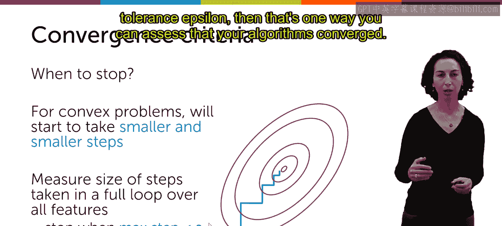
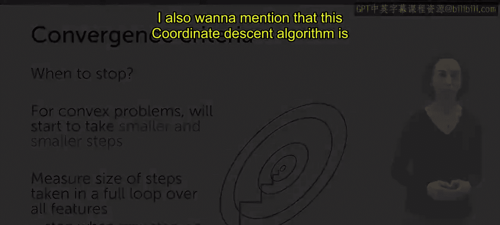
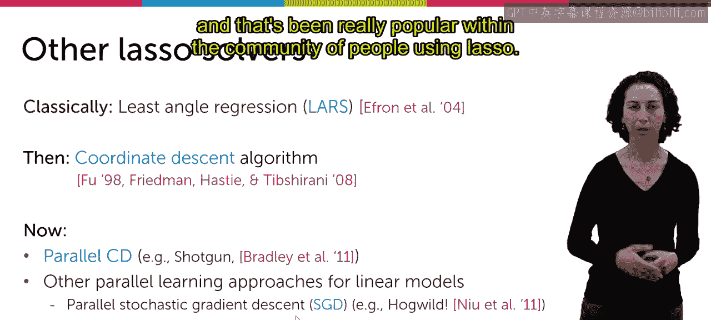

# 机器学习：回归：第2课：评估收敛性与其他Lasso求解器

在本节课中，我们将学习如何评估坐标下降算法的收敛性，并简要介绍除坐标下降法之外的其他Lasso求解器。我们将了解判断算法何时停止的实用方法，并概览解决Lasso问题的不同技术路径。

## 评估收敛性

上一节我们介绍了用于Lasso的坐标下降算法。在算法中，我们有一个“while not converged”的循环，那么如何评估算法是否收敛呢？

在梯度下降法中，我们通过检查梯度向量的大小来判断，当其模长小于某个容差ε时便停止迭代。然而，在坐标下降法中，我们并不直接计算梯度，因此需要采用其他方法。

我们知道，对于凸目标函数，算法在向最优解移动时，所采取的步长会变得越来越小。至少在强凸函数中，我们可以确信算法会收敛到最优解。

因此，一种可行的方法是：测量我们在所有坐标上完成一个完整循环后，所采取步骤的大小。必须强调的是，我们需要在遍历完所有0到D的坐标后，再判断是否停止。因为有可能某些坐标的更新步长很小，但后续坐标的更新步长仍然很大。

以下是判断收敛的准则：
*   如果在一次完整遍历所有坐标的循环中，所采取的最大更新步长小于预设的容差ε，那么就可以判定算法已经收敛。

## 其他Lasso求解器

我们刚刚详细探讨了坐标下降法。需要指出的是，坐标下降法只是求解Lasso目标的众多可能方法之一。

经典上，Lasso问题使用**最小角回归与收缩**算法求解。该算法在2008年之前非常流行。

大约在2008年，一种更早的算法被重新发现并推广开来，这就是我们正在学习的、用于Lasso的坐标下降法。

近年来，在开发高效、并行化和分布式的Lasso求解器方面涌现了大量研究。这些方法包括：
*   坐标下降法的并行版本。
*   其他并行学习方法，如并行随机梯度下降。
*   一种同样相当流行的分布式与平均方法。

其中，专门针对Lasso最流行的方法之一叫做**交替方向乘子法**。这种方法在Lasso使用者社区中非常受欢迎。

## 总结

本节课中，我们一起学习了如何为坐标下降算法设定收敛准则，即通过检查一次完整坐标循环中的最大更新步长是否小于阈值。此外，我们还简要回顾了Lasso求解器的发展历程，从经典的最小角回归，到如今广泛使用的坐标下降法，再到当前研究热点中的并行与分布式方法，特别是交替方向乘子法。