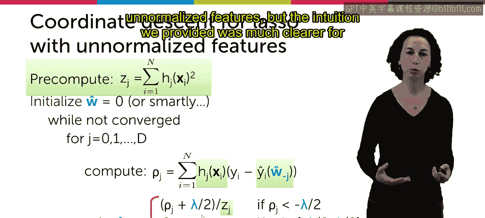

# 华盛顿大学《机器学习（回归，第2课⧸共4课）｜Machine Learning》中英字幕 p97 97_Lasso的坐标下降法（未归一化特征）.zh_en -BV11b421H7XL_p97-

。

So finally， I just wanted to present the coordinate descent algorithm for Lasso if you don't normalize your features so this is the most generic form of the algorithm because of course it applies to normalized features as well but let's just remember our algorithm for our normalized features so here it is now and relative to this the only changes we need to make are what's highlighted in these green boxes and what we see is that we need to precompute for each one of our features this term Zj and that's exactly equivalent to the normalizedizer that we described when we normalized our features so if you don't normalize you still have to compute this normalizer but we're going to use it in a different way as we're going through this algorithm。

Where when we go to compute Ro J。We're looking at our unnormalized features。

And when we're forming our predictions， y hat subis or prediction for the Ih observation。

 again that prediction is using unnormalized features， so there's two places in the rowj computation。

 where you would need to change things for unnormalized features。

 and then finally when we're setting w hat J according to this soft thresholdholding rule instead of just looking at row J plus lambda over 2 or row J minus lambda over 2 or0。

 we're going to divide each of these terms by Zj， this normalizer。Okay。

 so you see that it's fairly straightforward to implement this for unnormalized features。

 but the intuition we provided was much clearer for the case of normalized features。

🎼。