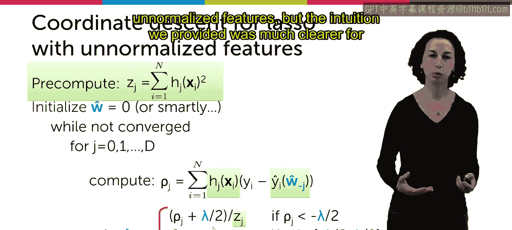

# 机器学习：第2课：Lasso坐标下降法（未归一化特征）


在本节课中，我们将学习如何将Lasso回归的坐标下降算法应用于未归一化的特征。我们将看到，算法核心逻辑不变，但需要引入一个额外的归一化因子 `Zj` 来调整计算过程。

上一节我们介绍了特征归一化情况下的坐标下降法。本节中我们来看看当特征未归一化时，算法需要做出哪些调整。

## 算法概述

未归一化特征的坐标下降算法是更通用的形式。它当然也适用于归一化后的特征。我们先回顾一下特征归一化时的算法步骤。

以下是归一化特征下的坐标下降算法核心步骤：

1.  初始化权重 `w`。
2.  循环直至收敛：
    *   对于每个特征 `j`：
        *   计算 `ρj`。
        *   根据软阈值规则更新权重 `ŵj`。

## 针对未归一化特征的调整

相对于归一化特征的算法，唯一的改动体现在几个关键位置，这些位置在下图中以绿色框高亮显示。


主要的调整有以下三点：

### 1. 预计算归一化因子 Zj

首先，我们需要为每个特征 `j` 预计算一个项 `Zj`。这个 `Zj` 实质上等同于我们对特征进行归一化时所用的归一化常数。

**公式：**
`Zj = Σ(x_ij²)`，对所有观测样本 `i` 求和。

即使不进行归一化，也必须计算这个归一化因子，因为后续步骤会用到它。

### 2. 计算 ρj 时使用未归一化特征

在计算 `ρj` 时，我们使用的是原始的、未归一化的特征值 `x_ij`。

**公式：**
`ρj = Σ( x_ij * (yi - ŷ_i^(j)) )`，其中 `ŷ_i^(j)` 是使用当前所有权重（但特征 `j` 的贡献被暂时移除）对第 `i` 个观测值的预测。

### 3. 应用包含 Zj 的软阈值规则

最后，在根据软阈值规则设置新的权重 `ŵj` 时，规则有所变化。我们不再直接比较 `ρj` 与 `λ/2`，而是需要将相关项除以归一化因子 `Zj`。

**更新规则（代码描述）：**
```
if ρj < -λ/2:
    ŵj = (ρj + λ/2) / Zj
elif ρj > λ/2:
    ŵj = (ρj - λ/2) / Zj
else:
    ŵj = 0
```

## 算法流程总结

综上所述，未归一化特征的Lasso坐标下降算法流程如下：

1.  **预计算**：为每个特征 `j` 计算 `Zj = Σ(x_ij²)`。
2.  **初始化**：初始化权重向量 `w`（例如，全零向量）。
3.  **迭代优化**：循环直至权重收敛或达到最大迭代次数。
    *   对于每个特征 `j`（按顺序或随机）：
        *   计算当前模型对每个样本 `i` 的预测 `ŷ_i`（使用所有特征，包括当前的 `wj`）。
        *   计算残差 `ri = yi - ŷ_i`。
        *   计算 `ρj = Σ( x_ij * ri ) + Zj * wj`。（此公式等价于移除特征j贡献后的计算，但更高效）
        *   根据上述包含 `Zj` 的软阈值规则更新权重 `ŵj`。

## 核心要点

本节课中我们一起学习了Lasso坐标下降法在未归一化特征下的应用。关键点在于：

*   算法本质不变，仍是通过循环更新每个权重来最小化目标函数。
*   主要区别是引入了特征 `j` 的平方和 `Zj` 作为归一化因子。
*   在计算相关性 `ρj` 和更新权重 `ŵj` 时，都需要考虑这个 `Zj` 因子。
*   虽然对未归一化特征实现该算法是直接的，但使用归一化特征能提供更清晰、更直观的算法解释和实现过程。



