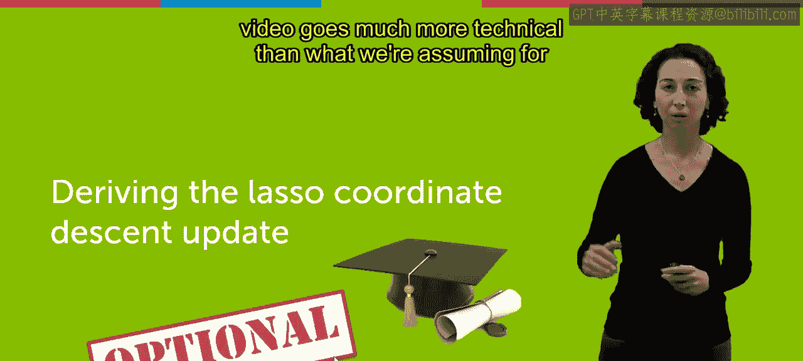
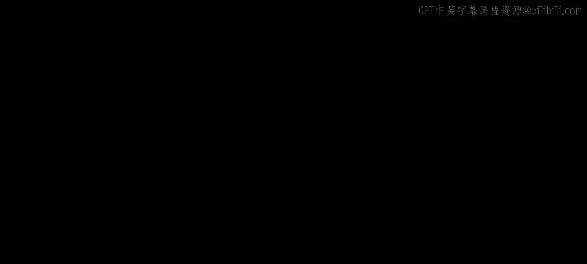
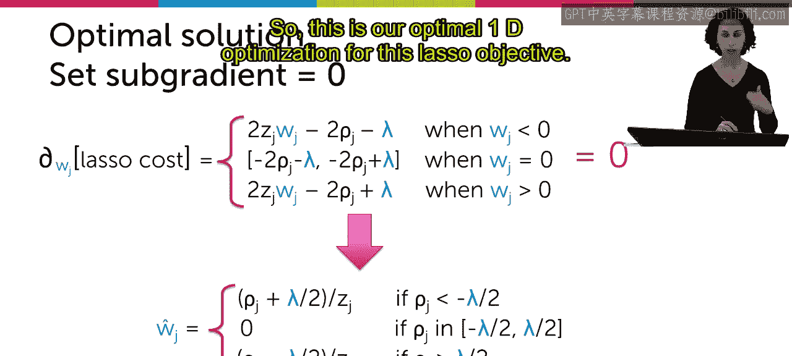
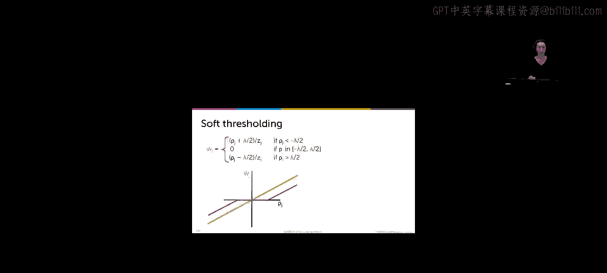
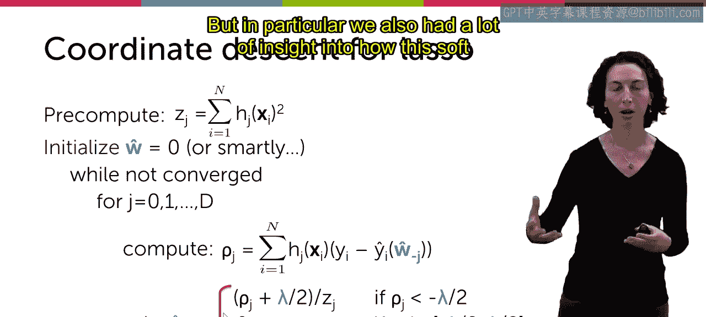
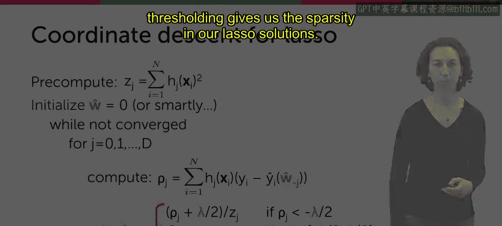

# 华盛顿大学《机器学习（回归，第2课⧸共4课）｜Machine Learning》中英字幕 p98 98_推导Lasso坐标下降更新.zh_en -BV11b421H7XL_p98-

。

Up to this point， we've derived our coordinate descent algorithm for least squares and we've discussed what the variant is for Lasso。

 but we didn't derive explicitly why our coordinate descent algorithm for Lasso has that soft thresholdholding form and for completeness we're going to include the derivation but as an optional video and I really want to emphasize that this video is optional。

 the material is quite advanced， it's actually material that's typically taught at the level of a PhD or grad levell course。

 so watch it at your own risk。We think it's still very interesting if you want to see what's under the hood in the Laso solver。

 but that's our little word of warning before we delve into this content because again。

 this is an example where the level of what we're going to present in this video goes much more technical than what we're assuming for the rest of the specialization。

Okay， so let's get into optimizing our Lasso objective。

 which we've written here and we're doing it again one coordinate at a time to derive our coordinate descent algorithm and in this derivation we're going to use unnormalized features。

 so we're not doing the normalization， this is just our typical H that's appearing here。

 and we're doing that because that's the most general case we can derive and the normalized case follows directly from this derivation。

Okay， so to start with， let's look at the partial of our residual summa squares term with respect to WJ and we did this derivation when we were looking at deriving coordinate to for least squares。

 but we did it for normalized features so let's do it now for unnormalized features where remember what we're going to do is just pull out this WJ term so we're going to get some I equals1 to n。

HJ of X I， and I'm going to skip a step assuming that you remember what we did on that previous video where I'm separating out。

The sum。K not equal to J。W，K， H， K， X， I。From this term， where we get。The W J HJ of X I。

And so when we do this multiplication， we're going to get minus2 sum over i equals1 to n。H J X， I。

Times Y I minus sum k not equal to J， W， K， H， K， X I。And here we're going to get plus 2。

 again the Wj comes out， we get sum I equals 1 to n and Hj X I squared。

And when we were talking about normalized features。

 we said the sum of the Hj squared was equal to one， but now we're looking at unnormalized features。

 so let's define some terms。Again， we're going to call this term。

 even though in this case we're looking at unnormalized features。

 we're still going to call this row J。And here now we have to define what we're calling this normalizer and we're going to call it this。

Z I， I mean， sorry， not Z I is Z J。Okay。So the result。Oops。

I go back to my blue color as we get minus2 rh j just like before， but now we get plus 2 Wj Zj。

So that completes our residual sum squares term， now let's turn to our L1 penalty。

 and this is where things become more complicated。So in particular。

 what's the partial with respect to the absolute value of WJ？

Remember that's all the other terms we're thinking of as held fixed。

 so we're just looking at this WJ component。Well， this is where we get these derivatives of absolute values that become problematic。

 Remember here we have。Derivative。Is equal to minus1 and here we have。Derivative。Equals plus one。

 and here we have this problem point。And we mentioned that instead of thinking about gradients or these partials。

 we think about subgrads。Okay， so now let's talk about these sub gradientients and formalize this a bit。

But let's first mention that gradients we can think of as lower bounding convex functions。

 so if I look at。My convex function at some points， A and B， if I take the gradient。At my point A。

 that's this tangent plane。So this is gradient of G at A。Then what I have is I have that G at B。

 so just to be clear， this is G of a。G of B。 So G of B is greater than or equal to G of a。Plus。

 gradient。Of G of a times。B。Minus a。And importantly。

 gradients are unique at x if the function is differentiable at x。Well。

 sub gradientdients generalize this idea of gradients to non-diiable points and a gradient is going to be any plane that lower bounds this function。

 so sorry， not a gradient if I said a gradient I mean a sub gradientd so a subd is really a set it's a set of all the planes that lower bound a function。

 so we're going to say that V。Is in。Our set， which we denote by this curly D of G。Add a point X。

 So this is our sub gradient。Of G at x。If。We have that G of B is greater than or equal to G of a plus in place of this gradient here。

 we're writing V。So here this was the one function。The one function that lower bounded are。Sorry。

 the one plane that lower bounded our function， and here this is one of the planes that lower bounds our function。

And again， we have B minus a。 So this is the definition of a sub gradientient。 and let's look at it。

In the context of this absolute value function。 So what are all planes that lower bound this absolute value function。

Well。All the planes that I'm going to draw。Lower bound， this absolute value function。

 there's this plane。There's this plane。There's。This plane with positive slope。

And I could fill this space here。With all these planes。And what are the slopes of these planes？

So here we know that。The slope。Is equal to minus1 and here the slope。Is equal to plus  one。

 and we see that anything that has a slope in the range of minus1 to1。

 any line in the range 1 to1 is going to lower bound this absolute value function。 So for。

absolute value of x， we have that。V is in。inus1 to1。

 so minus1 to 1 represents our sub gradientdient of the absolute value of x。

So now that we've had our detour into the world of subgrads。

 we can start talking instead of the partial of this L1 term。

 we can talk about the sub gradientdient of this L1 term。

 where here we get lambda times the sub gradientdient。

 we already know the sub gradientdient of the absolute value is the range minus1 to1。

So lambda times the sub gradientdient of the absolute value is going to be minus lambda to lambda when Wj is equal to0 and remember that subgradient is defined at that problem point。

 Wj equals 0。But in the case where the derivative exists or that partial exists。

 it's just going to be。Lambda times， in the case of w less than zero， we had minus1。

So this is lambda times minus1。Here we have Lambda times。

Minus1 to one in the case where we're in this positive half plane we get。Lambda times1。Okay。

 so this is our。Complete lambmbda times the sub gradientient of our L1 objective with respect to WJ。

And now that we have the partial of our residual sum squares term and the sub gradientdient of our L1 term。

 we can put it all together and get our sub gradientdient of our entire Lassso cost with respect to WJ。

And here this part。This is。From our residual sum of squares， whereas this part。Is from。

The L1 penalty。Or really lambda times the L1 penalty。And when we put these things together。

 we get three different cases because of the three cases for the L1 objective。

 so we get two Zj that normalr Wj minus roj minus lambda， and won't read all of the different cases。

 but this now is our sub gradientdient of our entire Laso solution。Okay。

Let's not get lost in the weeds here， let's pop up a level and say remember before we would take the gradient and set it equal to zero。

 or in the coordinate descent algorithm， we talked about taking the partial with respect to one coordinate and then setting that equal to zero to get the update for that dimension。

Well， here， now instead of this partial derivative。

 we're taking this sub gradientdient and we have to set it equal to zero to get the update for this specific Jth coordinate。

So let's do that so we've taken our sub gradientdient we're setting it equal to0 again we have three different cases we need to consider so in case one where WJ is less than0。

 let's solve for W hat a， we get What a。Equals。2 rh J plus lambda divided by 2 Zj。

 which I'm just going to rewrite as rhj plus lambda over 2 divided by Zj。

Multiply the top and bottom by one half here。Okay， but to be。In this case。

 to have WHj less than zero。We need a constraint on Ro J。So if Ro J。Is。嗯。

Less than minus lambda over 2 remember this is that correlation term if that。

 and that's something we can compute because that's a function of all the other variables except for WJ。

 so if rhj is less than minus lambda over 2。Then we know that W hatcht a。

Will be less than zero according to this formula。Okay， then we get to the second case。

 which is Wj equals0。In that case， we've already solved for W hatJ， there's only one solution。

But in order to have that be the optimum。We know that。This sub gradientdient， when Wj equals0。

 the sub gradientdient has to contain zero， otherwise we would never get that this is the case that is equal to zero。

 that it's an optimum。So we need for this range to contain zero so that。

W hat j equals zero is an optimum。Of our objective。And for that to be true。

 we need minus2 rh j plus lambda to be greater than 0。

So we need this upper term of the interval greater than0。

 which is equivalent to saying that row J is less than lambda over 2。

 and we need this bottom interval to be less than 0。 so minus2 row J minus lambda less than 0。

 which is equivalent to saying row J。Is greater than。Minus lambda over2。

 and if we put these together， what this is saying is that roj is。Less than。U。

Lambda over two and greater than。Minus lambda over2。And actually， we could put the equal sign here。

So let's just do it so it has to be less than or equal to less than or equal to less than or equal to Okay。

 in our final case， let's just quickly work through it， we get W hat J equals rh J。

Minus lambda over 2 divided by Zj。And。And。In order to have W hat J be greater than zero。

 we need row J。To be greater than lambmbda over2。So let me just talk through this kind of in the other direction now that we've done the derivation。

 which is saying。If roj is less than minus lambda over 2。Then we'll set WHtj as follows。

If row J is in this interval， we'll set W hat j equal to  zero and if row J is greater than lambda over 2。

 we're going to set W hat J。As this third case。Okay， so this slide just summarizes what I just said。

So this is our optimal 1D optimization for this Laso objective。

So let's talk about this more general form of the soft thresholdholding rule for Laso in the case of our unnormalized features。

So remember for our normalized features， there wasn't this Zj here and what we ended up with for our last sorry。

 our least square solution when Lada was equal to zero was just this line W hatchj equals rh J。

but now what does our least squares line look like， well again。

 we can just set lambda equal to zero and we see that this。

Lee squares line W hat Lee squares is equal to rh J over Zj。 Remember。

 Zj is that normalizer summing over the square of all of our features。

 So that number will be positive。 and it's typically going to be larger than one。

 potentially much larger than one。 So relative to a slope。Just a 45 degree angle， slope of one。

 I'm saying that this line is shrunk more this way。Typically in the case of unnormalized features。

And then when I look at my Lasso solution， W hat Lasso in this case， again in the range。

 minus lambda over 2， sorry， that is clearly not minus lambda over 2。This is。

Minus lambda over2 to lambda over 2。I get this thresholding of the coefficients exactly to zero relative to。

嗯。My least square solution and outside that range， the difference between the least square solution and my Lasso solution is that my coefficients are each shrunk by an amount。

Lambda over to Zj。Okay。But remember that Ro J here。

As compared to when we talked about normalized features was defined differently。

 it was defined in terms of our unnormalized features。

 so for the same value of lambmbda that you'd use with normalized features。

 you're getting a different relationship here， a different range where things are set to zero。

So in summary， we've derived this coordinate descent algorithm for Laso in the case of unnormalized features and in particular the key insight we had was instead of just taking the partial of our objective with respect to WJ。

 we had to take the subgra of our objective with respect to WJ and that's what leads to these three different cases because the gradient itself is defined for。

Every value of WJ except for this one critical point， WJ equals zero。But in particular。

 we also had a lot of insight into how this soft thresholding gives us this sparsity in our LaO solutions。

🎼。