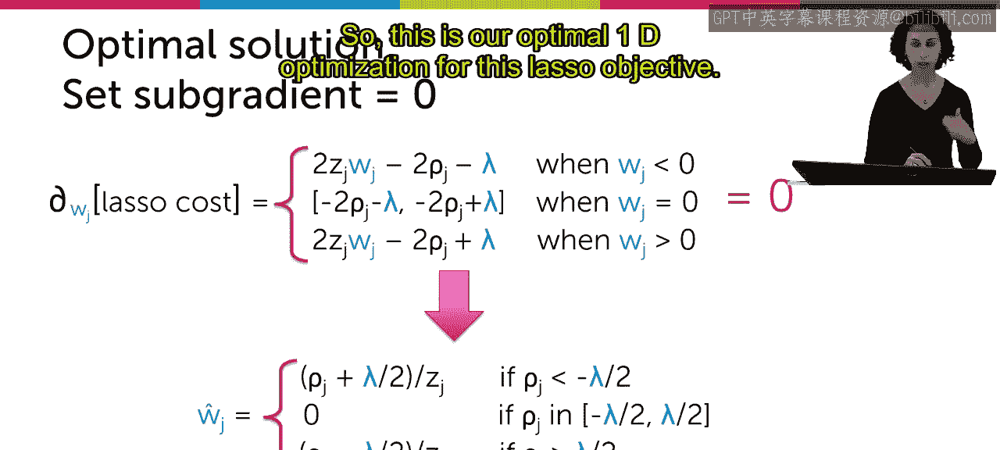
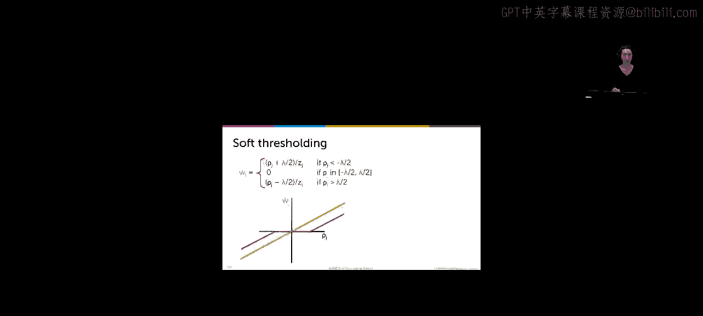
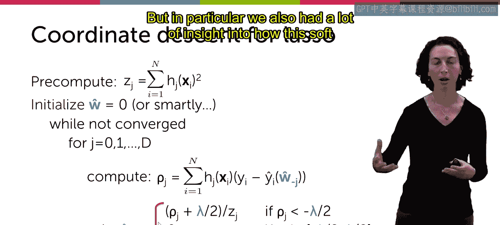
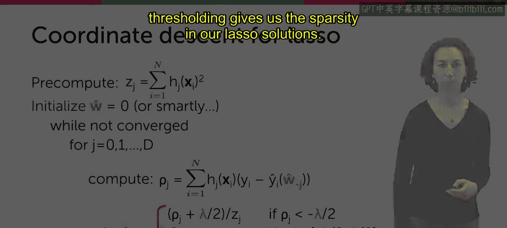

# 机器学习：第2课：推导Lasso坐标下降更新

在本节中，我们将深入探讨Lasso回归的坐标下降算法更新规则的推导过程。我们将看到，与普通最小二乘法不同，Lasso的目标函数包含不可微的L1惩罚项，这要求我们引入**次梯度**的概念来求解。通过本次推导，我们将清晰地理解Lasso解中**软阈值**形式的来源。

---

上一节我们介绍了Lasso坐标下降算法的基本形式，本节中我们将详细推导其更新规则。我们使用**未标准化**的特征进行推导，这是最一般的情况，标准化特征的推导可直接由此得出。

首先，我们回顾Lasso的目标函数，并针对单一坐标 \( w_j \) 进行优化。目标函数包含残差平方和项与L1惩罚项。

### 残差平方和项的偏导

我们从残差平方和项对 \( w_j \) 的偏导数开始。这与最小二乘法的推导类似，但针对未标准化特征。

我们定义两个关键量：
*   \( \rho_j = \sum_{i=1}^n h_j(x_i) \left[ y_i - \sum_{k \neq j} w_k h_k(x_i) \right] \)
*   \( Z_j = \sum_{i=1}^n h_j(x_i)^2 \)

经过推导，残差平方和项对 \( w_j \) 的偏导数为：
\[
\frac{\partial}{\partial w_j} \text{RSS} = -2\rho_j + 2 w_j Z_j
\]

### L1惩罚项的次梯度

接下来处理L1惩罚项 \( \lambda |w_j| \)。绝对值函数在 \( w_j = 0 \) 处不可微，因此我们需要使用**次梯度**。

对于函数 \( g(x) = |x| \)，其次梯度 \( \partial g(x) \) 是一个集合：
*   当 \( x > 0 \) 时，\( \partial g(x) = \{1\} \)
*   当 \( x < 0 \) 时，\( \partial g(x) = \{-1\} \)
*   当 \( x = 0 \) 时，\( \partial g(x) = [-1, 1] \)

因此，L1惩罚项 \( \lambda |w_j| \) 的次梯度为：
*   当 \( w_j > 0 \) 时，\( \lambda \cdot \{1\} \)
*   当 \( w_j < 0 \) 时，\( \lambda \cdot \{-1\} \)
*   当 \( w_j = 0 \) 时，\( \lambda \cdot [-1, 1] \)

### 合并得到完整目标的次梯度

现在，我们将残差平方和项的偏导与L1惩罚项的次梯度相加，得到整个Lasso目标函数关于 \( w_j \) 的次梯度 \( \partial_{w_j} \text{Cost} \)：

\[
\partial_{w_j} \text{Cost} = (-2\rho_j + 2 w_j Z_j) + \lambda \cdot \partial |w_j|
\]

根据 \( w_j \) 的符号，具体写出三种情况：
1.  若 \( w_j > 0 \)，则 \( \partial_{w_j} \text{Cost} = -2\rho_j + 2 w_j Z_j + \lambda \)
2.  若 \( w_j < 0 \)，则 \( \partial_{w_j} \text{Cost} = -2\rho_j + 2 w_j Z_j - \lambda \)
3.  若 \( w_j = 0 \)，则 \( \partial_{w_j} \text{Cost} = [-2\rho_j - \lambda, -2\rho_j + \lambda] \)

### 求解最优更新规则

为了找到最优的 \( \hat{w}_j \)，我们令次梯度包含零。这需要对上述三种情况分别求解。

以下是求解后得到的最优更新规则 \( \hat{w}_j^{\text{Lasso}} \)：

1.  如果 \( \rho_j < -\frac{\lambda}{2} \)，则：
    \[
    \hat{w}_j = \frac{\rho_j + \frac{\lambda}{2}}{Z_j}
    \]
    （此时解 \( \hat{w}_j < 0 \)）

2.  如果 \( \rho_j > \frac{\lambda}{2} \)，则：
    \[
    \hat{w}_j = \frac{\rho_j - \frac{\lambda}{2}}{Z_j}
    \]
    （此时解 \( \hat{w}_j > 0 \)）

3.  如果 \( -\frac{\lambda}{2} \le \rho_j \le \frac{\lambda}{2} \)，则：
    \[
    \hat{w}_j = 0
    \]

### 理解软阈值规则

这个更新规则体现了**软阈值**操作。我们可以将其与最小二乘解 \( \hat{w}_j^{\text{LS}} = \frac{\rho_j}{Z_j} \) 进行比较。

*   当 \( |\rho_j| \) 很大（即特征 \( j \) 与残差的相关性很强）时，Lasso解是在最小二乘解的基础上向零收缩了 \( \frac{\lambda}{2Z_j} \)。
*   当 \( |\rho_j| \) 较小（低于阈值 \( \frac{\lambda}{2} \)）时，Lasso解被直接**置为零**，这便产生了模型的稀疏性。

参数 \( Z_j \)（特征 \( j \) 的平方和）起到了缩放作用。特征尺度越大（\( Z_j \) 越大），阈值区间 \( [-\frac{\lambda}{2}, \frac{\lambda}{2}] \) 在 \( \rho_j \) 尺度上看起来越宽，但收缩量 \( \frac{\lambda}{2Z_j} \) 越小。

---

本节课中我们一起学习了Lasso坐标下降更新规则的完整推导。核心在于使用**次梯度**处理L1惩罚项的不可微性，并通过对三种情况的分析，最终得到了具有**软阈值**形式的更新公式。该公式清晰地解释了Lasso如何通过将较小系数置零来产生稀疏解，以及系数收缩的机制。理解这个推导有助于我们更深入地掌握Lasso回归的内在原理。