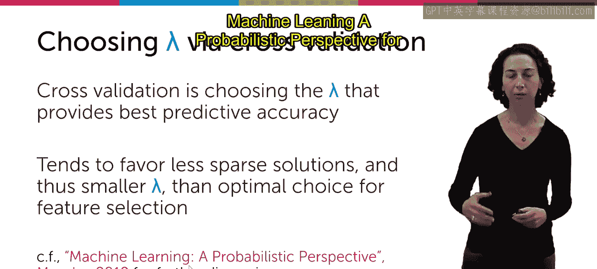
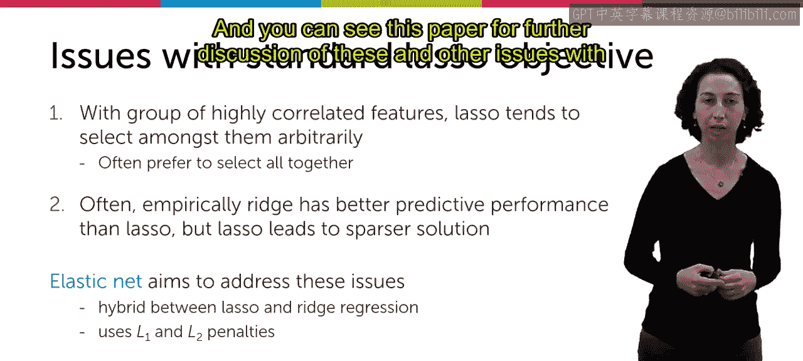

# 华盛顿大学《机器学习（回归，第2课⧸共4课）｜Machine Learning》中英字幕 p99 99_选择惩罚强度和Lasso的其他实际问题.zh_en -BV11b421H7XL_p99-

。

So we've gone through the coordinate descent algorithm for solving our Laso objective for a specific value of Lambda。

 and that begs the question， well， how do we choose the Lambda tuning parameter value？

Well。It's exactly the same as in Rige regression if we have enough data we can think about holding out a validation set and using that to choose amongst these different model complexities。

 Lambda， or if we don't have enough data， we talked about doing cross validation。

 so these are two very reasonable options for choosing this tuning parameter Lambda。

But in the case of LaSO， I just want to mention that using these types of procedures。

 assessing the error on a validation set or doing cross validation。

It's choosing Lambda that provides the best predictive accuracy。

 but what that ends up tending to do is choosing a lambda value that's a bit smaller than might be optimal for doing model selection because。

嗯。For predictive accuracy， having slightly less solutions can actually lead to a little bit better predictions on any finite data set than possibly the true model with the sparsest set of features possible。

So instead there are other ways that you can choose this tuning parameter Lambda and I'll just refer you to other texts like this textbook by Kevin Murphy。

 Maine learning and probaistic Per for further discussion on this issue。

So let's just conclude by discussing a few practical issues with LASO。

The first is the fact that as we've seen in multiple different ways throughout this module。

 Lasso shrinks the coefficients relative to the least square solution。

 and what it's doing is it's increasing the bias of the solution in exchange for having lower variances。

 So this is doing this automatic bias variance tradeoff。

 but we might want to still have a low bias solution。

 so we can actually think about reducing the bias of our solution in the following way。

 This is called de biasasing the Lasso solution where we run our Lasso solver and we get out a set of selected features。

 So those are the features whose weights were not set exactly to zero。

 And then what we do is we take that reduce model the model with these selected features and we run just standard least squares regression on that reduced model and in this case。

 what happens is these features that were deemed relevant to our。Our task。

Their weights after doing this debiasing procedure will not be shrunk relative to the weights of a least square solution if we had started exactly with that reduced model。

 but of course that was the whole point we didn't know which model， so the Laso is allowing us to。

Choose out this model and then just run these squares on that model。

 So these plots show a little illustration of the benefits of debiing。

 So the top figure shows the true coefficients for data。 So it' generated with。

4096 different coefficients or different features in the model。

 but only 160 of these had positive coefficients associated with them。

So it was a very sparse setup and if you look at the L1 reconstruction。

 that's the second row of this plot， you see that it's discovered 1024 features that have non zero weights has a mean squared error of 0。

00。7even，2。But if you take those 1，024 non0 weight features and just run least squares regression on them。

 you get the third row， and that has significantly， significantly lower mean squared error。

But in contrast， how do you run least squares on the full model with 4096 possible features。

 you would get a really， really poor estimate of what was going on in a very large mean squared error。

 So this shows the importance of doing both Laso and possibly this。Debiasing on top of that。

Another issue with LaSso is if you have a collection of strongly correlated features。

 LaSsso will tend to just select amongst them pretty much arbitrarily and what I mean is that a small tweak in the data might lead to one variable included whereas a different tweak of the data would have a different one of these variables included。

 so in our housing application maybe you can imagine that square feet and lot size are very correlated and we might just arbitrarily choose between these。

 but in a lot of cases you actually want to include the whole set of correlated variables。

 and another issue is the fact that it's been shown empirically that in many cases ridge regression actually outperforms Lasso in terms of predictive performance。

So there are other variants of LaSso， something called elasticastic net that tries to address these set of issues。

 and what it does is it fuses both objectives of Rige and LasSO。

 including both an L1 and an L2 penalty， and you can see this paper for further discussion of these and other issues with the original LASO objective and how elasticastic net addresses it。

。