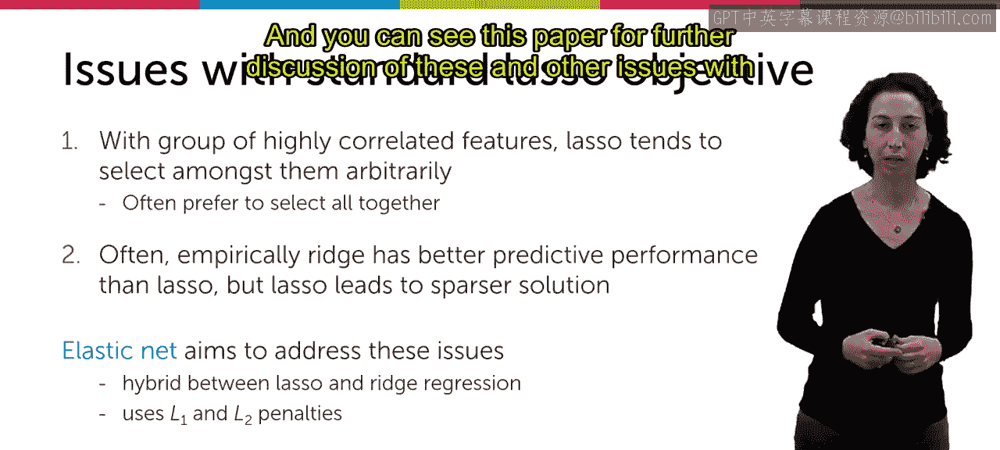

# 机器学习：第2课：选择惩罚强度与Lasso的其他实际问题

在本节课中，我们将学习如何为Lasso回归选择合适的惩罚强度参数λ，并探讨Lasso在实际应用中的几个重要问题，包括如何降低其估计偏差，以及它在处理强相关特征时的局限性。

## 选择惩罚强度参数λ

上一节我们介绍了使用坐标下降法求解特定λ值下的Lasso目标函数。本节中我们来看看如何选择合适的λ值。

选择λ值的方法与岭回归完全相同。以下是两种主要方法：
*   **验证集法**：如果数据量充足，可以预留一个验证集，通过比较不同λ值下模型在验证集上的表现来选择最优的λ。
*   **交叉验证法**：如果数据量有限，则可以使用交叉验证的方法来选择λ。

这些方法旨在选择能提供最佳预测精度的λ值。但需要指出的是，为了追求最佳预测精度，这些方法往往会选择一个比“最优模型选择”所需的λ值稍小的值。这是因为在有限的数据集上，包含少量不相关特征的模型，其预测效果有时可能比真正的、最稀疏的模型更好。关于如何为模型选择目的更精确地选择λ，可以参考Kevin Murphy的《Machine Learning: A Probabilistic Perspective》等教材进行深入探讨。

## Lasso的实用问题与解决方案

在选择了λ并得到Lasso模型后，我们还需要了解其在实际应用中的一些特性。本节将讨论两个关键问题及其应对策略。

### 问题一：偏差与去偏

正如我们在本模块中多次看到的，Lasso通过将系数向零收缩来增加解的偏差，以换取更低的方差，这是一种自动的偏差-方差权衡。但有时我们仍希望得到一个低偏差的解。

我们可以通过以下方式降低Lasso解的偏差，这种方法称为**Lasso去偏**：
1.  运行Lasso求解器，得到一组被选中的特征（即权重不为零的特征）。
2.  仅使用这组被选中的特征构成一个简化模型。
3.  在这个简化模型上运行标准的**最小二乘回归**。

这样，那些被判定为相关的特征，其权重将不会像原始Lasso解那样被收缩，而是会得到与仅在该简化模型上做最小二乘估计时相近的、无偏的权重。整个过程的核心在于，Lasso帮助我们完成了特征选择，然后我们在选出的模型上进行无偏估计。

下图展示了去偏带来的好处：

*   **第一行（True）**：展示了真实数据生成所用的系数，共有4096个特征，但只有160个具有非零系数，是一个非常稀疏的设置。
*   **第二行（L1）**：Lasso回归的结果，它发现了1024个非零权重的特征，均方误差为0.0072。
*   **第三行（Debiased）**：对Lasso选出的1024个特征进行最小二乘回归（去偏）后的结果，其均方误差显著降低。
*   **第四行（LS）**：作为对比，如果在全部4096个特征上直接进行最小二乘回归，会得到一个非常差的估计和巨大的均方误差。

这个例子说明了结合使用Lasso进行特征选择，再对选中特征进行去偏的重要性。

### 问题二：强相关特征与弹性网络

Lasso的另一个问题是，当存在一组强相关特征时，它倾向于近乎随机地从中选择一个，而排除其他。这意味着数据的微小变动可能导致被选入的变量完全不同。例如，在房价预测中，“房屋面积”和“地块大小”可能高度相关，Lasso可能会在它们之间任意选择。但在许多情况下，我们可能希望将整个相关特征组都纳入模型。

此外，经验表明，在许多情况下，岭回归的预测性能实际上优于Lasso。

为了应对这些问题，出现了Lasso的变体，称为**弹性网络**。它融合了岭回归和Lasso的目标，同时包含**L1惩罚项**和**L2惩罚项**。其目标函数可以表示为：

`最小化：RSS(w) + λ₁ * ||w||₁ + λ₂ * ||w||₂²`

其中，`||w||₁` 是L1范数（用于特征选择），`||w||₂²` 是L2范数的平方（用于处理共线性）。弹性网络旨在同时获得稀疏性和对相关特征组的稳定选择。关于弹性网络如何解决原始Lasso目标函数问题的更多讨论，可以参考相关论文。

## 总结

本节课中我们一起学习了为Lasso回归选择惩罚参数λ的实用方法，主要包括验证集法和交叉验证法。我们还探讨了Lasso的两个实际问题：首先，其解存在偏差，我们可以通过“去偏”步骤，即在Lasso选出的特征上运行最小二乘回归来降低偏差；其次，Lasso在处理强相关特征时可能不稳定，而弹性网络通过结合L1和L2惩罚项，为解决这一问题提供了方案。