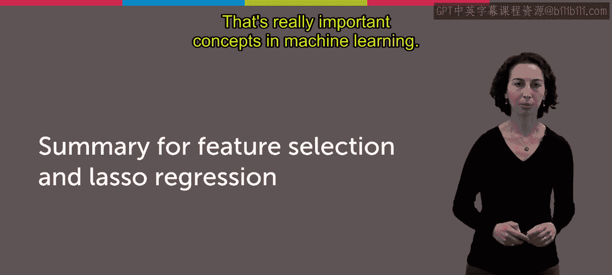
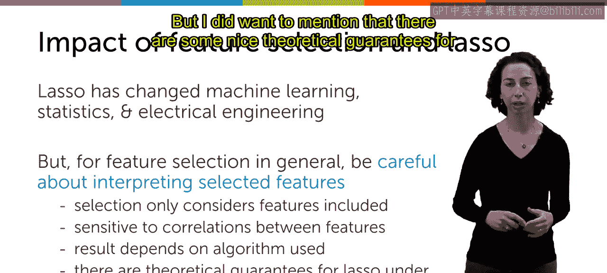
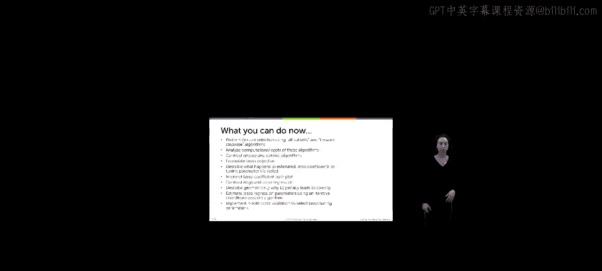
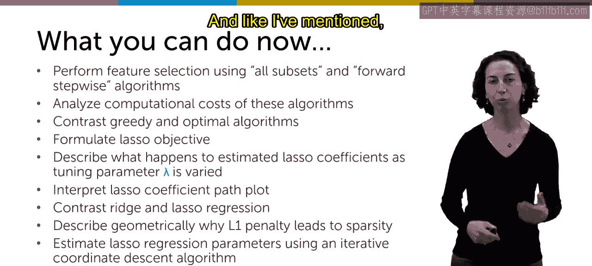

# 华盛顿大学《机器学习（回归，第2课⧸共4课）｜Machine Learning》中英字幕 p100 100_简要回顾.zh_en -BV11b421H7XL_p100-

。

Okay， well in summary we've really learned a lot this module。

 we've thought about this task of feature selection and we described ways of searching over first all possible sets of features that we might want to include to come up with the best model。

 talked about the challenges of that computationally and then we turn to thinking about greedy algorithms and then discuss these regular regression approach of LaSso for addressing the feature selection task。

 so really it's covered a lot of ground that's really important concepts in machine learning。

And this Lasso regularized regression approach， although really， really simple。

 has dramatically transformed the field of machine learning， statistics and engineering。

 and it's shown as utility and a variety of different applied domains。

 but I want to mention a really important issue， which we kind of alluded to。

 which is that for feature selection， not just Lasso。

 but in general when you're thinking about feature selection。

 you have to be really careful about about interpreting the features that you've selected。

And some reasons for this include the fact that the features you selected are always just in the context of what you provided as the set of possible features to choose from to begin with。

And likewise。The set of selective features are really sensitive to correlations between features and to small in those cases。

 small changes in the data can lead to different features being included so to say that one feature is important and the other isn't。

 you have to be careful with statements like that。And also of course the set of selected features depends on which algorithm you use。

 we especially saw this when we talked about those greedy algorithms like the forward stepwise procedure。

 but I did want to mention that there are some nice theoretical guarantees for LASsso under very specific conditions。

So in conclusion， heres a very long list of things that you can do now that you've completed this module everywhere from thinking about searching over the discrete set of possible models to do feature selection using all subsets or these greedy algorithms to formulating a regularized regression approach。

 Laso to implicitly do this feature selection， searching over a continuous space。

 this tuning parameter Lambda， we talked about formulating the objective。

Geometric interpretations of why the LasO objective leads to sparsity and we talked about using coordinate descent as an algorithm for solving LaSO。

 and so coordinate disscent itself was an algorithm that generalizes well beyond LaSso so that was an important concept that we got out of this module as well and finally if you watch the optional video we talked about some really technical concepts relating to subgrads and to conclude this module。

 we talked about some of the challenges associated with LaSso。

 but as well as some of the potential impact that this method has because it's really quite an important tool and like I've mentioned。

 it's really shown a lot of promise in many different domains。

