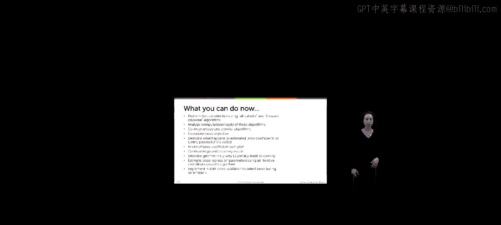
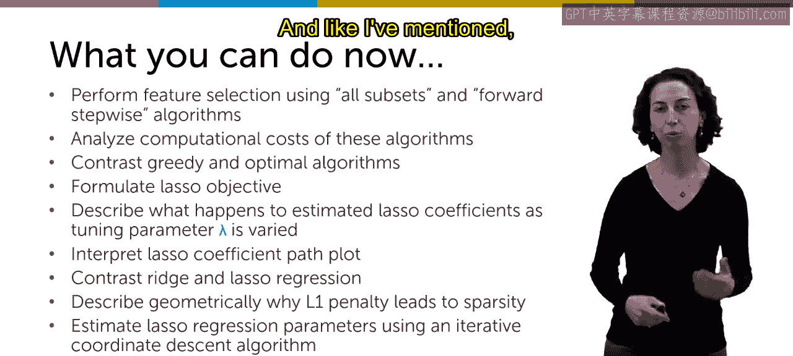

# 机器学习：第2课：特征选择与Lasso回归回顾 🎯

在本节课中，我们将回顾机器学习回归模块中关于特征选择的核心内容。我们将总结已学习的关键概念，包括特征选择的任务、搜索方法、Lasso正则化回归及其重要性，并讨论在解释所选特征时需要注意的问题。

---

## 模块内容总结 📚

上一节我们介绍了特征选择的基本任务及其挑战。本节中，我们来回顾本模块涵盖的核心知识点。

本模块深入探讨了特征选择任务。我们描述了搜索所有可能特征子集以构建最佳模型的方法。

我们讨论了该方法在计算上面临的挑战，随后转向贪心算法的思考，并介绍了用于处理特征选择任务的Lasso正则化回归方法。

本模块覆盖了机器学习中许多非常重要的概念。

---

## Lasso回归的影响与注意事项 ⚠️

尽管Lasso正则化回归方法非常简单，但它极大地改变了机器学习、统计学和工程学领域。

该方法在多种不同的应用领域中都显示了其实用性。

但需要提及一个非常重要的问题，我们在之前也有所暗示。对于特征选择，不仅仅是Lasso，在一般情况下思考特征选择时，必须非常小心地解释你所选择的特征。

以下是需要注意的原因：

*   **特征选择范围的局限性**：所选特征始终只是在你最初提供的可能特征集合的背景下进行的。
*   **特征相关性的敏感性**：所选特征集对特征之间的相关性非常敏感。在这些情况下，数据的微小变化可能导致包含不同的特征。因此，声称某个特征重要而另一个不重要时，必须谨慎对待此类陈述。
*   **算法依赖性**：所选特征集还取决于你使用的算法。特别是在讨论前向逐步选择等贪心算法时，我们清楚地看到了这一点。

不过需要指出，在非常特定的条件下，Lasso有一些很好的理论保证。

---

## 本模块掌握的技能清单 ✅

在完成本模块后，你现在可以执行以下一长串任务：

*   **离散模型空间搜索**：思考在可能的模型离散集合上进行搜索，以进行特征选择，可以使用全子集法或贪心算法。
*   **正则化回归公式化**：构建Lasso正则化回归方法，以隐式地进行特征选择，在一个连续空间（即调优参数λ）上进行搜索。
*   **目标函数与几何解释**：我们讨论了目标函数的构建，以及为什么Lasso目标函数会导致稀疏性的几何解释。
*   **坐标下降算法**：我们讨论了使用坐标下降作为求解Lasso的算法。坐标下降法本身是一个适用范围远超出Lasso的算法，这也是我们从本模块中获得的一个重要概念。
*   **高级概念（可选）**：如果你观看了可选视频，我们还讨论了一些与次梯度相关的技术性概念。

最后，为了总结本模块，我们讨论了与Lasso相关的一些挑战，以及该方法可能产生的影响，因为它确实是一个非常重要的工具。正如我所提到的，它在许多不同领域都显示了巨大的潜力。

---

## 总结 🏁

本节课中，我们一起回顾了机器学习回归模块关于特征选择的核心内容。我们总结了特征选择的多种方法、Lasso正则化回归的原理与巨大影响，并重点强调了在解释所选特征时需要保持谨慎。此外，我们还列出了通过本模块学习所掌握的一系列重要技能和算法。理解这些概念对于构建有效且可靠的机器学习模型至关重要。