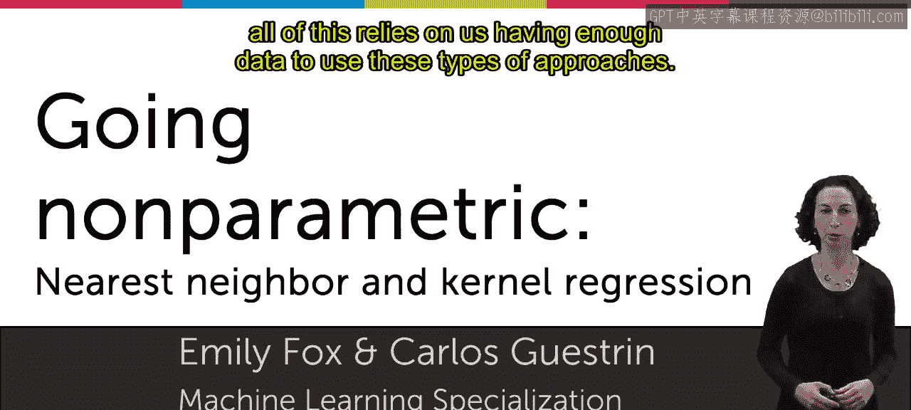
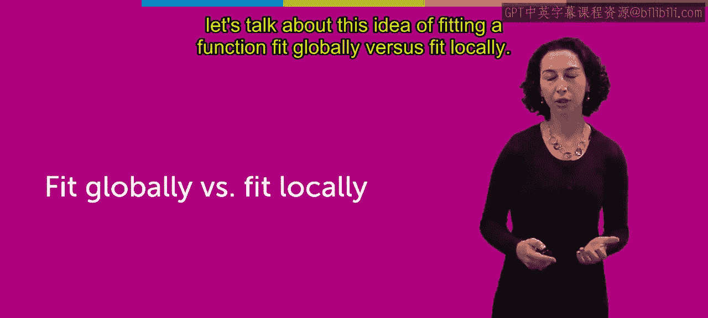
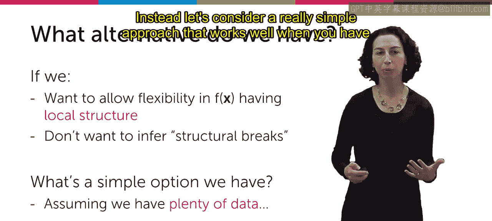

# 华盛顿大学《机器学习（回归，第2课⧸共4课）｜Machine Learning》中英字幕 p101 101_参数回归的局限性.zh_en -BV11b421H7XL_p101-

。

We've talked at great length about models where you specify some set of features and what that results in is a model with fixed flexibility there's a finite capacity to how flexible the model can be based on the specified features but now we're going to take a totally different approach theyre approaches that are called non-parametric approaches and the one that we're going to look at in this module is called canous neighbors and kernel regression and what these methods allow you to do is be extremely flexible the implementations are very。

 very simple and they allow the complexity of the models you infer to increase as you get more data。

 this really simple approach is surprisingly hard to beat but as we're going to see all of this relies on us having enough data to use these types of approaches。

To start with， let's talk about this idea of fitting a function globally versus locally。

So let's imagine that we have the following data。That represent observations of houses with a given square feet and their associated sales price and maybe just for the sake of argument in this module。

 let's imagine that for small houses， there tends to be a linear relationship between square feet and house value。

 but then that relationship tends to taper off and there's not much change in house price for square feet。

 but then you get into this regime of these really large houses whereas you increase the square feet。

 the prices can just go way up because maybe they become very luxurious houses in the types of models that we've described so far。

 we've talked about fitting some function across the whole input space of square feet So for example。

 if we assume a really simple model like just a constant fit we might get the following fit to our data。

Or if we assume that we're going to fit some line to the data。

 we might get the following or quadratic function and we might say well this data kind of looks like there's some cubic fit to it and so the cubic fit looks pretty reasonable but the truth is is that this cubic fit is kind of a bit too flexible。

 a bit too complicated for the regions where we have smaller houses。

 it tends to fit or it looks like it fits very well for our large houses。

 but it's a little bit too complex for lower values of square feet。

 because really for this data you could describe it as having a linear relationship like I talked about for low square feet value and then just a constant relationship between square feet and value for some other region and then having this maybe quadratic relationship between square feet and house value when you get these really really large houses so this motivates this idea of wanting to fit our。

Function。lococally to different regions of the input space or have the flexibility to have a more local description of what's going on than our models which did these global fits allowed so what are we going to do so we want to flexibly define our F of x their our relationship in this case between square feet and house value to have this type of local structure。

But let's say we don't want to assume that there's what are called structural breaks。

 that there' are certain change points where the structure of our regression is going to change in that case you'd have to infer where those break points are instead let's consider a really simple approach that works well when you have lots of data。

