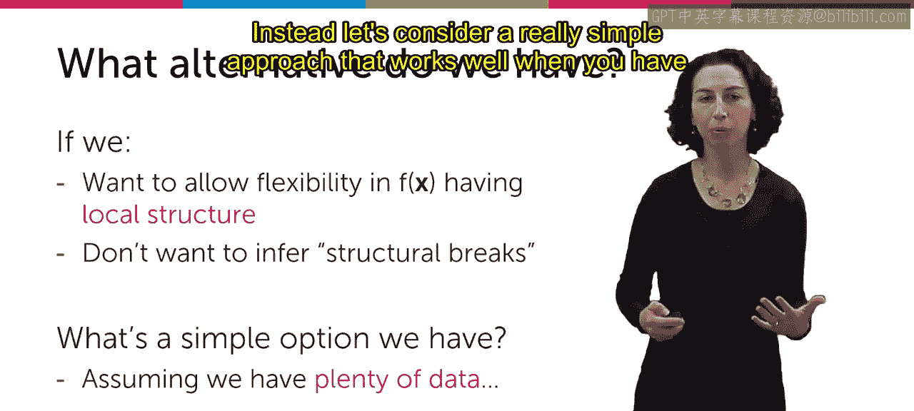

# 机器学习：第2课：非参数回归与局部拟合 🧩


在本节课中，我们将要学习一种全新的建模思路——非参数回归方法。我们将重点介绍 **K近邻（K-Nearest Neighbors）** 与 **核回归（Kernel Regression）**。与之前学习的参数化模型不同，这些方法不预先设定固定的函数形式，而是让模型的复杂度随着数据量的增加而增长，从而获得极大的灵活性。它们的实现非常简单，并且在拥有足够数据时，效果往往出人意料地好。

---

## 全局拟合 vs. 局部拟合 🌍

上一节我们介绍了基于特定特征集的参数化模型，其灵活性是固定的。本节中我们来看看一种不同的思路：局部拟合。

为了理解这个概念，让我们想象一个关于房屋面积（平方英尺）与售价的数据集。假设对于小户型房屋，面积与价格呈线性关系；对于中等户型，面积增加对价格的影响变小；而对于豪宅，面积增加可能导致价格大幅上升。

在之前介绍的模型中，我们尝试用一个函数（如常数、直线、二次或三次曲线）来拟合整个输入空间（所有面积范围）的数据。例如：
*   一个常数拟合可能是一条水平线。
*   一个线性拟合可能是一条斜线。
*   一个三次曲线拟合可能看起来更贴合数据点。


然而，这种**全局拟合**的问题在于，它试图用同一个函数形式描述所有区域的关系。这可能导致在某些区域（如小户型区）模型过于复杂，而在另一些区域又不够灵活。


这促使我们思考：能否在不同的输入区域**局部地**拟合函数？或者说，我们能否拥有比全局拟合模型更灵活的、针对局部数据的描述能力？这就是局部拟合的核心思想。

---

## K近邻回归（K-NN Regression）📏

我们希望灵活地定义函数 `f(x)`（即面积与房价的关系），使其能捕捉这种局部结构，但又不想手动设定所谓的“结构断点”。以下是一种在拥有大量数据时非常有效的简单方法。

**核心思想**：要预测一个新数据点 `x` 的输出值，我们只需找到训练数据中与 `x` 最接近的 `K` 个点，然后用这 `K` 个点的输出值的（加权）平均作为预测值。

**算法步骤**：
1.  **确定邻居数量 `K`**：选择一个正整数 `K`。
2.  **计算距离**：对于待预测点 `x`，计算它与训练集中所有点的距离（通常使用欧氏距离）。
3.  **找到K个最近邻**：找出距离最近的 `K` 个训练样本。
4.  **进行预测**：将这 `K` 个邻居的输出值（房价）取平均，作为 `x` 的预测值。

**公式表示**：
预测值 `ŷ` 的计算公式为：
`ŷ = (1/K) * Σ(y_i)`，其中求和针对 `x` 的 `K` 个最近邻。

**代码描述（伪代码）**：
```python
def knn_predict(x, training_data, K):
    # 计算x与所有训练点的距离
    distances = [distance(x, train_x) for train_x in training_data.x]
    # 获取K个最近邻的索引
    nearest_indices = argsort(distances)[:K]
    # 获取这些邻居的输出值
    neighbor_values = training_data.y[nearest_indices]
    # 返回平均值作为预测
    return mean(neighbor_values)
```

**特点**：
*   **简单直观**：没有复杂的模型参数，只有邻居数量 `K` 需要选择。
*   **极度灵活**：模型形状完全由数据驱动，可以拟合非常复杂的模式。
*   **数据依赖性**：模型“记住”了训练数据，预测时需要计算与所有训练点的距离。

---

## 核回归（Kernel Regression）🕯️

K近邻回归有一个特点：它对 `K` 个最近邻一视同仁，而完全忽略更远的点。核回归对此进行了平滑的改进。

**核心思想**：所有训练点都对待预测点 `x` 的预测有贡献，但贡献的权重根据该点与 `x` 的距离而定。距离越近，权重越大；距离越远，权重越小，直至可以忽略。

**关键组件——核函数 `K(z)`**：
核函数是一个用来分配权重的函数，它描述了距离与权重之间的关系。常见的核函数有高斯核（钟形曲线）、Epanechnikov核等。核函数通常满足：距离 `z=0` 时权重最大，随着 `|z|` 增大，权重平滑地衰减至0。

**公式表示**：
预测值 `ŷ` 的计算公式为加权平均：
`ŷ = Σ [ w_i * y_i ] / Σ w_i`
其中，权重 `w_i = K( (x - x_i) / h )`，`h` 是一个称为**带宽（bandwidth）** 的参数，控制着权重衰减的速度（即影响的局部范围）。

**代码描述（伪代码）**：
```python
def kernel_predict(x, training_data, bandwidth, kernel_func):
    weights = []
    values = []
    for train_x, train_y in training_data:
        # 计算标准化距离
        z = (x - train_x) / bandwidth
        # 计算权重
        weight = kernel_func(z)
        weights.append(weight)
        values.append(train_y)
    # 计算加权平均作为预测
    prediction = sum(w*v for w, v in zip(weights, values)) / sum(weights)
    return prediction
```

**特点**：
*   **更平滑的预测**：预测输出是所有权重贡献的平滑组合，结果通常比K-NN更连续、光滑。
*   **带宽 `h` 是关键**：`h` 控制模型的平滑程度。`h` 太大，模型过于平滑（欠拟合）；`h` 太小，模型会对噪声过于敏感（过拟合）。

---

## 总结 📚

本节课中我们一起学习了非参数回归的核心思想与方法。

1.  **思路转变**：我们从**全局拟合**（用单一函数描述全体数据）转向了**局部拟合**（在不同数据区域自适应地描述关系）。
2.  **K近邻回归**：通过查找最近邻的 `K` 个点并取平均进行预测。**公式：`ŷ = mean(y_neighbors)`**。其实现简单，灵活性高。
3.  **核回归**：通过**核函数**为所有数据点分配距离权重，进行加权平均预测。**公式：`ŷ = Σ [K((x-x_i)/h) * y_i] / Σ K((x-x_i)/h)`**。它提供了比K-NN更平滑的预测曲线。



这两种方法都**极度依赖数据**，需要足够多的数据点才能对局部区域做出可靠估计。它们的强大之处在于，无需预先假设数据的全局函数形式，模型的复杂度能随着数据量的增加而自然增长，从而在许多复杂现实问题上表现出色。