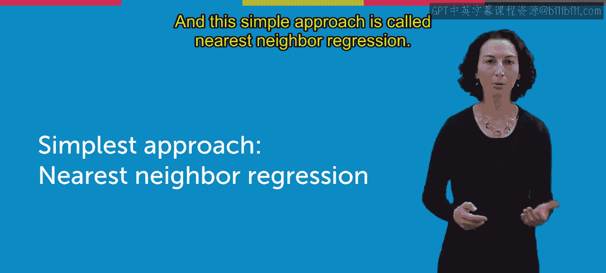
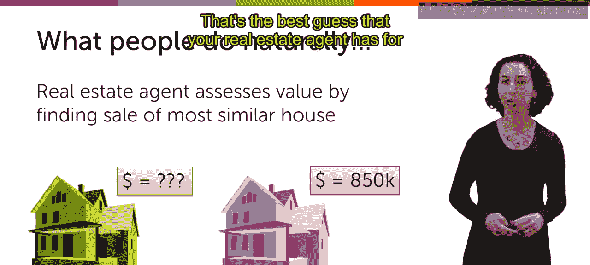
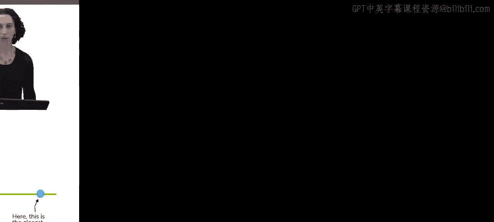
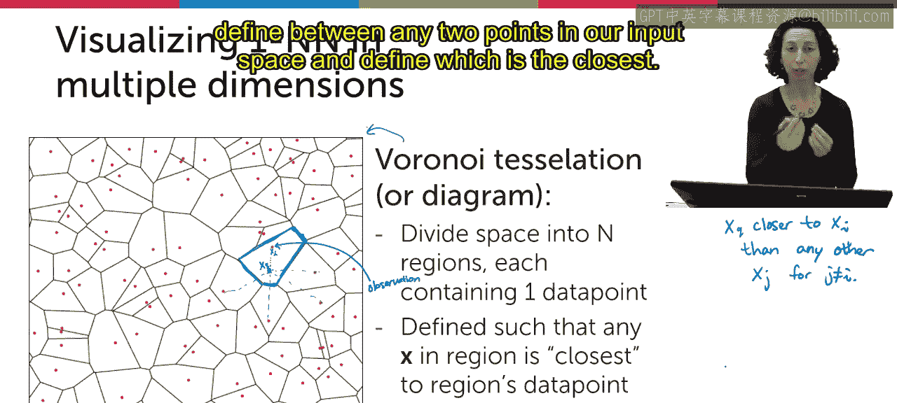

# 华盛顿大学《机器学习（回归，第2课⧸共4课）｜Machine Learning》中英字幕 p102 102_1-最近邻回归方法.zh_en -BV11b421H7XL_p102-

。

And this simple approach is called nearest Ne regression。

So the idea of nearest neighbor regression is you have some set of data points which are shown as these blue circles and then when you go to predict the value at any point in your input space。

 all you do is you look for the closest。Observation that you have and what its outputted value is。

 and you just predict that your value is exactly equivalent to that value。Okay。

 so this is really the simplest model you can think of。

 So here we're showing what the resulting fit would look like。

 so the green line is the fit and we have these little arrows showing。

Wwhichch are the closest observations， so just to be clear if I'm somewhere in this input space so I have some number of square feet for my house。

 I'm going to look for the closest observation and I'm going to choose my predicted value for my house to be exactly the same as this other observation so we can see that this leads to this idea of having local fits where these local fits are defined around each one of our observations and how local they are。

 how far they stretch is based on where the placement of other observations are。

And this is called one nearest neighbor regression。And this is really what people do naturally。

 so if you think of some real estate agent out there and you're selling your house and the real estate agent wants to assess the value of your house。

 what are they going to do well that agents going to look at all the other houses that were sold and it's going to say。

 well what's the most similar house to your house and how much did it sell for？

So implicitly what this real estate agent is doing。

 it's looking for your nearest neighbor which house is most similar to yours and then is going to assess the value of your house as being exactly equal to the sales price of this other house that's the best guess that your real estate agent has for the value of your house and how much it's likely to sell or on the market。

So let's formalize this nearest neighbor method a bit。

We're going to have some data set in our housing application it's going to be pairs of house attributes and values associated with each house so the sales price of the house and so we're going to denote this as。

X comma y for some set of observations，1 to capital N。So this is what we assume our data is。

 and then we assume that we have some query house which is not in our training data。

 so this is some point XK， this is our some house that we're interested in the value。

And the first step of the nearest neighbor method is to find the closest other house in our data。

 so specifically let's call our X nearest neighbor。To be the house that minimizes。Over。

All of our observations， I。The distance。Between。X， I。And our。Querry house XK。So to be clear。

 in the picture we had on the previous slide， this XN。

 this X nearest neighbors would just be that big pink house。

Then what we're going to do is we're simply going to predict。The value of our query house。

 which is our。Big lime greenhouse。To be exactly the value or the sales price of this big pink house。

So。Sales， price。Of。Big pink house。Okay， so really， really。

 really straightforward algorithm and so just to be clear， let's say this was the square feet。Of our。

Greenhouse。We go。 and what we're going to do is we're going to look for our nearest neighbor。

 research search along。Square feet and say which house has the most similar square feet to mine happens to be this house。

 This is our pink house。Which will be。There's space， I'll just write it here， our X nearest neighbor。

Actually， I like to write it under where it actually should be， so x nearest neighbor。

And then we say what is the value of that house， which is how much it sold for a wide nearest neighbor。

 and that's exactly what we're going to predict for our query house。

So a key thing in our nearest neighbor method is this distance metric。

 which measures how similar this query house is to any other house。

And this defines our notion of in quotes closest house in the data set， and it's a really。

 really key thing to how the algorithm is going to perform， for example。

 what house it's going to say is most similar to my house and so we're going to talk about distance metrics in a little bit。

But first， let's talk about what one nearest neighbor looks like in higher dimensions。

 because so far we've assumed that we just have one input like square feet and in that case what we had to do was define these transition points。

Where we go from。One nearest neighbor to the next nearest neighbor and thus changing our predicted values across our input space square feet。

 but how do we think about doing this in higher dimensions well。

 what we can do is look at something that's called a void diagram or void tessselllation and here we're showing a picture of such a Vorenoid tessellllation。

But just in two dimensions， though this idea generalizes to higher dimensions as well。

 and what we do is we're just going to divide our input space into regions。

So in the case of two dimensions， they're just regions in this two dimensional space。

 so I'm just going to highlight one of these regions。And each one of these regions。

Is defined by one observation。So here is an observation。

And what defines the region is the fact that any other point in this region。Let's call it X。

Let's call this X I and this other point， some other x， well this point X is closer to X。

 let me write this so X。Closer。To X I。Then。Any。Other。X J for。J not equal to I。

 meaning any other observations， so in pictures what we're saying is that the distance。

From X to Xi is less than the distance to any of these other observations。In our data set。

So what that means is let's say that x is our query point。So let's now put a subqe。

If x is our query point， then when we go to predict the value。Associated with XQ。

 we're just going to look at what the value was associated with Xi。

 the observation that's contained within this region。

So this vnooid diagram might look really complicated。

 but we're not actually going to explicitly form all these regions。

 all we have to do is be able to compute the distance and define between any two points in our input space and define which is the closest。

