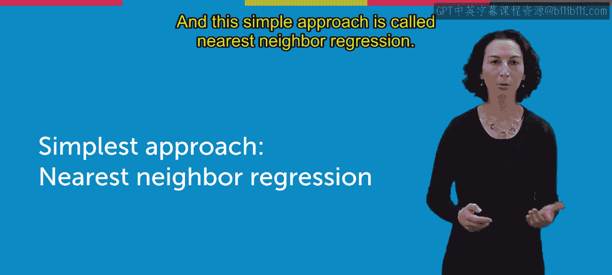
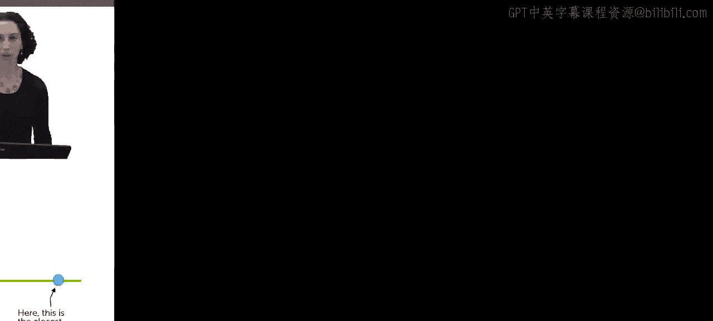
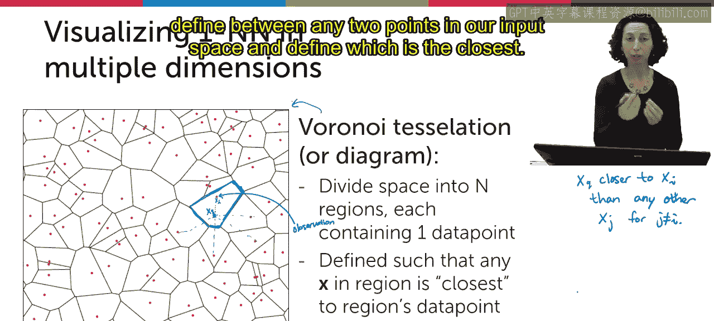

# 机器学习：第2课：最近邻回归方法 🏠

在本节课中，我们将要学习一种非常直观且基础的回归方法——最近邻回归。我们将从核心思想开始，逐步形式化其算法，并探讨其在多维空间中的应用。

## 概述

最近邻回归是一种简单直接的预测方法。其核心思想是：当需要预测一个新数据点的值时，只需在已有数据中找到与它最相似（即“最近”）的那个观测点，并将该观测点的值直接作为预测值。

## 最近邻回归的核心思想

上一节我们概述了基本概念，本节中我们来看看其具体的工作方式。

假设我们有一些数据点，如上图中的蓝色圆圈所示。当你想预测输入空间中任意一点（例如，你的房子的面积）对应的输出值时，你只需找到数据集中与你的房子最接近的那个观测点（即“最近邻”），并将其输出值直接作为你的房子的预测值。

这可能是你能想到的最简单的模型。图中的绿色拟合线展示了这种方法的预测结果，小箭头指示了每个查询点对应的最近邻观测点。这导致了一种“局部拟合”的效果，每个局部拟合区域都围绕着一个观测点，其范围大小取决于其他观测点的位置。

这种方法被称为 **1-最近邻回归**。这实际上也是人们自然而然的做法。例如，一位房地产经纪人评估你的房子价值时，他会查看所有已售出的房子，并问：“哪套房子与你的房子最相似？它卖了多少钱？”这位经纪人隐式地就是在执行最近邻回归：寻找与你房子最相似的“最近邻”，并将其售价作为对你房子价值的评估。

## 形式化最近邻方法

理解了直观思想后，现在我们来形式化定义这个算法。

我们有一个数据集。在房价应用中，它是成对的房屋属性和对应价值（售价）的集合。我们将其表示为 `(X, y)`，共有 N 个观测点。这是我们假设拥有的数据。

同时，我们有一个查询房屋 `X_q`，它不在我们的训练数据中，是我们感兴趣并想预测其价值的房子。

最近邻方法的第一步是：在数据集中找到与查询房屋最接近的其他房屋。

具体来说，我们定义 **最近邻** `X_nn` 为那个能最小化其与查询点 `X_q` 之间距离的观测点 `X_i`。用公式表示如下：

**`X_nn = argmin_i distance(X_i, X_q)`**

在之前的图示中，`X_nn` 就是那个粉色的大房子。

然后，我们简单地预测查询房屋（图中的绿色大房子）的价值，恰好等于这个最近邻房屋（粉色大房子）的售价。

**`预测值 = y_nn`** （其中 `y_nn` 是 `X_nn` 对应的真实输出值）

这是一个非常直接的算法。关键点在于 **距离度量**，它衡量了查询房屋与数据集中任何其他房屋的相似程度。这个度量定义了数据集中“最接近的房屋”的概念，是算法性能的核心，决定了哪个房子会被认为与你的房子最相似。我们稍后会详细讨论距离度量。

## 高维空间中的最近邻

到目前为止，我们假设只有一个输入特征（如房屋面积）。在那种情况下，我们需要定义这些“过渡点”，在这些点上，最近邻从一个观测点切换到另一个，从而改变整个输入空间上的预测值。

那么，我们如何在高维空间中思考这个问题呢？我们可以借助 **Voronoi 图**（或 Voronoi 镶嵌）来可视化。上图展示了一个二维空间中的 Voronoi 镶嵌，但这个概念可以推广到更高维度。

以下是其工作原理：

我们将输入空间划分为多个区域。在二维情况下，这些区域就是二维平面上的多边形。每个区域由一个观测点定义。区域的定义是：对于该区域内的任何其他点 `X`，它到其所属观测点 `X_i` 的距离，小于到数据集中任何其他观测点 `X_j` 的距离。

用公式表示，对于区域内的点 `X`，满足：
**`distance(X, X_i) < distance(X, X_j)`**，对于所有 `j ≠ i`。

这意味着，如果 `X` 是我们的查询点 `X_q`，那么当我们预测 `X_q` 的值时，我们只需查看该区域内观测点 `X_i` 对应的值 `y_i`。

Voronoi 图看起来可能很复杂，但我们实际上并不需要显式地构建所有这些区域。我们只需要能够计算输入空间中任意两点之间的距离，并确定哪个观测点是最接近的即可。

## 总结

本节课中我们一起学习了最近邻回归方法。我们从其“寻找最相似数据点并直接借用其值”的直观思想开始，然后将其形式化为一个具体的算法，涉及寻找最近邻和距离度量。最后，我们探讨了如何通过 Voronoi 图的概念，将这种方法理解并扩展到高维输入空间。这是一种简单而强大的基线方法，体现了机器学习中“相似输入产生相似输出”的基本假设。