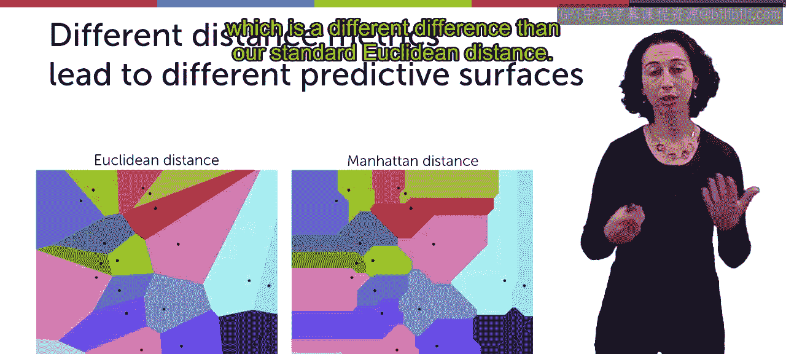

# 华盛顿大学《机器学习（回归，第2课⧸共4课）｜Machine Learning》中英字幕 p103 103_距离度量.zh_en -BV11b421H7XL_p103-

。

How are we defining distance Well in one day it's really straightforward because our distance on continuous space is just going to be Euclidean distance where we take our input X and our query house Xq and we're just going to look at the absolute value between these two different numbers so these might represent square feet for two houses and we just look at the absolute value of their difference。

But when we get to higher dimensions， there's lots of interesting distance metrics that we can think about and let's just go through one that tends to be pretty useful in practice where we're going to simply weight the different dimensions differently。

 but use standard Euclidean distance otherwise， so it looks just like Euclidean distance。

 but we're going to have different weightings on our different dimensions。So just to motivate this。

 going back to our housing application， you can imagine that you have some set of different inputs which are attributes of the house。

 like how many bedrooms it has， how many bathroom square feet。

 all are standard inputs that we've talked about before。

 but when we think about saying which house is most similar to my house？Well。

 some of these inputs might matter more than others when I think about this notion of similarity。

 so for example， number of bedrooms， number of bathrooms。

 square feet of the house might be very relevant much more so than what year the house was renovated when I'm going to assess the similarity so to account for this what we can do is we can define what's called a scaled Euclidean distance where we take the distance between now this vector of inputs。

 let's call it XJ and this vector of inputs associated with our query house XQ。

And we're going to component wise， look at their difference squared。

But then we're going to scale it by some number and then we're going to sum this over all our different dimensions。

 Okay， so in particular， I'm using this letter a。To denote the scaling， so a sub。

D is the scaling on our D input and what this is capturing is the relative importance of these different inputs in computing this similarity。

And after we take the sum of all these squares， we're going to take the square root。

 and if all these a values were exactly equal to one。

 meaning that all our inputs had the same importance。

 then this just reduces to standard Euclidean distance。

So this is just one example of a distance metric we can define in multiple dimensions and there are lots and lots of other interesting choices we might look at as well。

 but let's visualize what impact different distance metrics have on our resulting nearest neighbor fit so if we just use standard Euclidean distance on the data shown here we might get this image which is shown on the right where the different colors indicate what the predicted value is in each one of these regions remember each region you're going to assume。

Any point in that region， the predicted value is exactly the same because it has the same nearest neighbor。

 so that's why we get these different regions of constant color。

 but if we look at the plot on the left hand side where we're using a different distance metric what we see is we're defining different regions where again。

 those regions mean that any point within that region is closer to the one data point lane in that region。

 then any of the other data points in our training data。

But the way this distance is defined is different so thus the region looks different， so for example。

 with this Manhattan distance， what this is saying is just think of New York and driving along the streets in New York。

 it's measuring distance along these axis aligned directions。

 so it's distance along the x direction plus distance along the Y direction。

 which is a different distance than our standard Euclidean distance。

。