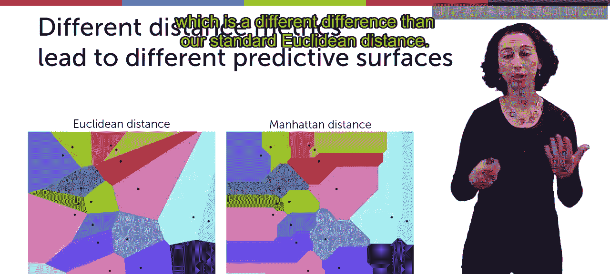

# 机器学习：第2课：距离度量 📏

在本节课中，我们将要学习最近邻算法中的一个核心概念：距离度量。我们将探讨如何定义和计算两个数据点之间的距离，尤其是在多维空间中，并了解不同的距离度量方式如何影响模型的预测结果。

---

## 距离的定义

在最近邻算法中，我们需要一个方法来衡量数据点之间的“相似性”或“距离”。在一维空间中，这非常简单。对于连续空间，我们通常使用欧几里得距离。具体来说，给定一个输入点 **X** 和一个查询点 **Xq**，我们计算这两个数字之间的绝对差值。例如，这可以代表两栋房屋的平方英尺面积，我们只需计算它们差值的绝对值。

**公式**：`距离 = |X - Xq|`

---

## 多维空间的距离度量

当我们处理更高维度的数据时，有许多有趣的距离度量方法可以考虑。接下来，我们将介绍一种在实践中非常实用的方法：**加权欧几里得距离**。这种方法的核心思想是，为不同的维度分配不同的权重，但除此之外，其计算方式与标准欧几里得距离类似。

为了理解其动机，让我们回到房屋预测的例子。假设我们有一组描述房屋属性的输入特征，例如卧室数量、浴室数量和房屋面积。当我们思考“哪栋房子与我的房子最相似”时，某些特征可能比其他特征更重要。例如，卧室数量、浴室数量和房屋面积在评估相似性时，可能比房屋的翻新年份更为相关。

为了考虑这一点，我们可以定义一个**缩放欧几里得距离**。我们计算输入向量 **Xj**（训练数据点）和查询向量 **Xq** 之间的距离。具体做法是，对每个维度计算差值的平方，然后乘以一个缩放系数，最后对所有维度的结果求和并取平方根。

**公式**：`距离 = sqrt( Σ [ a_d * (Xj_d - Xq_d)^2 ] )`

其中，**a_d** 是第 **d** 个维度的缩放系数，它捕捉了该维度在计算相似性时的相对重要性。如果所有权重 **a_d** 都等于1，那么这个公式就简化为标准的欧几里得距离。

---

## 不同距离度量的影响

不同的距离度量方式会直接影响最近邻模型的预测结果。为了直观地理解这一点，我们可以观察不同距离度量下数据区域的划分情况。

以下是两种不同距离度量的可视化效果：

*   **标准欧几里得距离**：在右侧的图中，不同颜色代表不同区域的预测值。每个区域内的所有点都具有相同的最近邻，因此预测值也相同，形成了颜色恒定的区域。
*   **曼哈顿距离**：在左侧的图中，区域划分的方式有所不同。曼哈顿距离的计算方式类似于在纽约街道上开车，它测量的是沿坐标轴方向的距离总和，即X方向的距离加上Y方向的距离。这与标准的欧几里得距离不同。

**公式（曼哈顿距离）**：`距离 = |Xj_x - Xq_x| + |Xj_y - Xq_y|`

由于距离的定义方式不同，数据空间的区域划分也会随之改变，从而影响模型的预测边界和结果。

---

## 总结

本节课中，我们一起学习了距离度量的概念及其在最近邻算法中的重要性。我们从一维空间中的简单绝对距离开始，扩展到多维空间中的加权欧几里得距离，理解了如何通过为不同特征分配权重来捕捉其在相似性判断中的重要性。最后，我们通过可视化对比了标准欧几里得距离和曼哈顿距离如何导致不同的预测区域划分。选择合适的距离度量是构建有效最近邻模型的关键一步。