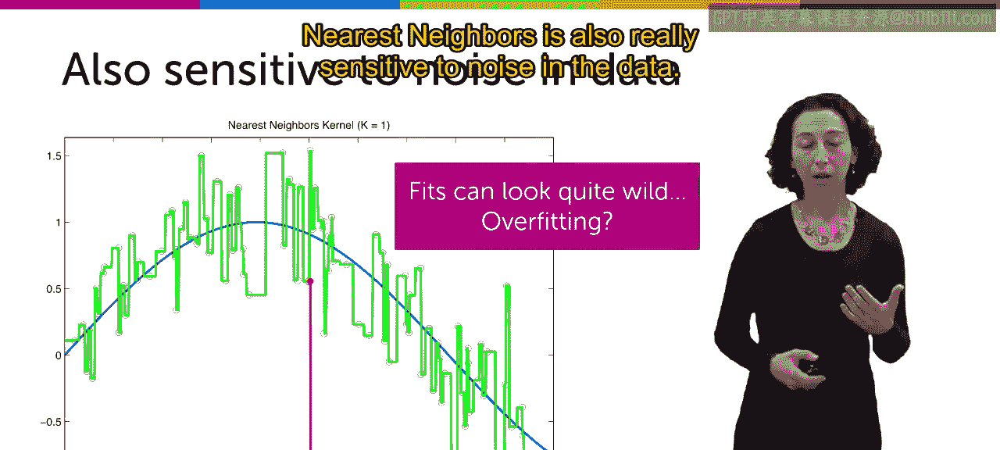
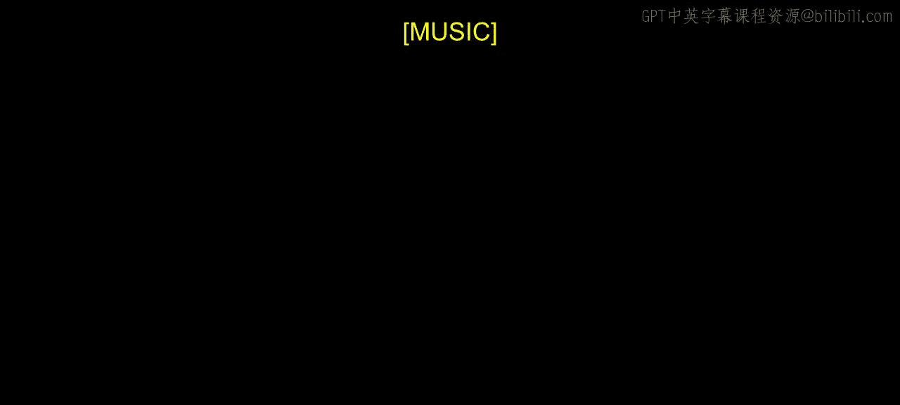

# 华盛顿大学《机器学习（回归，第2课⧸共4课）｜Machine Learning》中英字幕 p104 104_1-最近邻算法.zh_en -BV11b421H7XL_p104-

。

Well we've talked about what one nearest neighbors is doing intuitively now let's talk about how to actually implement one nearest neighbors in practice so to perform our nearest neighbor search。

 what we have to do is we have to specify a query input which will be。

 for example some house that we're interested in assessing its value and then we also need to provide our data or set of training houses and we also need to specify a distance metric which is measuring our way of measuring the similarity between houses and then the output of our one nearest neighbor search is going to be the most similar house and we can use that the value associated with that house as our prediction for our query house。

So more explicitly， our one nearest neighbor algorithm。

 we can initialize what I'm calling distance to nearest neighbor to be infinity and initialize our closest house to be the empty set。

Then what we do is we're going to step through every house in our data set and we're going to compute the distance。

From our query house to the house that we're at at our current iteration。

And if that distance is less than the current distance to our nearest neighbor。

 which at first is infinity， so at the first iteration， you're definitely going have a closer house。

 so the first house that you search over， you're going to choose as your nearest neighbor for that iteration。

 but remember you're going to continue on。And so what you're going to do is if the distance is less than the distance to your nearest neighbor。

 you're going to set your current nearest neighbor equal to that house or that X。

 and then you're going to set your distance to nearest neighbor equal to the distance that you had to that house and then you're just going to iterate through all your houses and in the end what you're going to return is the house that was most similar and then we can use that for prediction to say that the value associated with that house is the value we're predicting for our query house。

So let's look at what this gives us on some actual data so here we drew some set of observations from a true function that had this kind of curved shape to it and the blue line indicates the true function that was used to generate this data and what the green line represents is our one nearestears neighbor fit and what you can see is that the fit looks pretty good for data that's very dense in our input space so dense in X we get lots of observations across our whole input space。

But if we just remove some observations in a region of our input space。

 then things start to look not as great because nearest Neor really struggles to interpolate across regions of the input space where you don't have any observations or you have very few observations。

And likewise， if we look at a data set that's much noisier。

 we see that our nearest neighbor fit is also quite wild。

 so this looks exactly like the types of plots we。Showed when we talked about models that were overfitting our data。

 so what we see is that one nearest neighbors is also really sensitive to noise in the data。

