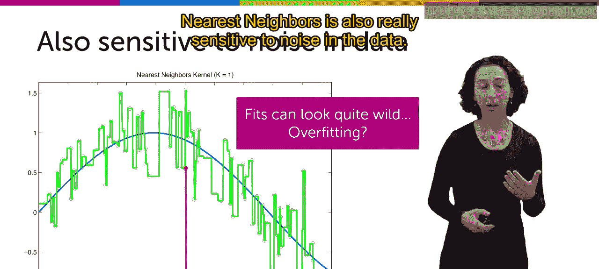
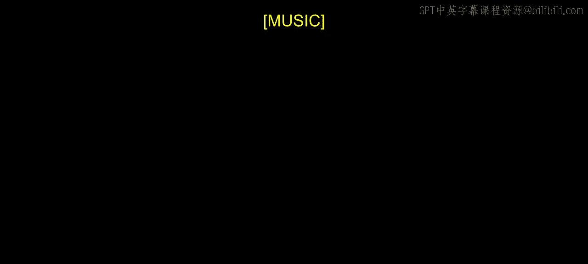

# 机器学习：第2课：最近邻算法


在本节课中，我们将学习最近邻算法的具体实现方法。我们将了解如何通过指定查询点、数据集和距离度量来执行最近邻搜索，并观察该算法在不同数据分布下的表现。

---

上一节我们直观地讨论了最近邻算法的工作原理。本节中，我们来看看如何在实践中具体实现最近邻算法。

为了执行最近邻搜索，我们需要完成以下步骤：
*   指定一个查询输入，例如我们想要评估其价值的房屋。
*   提供我们的数据，即训练用的房屋集合。
*   指定一个距离度量，用于衡量房屋之间的相似性。

最近邻搜索的输出将是与查询点最相似的房屋。我们可以使用该房屋对应的价值，作为我们对查询房屋的预测值。

更具体地说，一最近邻算法的伪代码如下：

```
初始化 distance_to_nearest_neighbor = 无穷大
初始化 closest_house = 空集

对于数据集中的每一个房屋：
    计算 查询房屋 到 当前房屋 的距离
    如果 该距离 < distance_to_nearest_neighbor：
        设置 closest_house = 当前房屋
        设置 distance_to_nearest_neighbor = 该距离

返回 closest_house
```

算法首先将“到最近邻的距离”初始化为无穷大，将“最近邻房屋”初始化为空。然后，它遍历数据集中的每一个房屋，计算其与查询房屋的距离。如果该距离小于当前记录的最小距离，则更新最近邻房屋和最小距离值。遍历结束后，返回最相似的房屋，其对应的价值即为预测值。

---

现在，让我们看看这个算法在实际数据上的表现。

下图展示了一组从一个具有曲线形状的真实函数中抽取的观测数据。蓝线代表用于生成这些数据的真实函数，而绿线代表我们的一最近邻拟合结果。


可以看到，在输入空间（X轴）数据密集的区域，拟合效果相当好。我们在整个输入空间获得了大量观测值。

然而，如果我们在输入空间的某个区域移除一些观测数据，情况就开始变得不那么理想。



最近邻算法很难在没有任何观测值或观测值非常稀少的输入空间区域进行有效插值。

同样地，如果我们观察一个噪声更大的数据集，会发现最近邻拟合也变得非常不稳定。


这看起来就像我们之前讨论过拟合模型时展示的图表类型。由此可见，一最近邻算法对数据中的噪声也非常敏感。

---




本节课中，我们一起学习了最近邻算法的具体实现步骤，并通过图示观察了其表现。我们了解到，该算法在数据密集区域表现良好，但在数据稀疏或噪声较大的情况下，其拟合结果可能不稳定或出现过拟合现象。