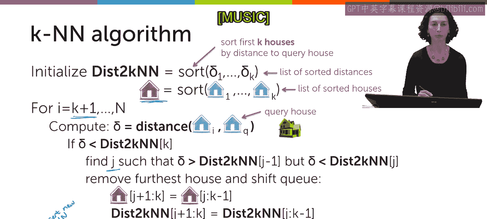

# 华盛顿大学《机器学习（回归，第2课⧸共4课）｜Machine Learning》中英字幕 p105 105_K-最近邻回归.zh_en -BV11b421H7XL_p105-

。

And what this motivates us to look at is something called K nearest neighbors。

 which is a very simple extension off of one nearest neighbors。And again。

 going back to our housing application。It's what real estate agents do。

 I said they just look at the nearest house， but that's not quite true。

 they tend to go out and get a set of what are called comps。

 so instead of just looking for the closest most similar house to yours。

They're going to collect a set of houses that are similar and look at the values for that set of houses and say。

 well your house value should be somehow related to these set of houses because the agent is understanding that the one most similar house。

 there might have been something strange about the value it got。

 maybe a buyer was really drawn to some specific feature of that house and that drove up the cost or maybe it sold at a strange time in the year and maybe that gave it an artificially low value。

 so looking at a larger set of houses to assess the value of yours can give you a much more reliable estimate。

So formerly K nearest neighbors is going to take the same data that we had before and a query point and what it's going to do is it's going to find the K closest observations in our data。

 so specifically let's call it x nearest neighbor1。

X nearest neighbor2 all the way to x nearest neighbor K where I'm going to assume that I've ordered these nearest neighbors so that x nearest neighbor K is the furthest。

 the least similar out of the set to the query house。Well， this set is defined。Such that。For any。X I。

 not in my nearest neighbor set。Then。The distance。Between X I and my query point。

 Xq is greater than or equal to the distance。Between。My caseith。

Nearest neighbor and XQ So what this means is that every other observation in the data is further away than my case nearest neighbor that's what defines it as my case nearest neighbor。

Okay， so then what do I do for my prediction because when we were doing one nearest neighbor regression。

 we were just taking our nearest neighbor looking at the。

Output associated with that nearest neighbor and saying that was my predicted value。

 but now I have a set of nearest neighbors， and so I need to decide what I'm going to do with these nearest neighbors and their associated outputs to form my prediction。

And what Ka nearest neighbors does is it says the predicted value。

Associated with my query point is simply going to be the average value of all the nearest neighbor outputs。

 so one over k y nearest neighbor one plus。Plus y nearest neighbor2 plus all the way up to y nearest neighbor K。

 or we can write this more simply as one over k sum。J equals1 to k of y nearest neighbor J。Okay。

 so Ca nearest neighbors， like I said， is a very simple variant or generalization of one nearest neighbors。

Now let's talk about how we implement our K nearest neighbor search in practice and the setup is exactly like it was for one nearest neighbor。

 but instead of outputting just the most similar house，We're going to output a set of similar houses。

 specifically K similar houses。For completeness， I've included what the K nearest neighbor algorithm looks like。

 where the one key insight here is to maintain asortred cu of the K nearest neighbors as you're going through the different steps of your search so let's just walk through this algorithm here what we're going to do is we're going to initialize what I'm calling distance to K nearest neighbors。

 which is a list of distances， the current distances to the K nearest neighbors I have at the current iteration and so to start with we can just look at the first K houses in our data set。

And initialize those as our k nearest neighbors， but we're going to sort these distances for these k nearest neighbors for these first K houses。

 and however these distances sort， we're going to likewise sort the first K houses in our data set to be our current estimate of our nearest neighbors。

Then for now we're going to just cycle through houses K plus1 to capital N。

 what we're going to do is we're going to compute the distance of this new house that we haven't seen before to our query house。

And if that distance is less than the distance to my Caith nearest neighbor。

 the house that's furthest away。Then what I'm going to do is I'm going go through my sorted list because remember just because this new house is closer than the k nearest neighbor。

 that doesn't mean that this new house becomes my Kate nearest neighbor because it could be closer than my second nearest neighbor or fourth so what I need to do is I need to go through and find which index this house should go into meaning there's some point at which all houses nearest neighbors1 to J minus1 are actually closer than this house that I'm looking at now。

 but this house is closer than all the other nearest neighbors in my set and what I'm going to do now that we have this index J we're going to go and try and insert this house that we found that it's one of our current estimates of our nearest neighbor into the queue and what we're going to do is we're simply going to knock off the K nearest neighbor which we know was our worst estimate of our nearest neighbors so far we're going to go and insert this。

houseuse into this queue so this step is just shifting the indices for our list of houses。

 just knocking off that Caith last house， and then this step is doing exactly the same thing。

 but for the distances associated with each of these nearest neighbors。So finally， here。

 this is where we're inserting the new nearest neighbor。Where in that Cha slot。

 we're putting the distance to this newly found house and。

And the J slot of our list of houses were putting the house itself。

So once we cycle through all our observations in our data set。

 what we're going to end up with is a set of the K most similar houses to the query house。

And like we described before， when we want to go and predict the value associated with our query house。

 we're simply going to average over the values associated with these K nearest neighbors。

