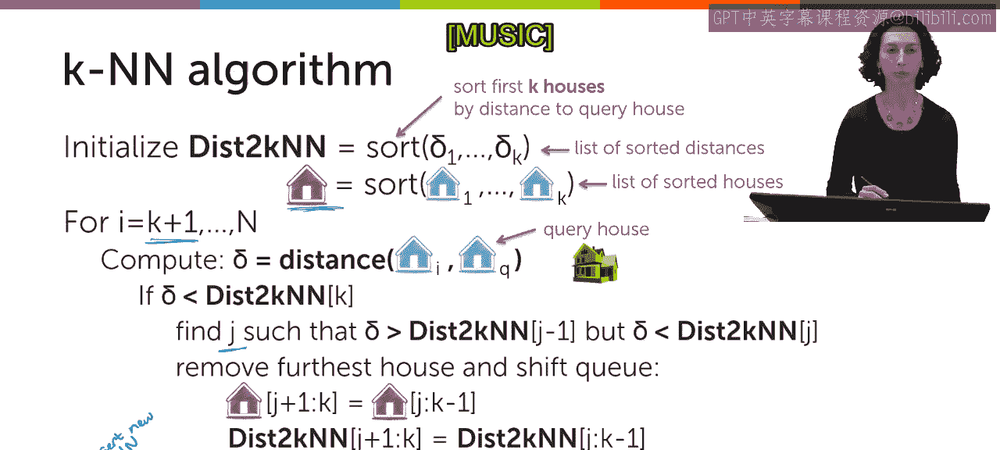

# 机器学习：第2课：K-最近邻回归


在本节课中，我们将要学习一种名为 **K-最近邻** 的回归方法。它是我们上一节介绍的“1-最近邻”回归的一个简单而强大的扩展。我们将了解其核心思想、工作原理以及如何在实际中实现它。

## 从1-最近邻到K-最近邻

上一节我们介绍了1-最近邻回归，它通过寻找与查询点最相似的一个数据点来进行预测。然而，这种方法可能不够稳定，因为单个数据点的值可能受到特殊因素（例如，房屋在特定时间以异常价格售出）的影响。

为了获得更可靠的估计，我们可以借鉴房地产评估师的常用方法：他们不会只看一套“可比房屋”，而是会收集一组相似的房屋（即“可比销售”或“comps”），并基于这组房屋的价值来评估目标房屋。K-最近邻回归正是基于这一思想。

## K-最近邻的核心概念

K-最近邻方法接收与之前相同的数据集和一个查询点。它的目标是找到数据集中与查询点最相似的 **K** 个观测值。

具体来说，我们定义一组 **K个最近邻**：`x_nearest_neighbor_1`, `x_nearest_neighbor_2`, ..., `x_nearest_neighbor_K`。我们假设这些邻居已按与查询点的相似度（距离）排序，因此 `x_nearest_neighbor_K` 是这组中最不相似（距离最远）的一个。

这组最近邻的定义是：对于数据集中 **任何不在** 这组最近邻中的观测点 `x_i`，其与查询点 `x_q` 的距离，都 **大于或等于** 第K个最近邻 `x_nearest_neighbor_K` 与 `x_q` 的距离。这意味着所有其他数据点都比我们选出的第K个邻居更远。

## 如何进行预测？

在1-最近邻回归中，预测值就是最近邻对应的输出值 `y`。但现在我们有了K个最近邻，每个都有其输出值 `y_nearest_neighbor_j`。

K-最近邻回归的预测方法是：取这K个邻居输出值的 **平均值**。

我们可以用以下公式表示：

**预测值 = (1/K) * Σ (y_nearest_neighbor_j)**，其中求和下标 j 从 1 到 K。

或者写成代码形式：
```python
prediction = sum(y_nearest_neighbors) / K
```

这种方法通过平均多个相似点的值，平滑了单个数据点可能存在的噪声或异常，从而得到更稳健的预测。

## K-最近邻搜索算法实现

了解了核心思想后，本节我们来看看如何在实践中实现K-最近邻搜索。其设置与1-最近邻类似，但目标变为输出K个最相似的房屋。

以下是K-最近邻搜索算法的关键步骤概述。算法的核心在于，在遍历数据的过程中，始终维护一个 **有序的、包含当前K个最近邻的队列**。

以下是算法步骤的详细说明：

1.  **初始化**：创建一个列表 `distance_to_K_nearest_neighbors`，用于存储当前K个最近邻的距离。开始时，我们可以将数据集中的前K个房屋作为初始的K个最近邻，并计算它们与查询房屋的距离，然后对这个距离列表进行排序。同时，对应的房屋列表也按此顺序排列。

2.  **遍历剩余数据**：接着，我们遍历数据集中从第K+1个到第N个的所有房屋。
    *   对于每一个新房屋，计算其与查询房屋的距离。
    *   如果这个距离 **小于** 当前K个最近邻中 **最远那个邻居的距离**（即列表中的最大值），则说明这个新房屋应该进入我们的最近邻集合。

3.  **插入新邻居**：
    *   由于新房屋的距离比当前第K个邻居小，我们需要找到它在有序距离列表中的正确位置 `J`。位置 `J` 满足：所有索引小于 `J` 的邻居都比这个新房屋更近，而新房屋比索引 `J` 及之后的所有当前邻居都更近。
    *   找到位置 `J` 后，我们需要更新列表。这分为两步：
        *   首先，将房屋列表从索引 `J` 到 `K-1` 的元素向后移动一位，从而“挤掉”原先的第K个房屋（即最不相似的那个）。
        *   同样，对距离列表进行完全相同的移位操作。
    *   最后，将新房屋插入到房屋列表的 `J` 位置，将其距离插入到距离列表的 `J` 位置。

4.  **完成与预测**：遍历完所有数据后，我们便得到了与查询房屋最相似的K个房屋的集合。要预测查询房屋的值，我们只需计算这K个邻居对应房价的平均值，如上一节所述。

## 课程总结



本节课中我们一起学习了 **K-最近邻回归**。我们了解到，它是1-最近邻的自然扩展，通过考虑多个（K个）相似数据点并取其输出值的平均值来进行预测，这种方法能有效减少单个数据噪声带来的影响，使预测更加稳定。我们还详细探讨了在大量数据中高效查找K个最近邻的算法实现，其关键在于动态维护一个有序的最近邻队列。K-最近邻是一个简单直观却非常强大的基础机器学习算法。