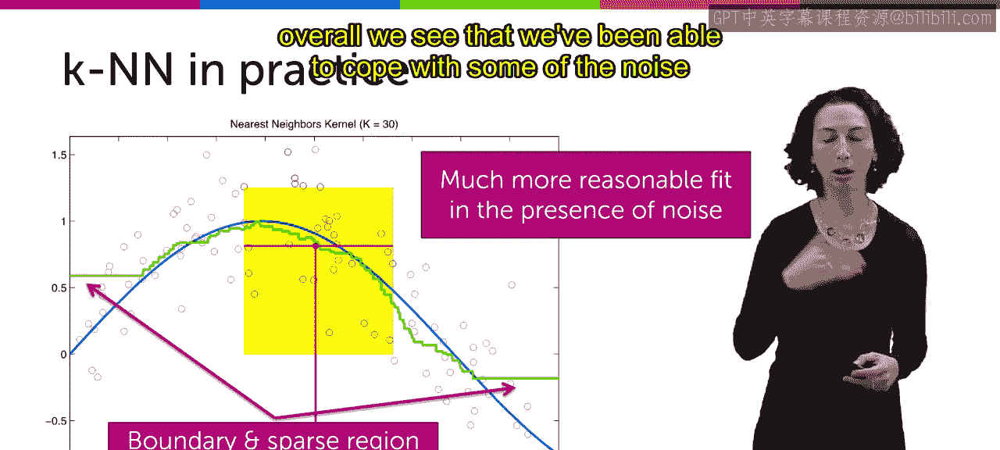
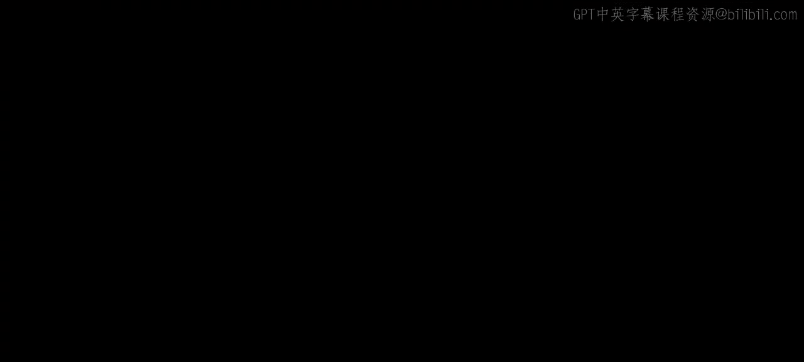
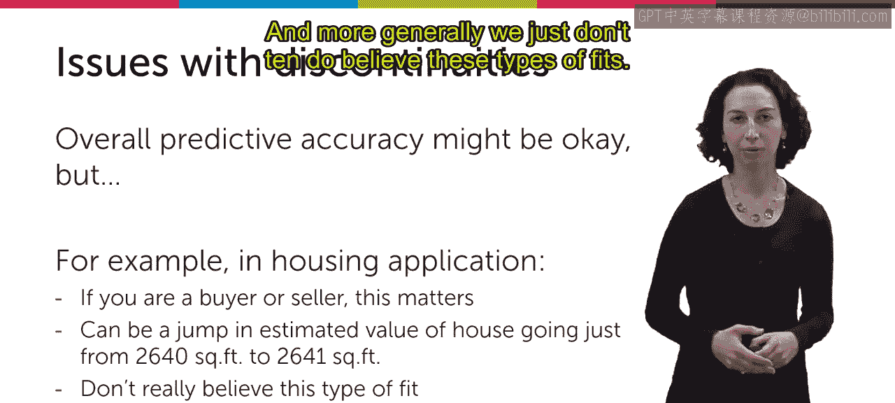
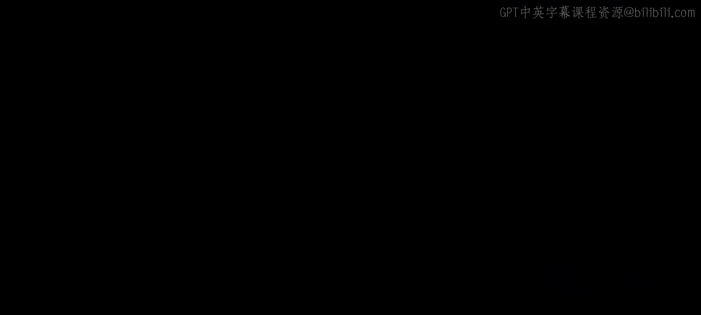

# 华盛顿大学《机器学习（回归，第2课⧸共4课）｜Machine Learning》中英字幕 p106 106_K-最近邻的实际应用.zh_en -BV11b421H7XL_p106-

。

So now let's look at k nearest neighbors in practice and we're going to look at exactly the same data set we looked at for one nearest neighbors where we show that really noisy fit and what we see is that things look a lot better here。

 so in this yellow box what we're showing are all the nearest neighbors for a specific target point x0。

 so there's a red line going up from our target our query point。

To a yellow box and this yellow box has all the nearest neighbor observations highlighted as red circles instead of gray circles for this one query point。

 and if we think about averaging the values of all these points。

 that results in the the value of the green line at this target point x0 and we can repeat this for every value of our input space。

 and that's what's going to give us this green curve。

And so what we see here is that this fit looks much more reasonable than that really noisy one nearest neighbor fit we showed before。

But one thing that I do want to point out is that we get these boundary effects and the same is true if we have limited data in any region of the input space。

 but in particular at the boundary， the reason we get these constant fits is the fact that our nearest neighbors are exactly the same set of points for all these different input points because if I'm all the way over at the boundary。

 all my nearest neighbors are the K points to either the right or left of me。

 depending which boundary on' that， and then if I shift over one point。

 I still have the same set of nearest neighbors， obviously except for the one point that is the query point。

 but aside from that it's basically the same set of values that you're using at each one of these points along the boundary。

But overall， we see that we've been able to cope with some of the noise that we had in the one nearest neighbor situation a lot better than we did before。

But beyond the boundary issues， there's another fairly important issue with the K nearest neighbors fit。

 which is the fact that you get discontinuity so if you look closely at this green line it's these a bunch of jumps between values and the reason you get those jumps is the fact that as you shift from one input to the next input a nearest neighbor is either completely in or out of the window so there's this effect where all of a sudden a nearest neighbor changes。

And then you're going to get a jump in the predicted value。

And so the overall effect on predictive accuracy might actually not be that significant。

 but there' are some reasons we don't like fits with these types of discontinuities first visually maybe it's not very appealing。

 but let's think in terms of our housing application where what this means is that if we go from a house for example。

 2640 square feet to a house of 2641 square feet to you that probably wouldn't make much of a difference in assessing the value。

 but if you have a discontinuity between these two points。

 what it means is there's a jump in the predicted value。

 so I take my house as some predicted value I just add one square feet and the predicted value would have perhaps significant increase or decrease。

And so that is not very attractive in applications like housing and more generally。

 we just don't tend to believe these types of fits。

