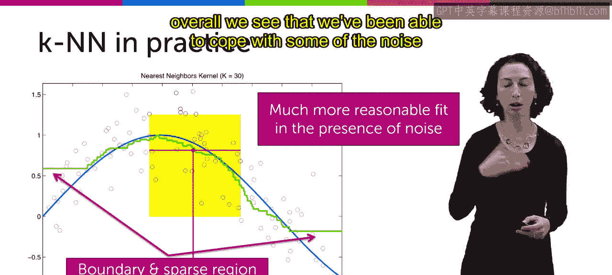
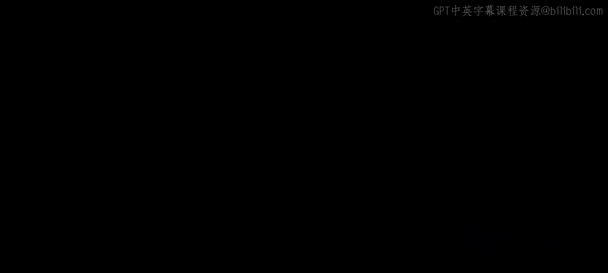

# 机器学习：第2课：K-最近邻的实际应用 🧠

在本节课中，我们将学习K-最近邻（K-NN）算法在实际应用中的表现。我们将通过一个具体的数据集，对比K-NN与1-最近邻（1-NN）的拟合效果，并探讨K-NN算法的优点及其存在的边界效应和不连续性问题。

---

## K-最近邻的拟合效果

上一节我们介绍了1-最近邻算法及其可能产生的噪声拟合。本节中我们来看看当使用K-最近邻（K>1）时，拟合效果如何改善。

图中展示的是对同一个数据集应用K-最近邻算法的结果。我们可以看到，与之前1-最近邻产生的噪声拟合相比，现在的拟合曲线看起来合理得多。

在图中黄色的方框内，我们展示了针对一个特定目标点 **x₀** 的所有最近邻。一条红线从我们的查询点（目标点）向上延伸至黄色方框。在这个黄色方框中，所有最近邻的观测点都被高亮显示为红色圆圈（而非其他点的灰色圆圈）。

如果我们考虑对这些点的值进行平均，结果就是绿色曲线在目标点 **x₀** 处的值。我们可以对输入空间中的每一个值重复这个过程，最终得到整条绿色的拟合曲线。

因此，我们看到这个拟合结果比之前展示的噪声很大的1-最近邻拟合要合理得多。

---

## 边界效应

然而，我们需要指出一个现象：我们得到了这些边界效应。如果输入空间的任何区域数据有限，也会出现同样的情况。

特别是在边界处，我们得到这些恒定拟合值的原因是：对于所有这些不同的输入点，我们的最近邻集合是完全相同的一组点。因为如果我处于边界的最边缘，我的所有最近邻都是在我右侧或左侧的K个点（取决于位于哪个边界）。然后，如果我向右移动一个点，我仍然拥有几乎相同的最近邻集合（显然，除了查询点本身发生变化）。因此，在边界上的每一个点，你使用的基本上是同一组值来计算平均值。

但总体而言，我们看到K-最近邻能够比1-最近邻更好地处理数据中的一些噪声。

---

## 不连续性问题

除了边界问题，K-最近邻拟合还存在另一个相当重要的问题：不连续性。

如果你仔细观察这条绿线，会发现它在不同值之间有一系列的跳跃。产生这些跳跃的原因是：当你从一个输入点移动到下一个输入点时，一个最近邻点要么完全进入窗口，要么完全退出窗口。这种效应导致最近邻集合突然发生变化，进而引起预测值的跳跃。

对预测准确性的整体影响可能并不显著，但我们不喜欢这类不连续拟合有几个原因：
1.  视觉上可能不太美观。
2.  从应用角度考虑，这不符合常理。

以下是具体说明：

以我们的房屋估价应用为例。这意味着，如果我们从一栋2640平方英尺的房子，换到一栋2641平方英尺的房子，在你看来，这对评估价值可能不会有太大差别。但如果这两个点之间存在不连续性，就意味着预测值会发生跳跃。我的房子有一个预测值，我仅仅增加一平方英尺，预测值就可能出现显著的增长或下降。

在房屋估价这类应用中，这是非常不合理的。更普遍地说，我们通常不相信这类具有跳跃性的拟合模型。

---

## 总结

本节课中，我们一起学习了K-最近邻算法的实际应用。我们看到了通过平均多个最近邻点的值，K-NN能够有效减少1-NN带来的噪声，产生更平滑、更合理的拟合。然而，我们也分析了K-NN算法的两个主要局限性：在数据边界处产生的**边界效应**，以及由于最近邻集合突变导致的预测曲线**不连续性**。理解这些优缺点对于在实际问题中正确选择和使用K-最近邻算法至关重要。