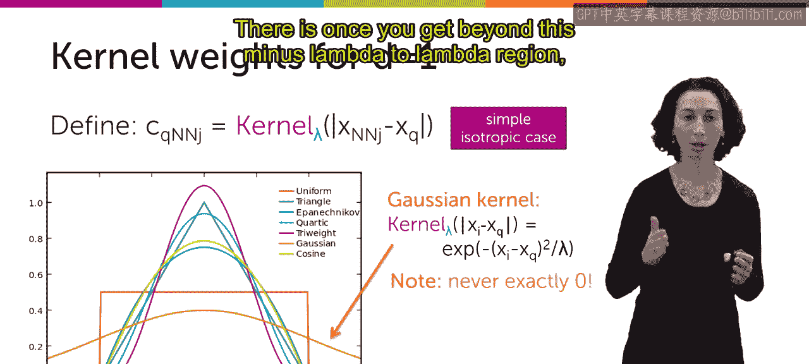
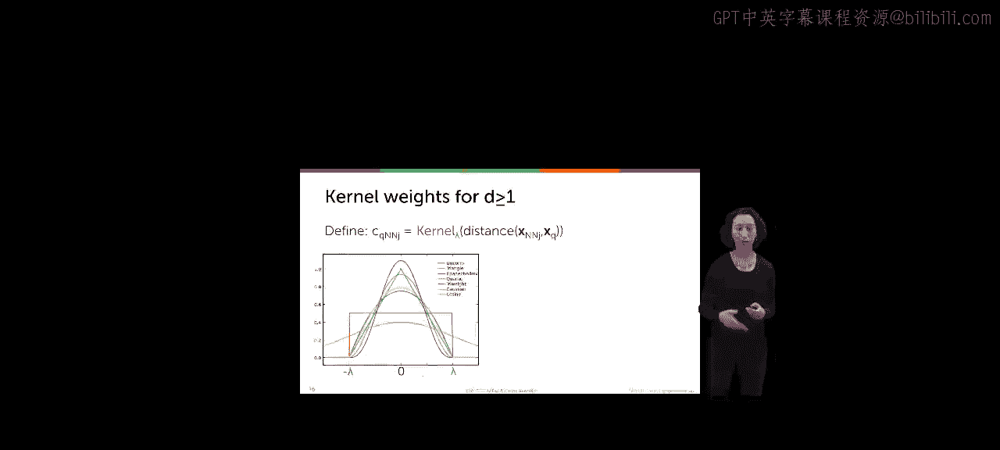
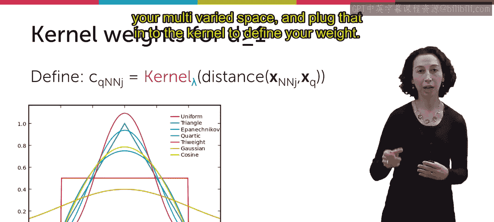

# 华盛顿大学《机器学习（回归，第2课⧸共4课）｜Machine Learning》中英字幕 p107 107_加权K-最近邻.zh_en -BV11b421H7XL_p107-

。

So this leads us to consider something called weighted k nearest neighbors and what weighted k nearest neighbors does is it down weights the neighbors that are further from the specific query point or target point and the effect that has is as we're shifting from target point to target point。

 when a neighbor jumps in or out of our set of nearest neighbors。

 the effect of that isn't as significant because when I'm computing what my prediction is at a given value。

 I've already down weighted that neighbors， so when it drops out。

 it was not that significant in forming my predicted value to start with。So in particular。

 when we talk about our predictive value， we're going to weight each one of our nearest neighbor observations by some amount that I'll call C subscript Q for looking at query point Q。

 and then I also have a nearest neighbor J indexing which nearest neighbor that weight is associated with。

And the question is how do we want to define these weights， Well。

 if the distance between my query point and this nearest neighbor is really large。

 then we want this constant that we're multiplying by to be very small because we want to down weight that observation。

But in contrast， if the distance is very small， meaning this house is very similar to my house。

 I want that constant to be larger。So one simple choice。

Is simply to take our weights to be equal to one over the distance between these points。

 so let's say that C Q nearest neighbor J is going to be equal to one over the distance。Between。

X J and Xq。So this will have the effect that when the distance is larger， the weight is smaller。

 when the distance is smaller， the weight is larger more generally we can think of defining these weights using something that's called a kernel。

 where here in this slide we're going to focus on the simplest case of what are called isotropic kernels and these kernels are just a function of the distance between any point and the target point。

 the query XQ。And in this figure we're showing a couple examples of commonly used kernels and what we see is this kernel is defining how the weights are going to decay if at all。

 as a function of the distance between a given point and our query point。So as an example here。

 one commonly used kernel is something called the Gaussian kernel。

 and what we see is that this kernel takes the distance between Xi and Xq。

 looks at the square of that distance。And then divides that by a parameter lambda。

And that lambda is going to define how quickly the function decays and importantly。

This whole thing that I described is exponentiated so that all these weights are positive。

 but I want to emphasize that this parameter lambda that all of these kernels have。

 that's why I've written kernel sub lambmbda define how quickly we're going to have the weights decay as a function of this distance。

And another thing that's worth noting is the fact that this Gaussian kernel that I've mentioned here。

Has the weights never go exactly to zero， they just become very， very， very。

 very small as the distance increases， but for the other kernels I've shown on this plot here。

 there's once you get beyond this minus lambda to lambda region。

The weights go exactly to zero。So what we just described was assuming that we're just looking at a single input like square feet and that's our distance was just our standard Euclidean distance of looking at the absolute value between the two inputs。

 but more generally you can use the same kernels in higher dimensional spaces where again you just compute the distance however you've defined it in your multivariate space。

And plug that into the kernel to define your weight。

