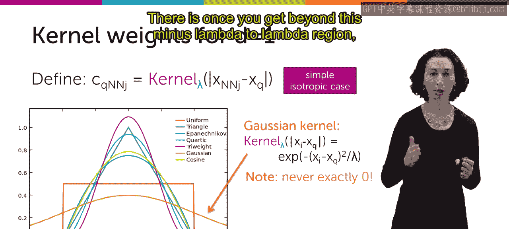
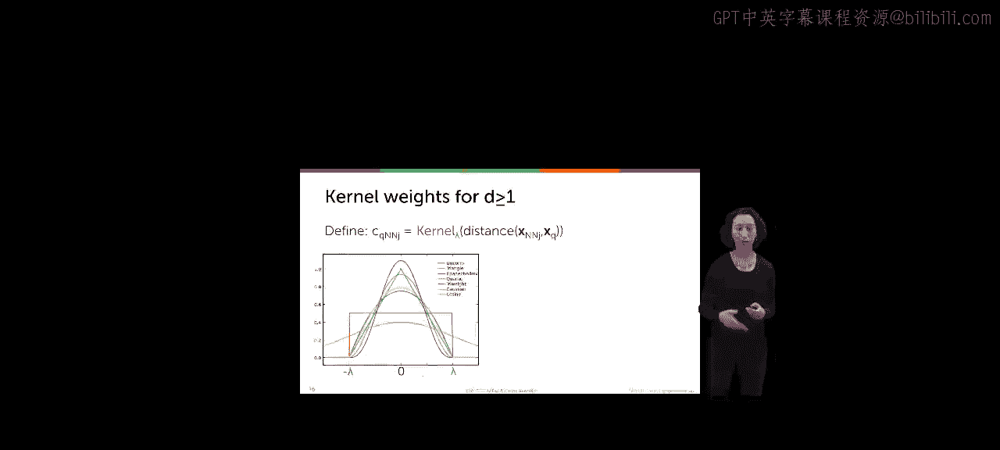
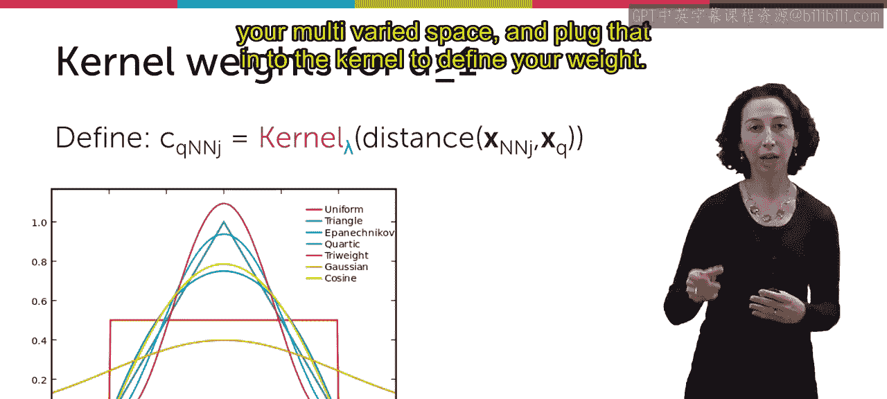

# 机器学习：第2课：加权K-最近邻

在本节课中，我们将要学习一种改进的K-最近邻算法，称为加权K-最近邻。这种方法通过调整不同邻居的权重，使预测结果更加平滑和稳定。

上一节我们介绍了基本的K-最近邻算法，本节中我们来看看如何通过引入权重来优化其预测性能。

## 加权K-最近邻的核心思想

加权K-最近邻的核心思想是：**根据邻居与查询点（目标点）的距离远近，赋予不同的权重**。距离查询点较近的邻居对预测的影响更大，而距离较远的邻居影响则被削弱。

这样做的好处是，当我们从一个查询点切换到另一个查询点时，即使最近邻集合中的成员发生变化，由于较远的邻居已被赋予较低的权重，其对最终预测值的“跳入”或“跳出”影响就不会那么显著。

## 如何定义权重

在加权K-最近邻中，我们对每个最近邻观测值赋予一个权重。这个权重通常表示为 **C_{Q, j}**，其中 **Q** 代表查询点，**j** 代表第 **j** 个最近邻。

权重的定义原则很简单：
*   如果查询点与某个邻居的距离很大，我们希望赋予它的权重常数非常小，以削弱该观测值的影响。
*   反之，如果距离很小（即房屋非常相似），我们希望赋予它的权重较大。

以下是定义权重的一种简单方法：

**权重 = 1 / 距离**

用公式表示即：
**C_{Q, j} = 1 / distance(X_j, X_Q)**

这个公式实现了我们的目标：距离越大，权重越小；距离越小，权重越大。

## 更通用的方法：核函数

更一般地，我们可以使用**核函数**来定义这些权重。核函数是距离的函数，它描述了权重如何随着查询点与数据点之间距离的增加而衰减。

在本课程中，我们主要关注最简单的**各向同性核**，这类核函数仅依赖于点与查询点 **X_Q** 之间的距离。

以下是几种常用的核函数示例：

*   **高斯核**：权重随距离呈指数衰减，永远不会精确变为零。
    *   公式：**K_λ(d) = exp(-d² / λ)**
    *   参数 **λ** 控制衰减速度。
*   **Epanechnikov核**：在距离超过一定范围（如 **[-λ, λ]**）后，权重精确变为零。
*   **三次核**：同样，在边界外权重精确为零。

这些核函数都有一个共同参数 **λ**，它决定了权重随距离衰减的快慢。

## 从单变量到多变量空间

我们之前的描述假设只考虑一个输入特征（如房屋面积），距离计算使用简单的绝对值差（即一维欧几里得距离）。

然而，加权K-最近邻可以轻松扩展到具有多个特征的高维空间。方法完全一致：
1.  根据你定义的方式（通常是欧几里得距离）计算多变量空间中查询点与每个数据点之间的距离。
2.  将这个距离值代入你选择的核函数中，计算出对应的权重。

## 总结

本节课中我们一起学习了加权K-最近邻算法。我们了解到，通过根据距离为K个最近邻分配不同的权重，可以使得预测模型对邻居集合的变化不那么敏感，从而产生更平滑的预测结果。我们介绍了权重的核心思想，探讨了使用**1/距离**的简单加权方法，并引入了更通用的**核函数**（如高斯核）来定义权重衰减。最后，我们明确了这些概念可以自然地推广到多特征的高维数据空间中。