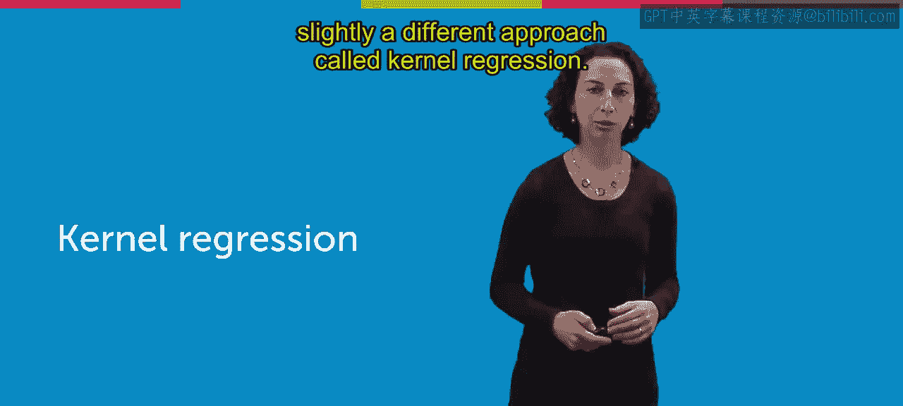
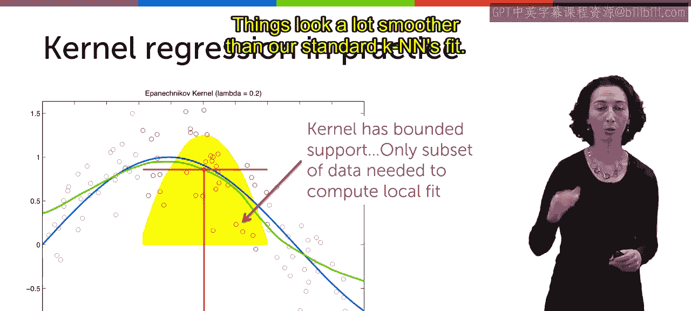
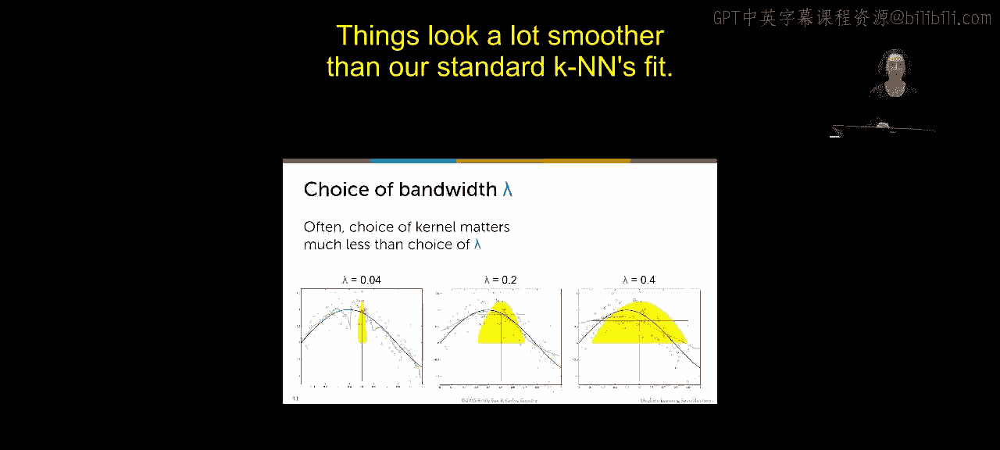
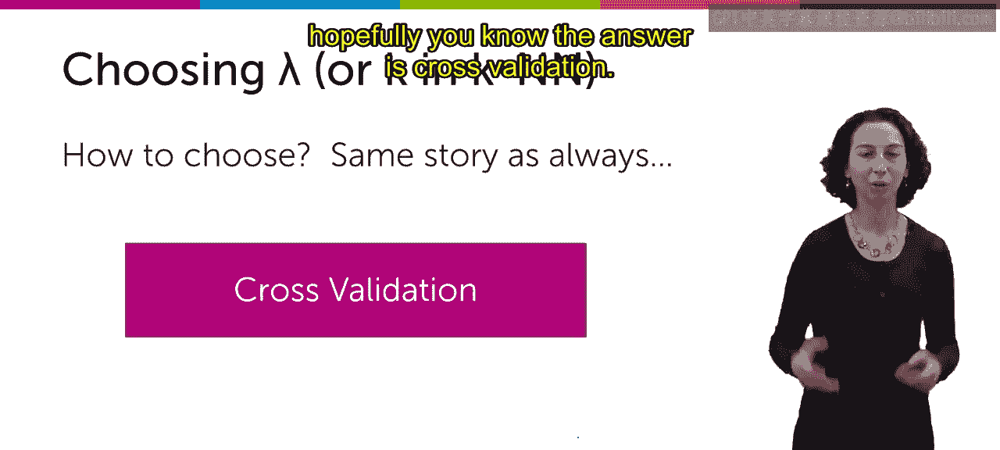

# 华盛顿大学《机器学习（回归，第2课⧸共4课）｜Machine Learning》中英字幕 p108 108_从加权K-NN到核回归.zh_en -BV11b421H7XL_p108-

。

So these ideas lead directly to a related， but slightly a different approach called kernel regression。

Let's start by just recalling what we did for weighted K nearest neighbors and what we did was we took our set of k nearest neighbors and we applied some weight to each nearest neighbor based on how close that neighbor was to our query point well for kernel regression instead of just weighting some set of k nearest neighbors we're going to apply weights to every observation in our training set so in particular our predicted value is going to sum over every observation and we're going to have a weight C subqi on each one of these data points and this weight is going to be defined according to the kernels that we talked about for weighted K nearest neighbors。

And in statistics， this is often called Nadaria Watson Col weighted averages。

 so let's see what effect this kernel regression has in practice and now what we're showing is this yellow curved region represents some kernel that we're choosing in this case it's called the Eetchnikov kernel and what we see are some set of red highlighted observations。

For our given target point in this case called x0 and I want to emphasize that we didn't set a fixed number of observations to highlight as red like we did in arcane nearest neighbors here what we did was we chose a kernel with a given what's called bandwidth that's the lambda parameter we discussed earlier and that defines a region in which our observations are going to be included in our waiting because in this case when we're looking at this epietniov kernel。

 this kernel has。boundunded support and that's in contrast to for example。

 the Galaxian kernel and what that means is that there's some region in which points will have this weighting。

 these decaying sets of weights， and then outside this region。

 the observations are completely discarded from our fit at this one point。

So what we do is at every target point x0 in our input space。

 we weight our observations by this kernel。So we compute this weighted average and we say that is our predicted value。

 we do that at each point in our input space to carve out this green line as our predicted fit。

So the result of this kernel regression isn't very different than what the fit would look like from weighted K nearest neighbors。

 it's just in this case instead of specifying K we're specifying a region based on this kernel bandwidth for weighting the observations to form this fit。

 but what we see is in this case for this kernel regression fit。

 which like I've kind of alluded to should look fairly similar to our weighted K nearest neighbors。

 things look a lot smoother than our standard K nearest neighbors fit。

So there are two important questions when doing kernel regression。

 one is which kernel to use and the other is for giving kernel， what bandwidth should I use。

 but typically the choice of the bandwidth matters much more than the choice of kernel so to motivate this。

 let's just look again at this Eetniov kernel with a couple different choices of bandwidths。

And what we see is that the fit dramatically changes here， for example。We good。

Much wilder overfitting。Here for this lambda value， things look pretty reasonable。

But when we choose a bandwidth that's too large， we start to get over smooththing。

So this is an overs smoothooth fit to the data， not making very good predictions。

So we can think of this in terms of this bias variance tradeoff。

 this lambda parameter is controlling how much we're fitting our observations。

 which is having low bias， but high variance very sensitive to the observations if I change the observations。

 I get a dramatically different fit for kernel regression versus over here for a very large bandwidth。

 it's the opposite， I have very low variance as I'm changing my data。

 I'm not going to change the fit very much， but high bias。

 significant differences relative to the true function which is shown in blue。

But just to show how we're fairly insensitive to the choice of kernel here in this middle plot。

 I'm just going to change the kernel from this Eetchnikov to our box car kernel。

And where the box car kernel， instead of having decaying weights with distance。

 is going to have a fixed set of weights。But we're only going to include observations within some fixed window。

 just like the Eetchnikov kernel。 So this box car kernel starts to look very。

 very similar to our standard k nearest neighbors。 But again。

 instead of fixing what k is you're fixing a neighborhood about your observation。

 But what you see is that although this box car window has these types of discontinuities we saw with can nearest neighbors because observations are either in or they're out。

 the fit looks。The fit looks fairly similar to our Eetchnikov kernel。

 so this is why we're saying that the choice of bandwidth has a much larger impact than the choice of kernel。

So this leads to the next important question of how are we going to choose our bandwidth parameter lambda that we said matters so much。

 or when we're talking about K nearest neighbors， the equivalent parameter we have to choose is k。

 the number of nearest neighbors we're going to look at。And again， in the K nearest neighbors。

 I just want to mention this now， we saw a similar kind of bias variance tradeoff where for one nearest neighbors we saw these crazy wildly overfit functions。

 but once we got to K for some larger K value we had much more reasonable and well behaveved fits。

 so again we have the same type of bias variance trade off for that parameter as well。

And so the question is how are we choosing these tuning parameters for these methods that we're looking at。

 well it's the same story as before， so you don't have to go into the lengthy conversations we've had on this that we've had in past modules。

And hopefully， you know the answer is cross validation or using some validation set assuming you have an updated to do that。

