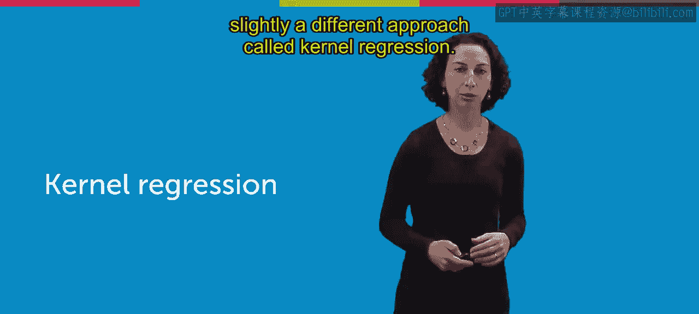
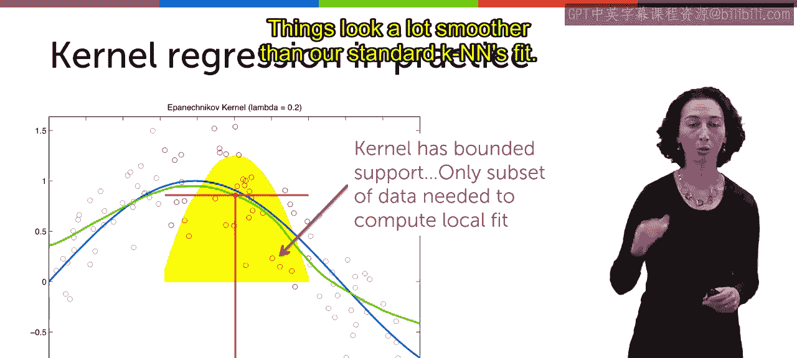
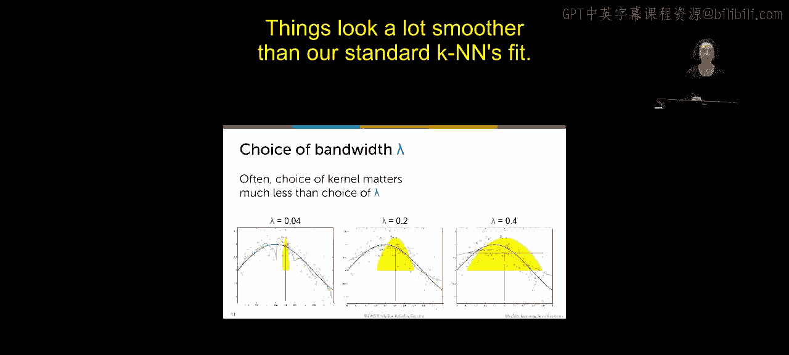
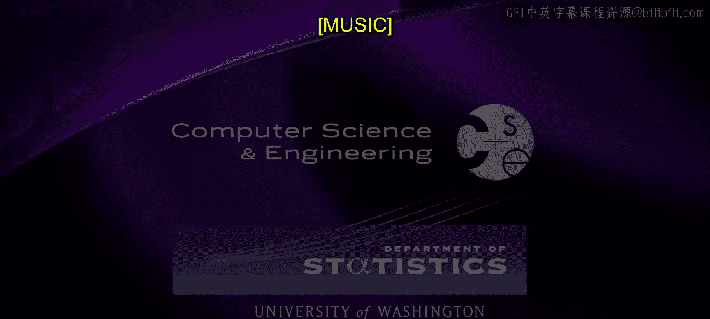

# 机器学习：第2课：从加权K-NN到核回归 📈

在本节课中，我们将学习一种与加权K近邻（K-NN）密切相关但略有不同的方法——核回归。我们将探讨其核心思想、工作原理，以及如何选择关键参数来获得良好的预测效果。

---

上一节我们介绍了加权K-NN，它通过距离为K个最近邻分配权重。本节中，我们来看看核回归如何将这一思想推广到整个训练集。

核回归的核心思想是：**为训练集中的每一个观测值都分配一个权重**，而不仅仅是K个邻居。预测值是通过对所有观测值的加权平均计算得出的。

以下是核回归的预测公式：

**公式：**
`ŷ(x_q) = Σ_i [ C_qi * y_i ]`

其中：
*   `ŷ(x_q)` 是在查询点 `x_q` 处的预测值。
*   `y_i` 是第 `i` 个训练观测的真实值。
*   `C_qi` 是赋予第 `i` 个观测的权重，它由**核函数**和**带宽**参数决定。权重 `C_qi` 通常需要归一化，使得所有权重之和为1。

在统计学中，这种方法常被称为**Nadaraya-Watson核加权平均**。

---

为了理解核回归的实际效果，让我们看一个例子。图中黄色的曲线区域代表我们选择的一个核函数（本例中是Epanechnikov核）。红色高亮的观测点，是针对目标点 `x0` 被赋予显著权重的点。

需要强调的是，这里我们没有像在K-NN中那样固定邻居数量（K）。相反，我们选择了一个具有特定**带宽**（即之前讨论的λ参数）的核函数。这个带宽定义了一个区域，只有落在这个区域内的观测值才会被纳入加权计算。像Epanechnikov这样的核具有**有界支撑**，这意味着权重只在某个区域内非零，区域外的观测点权重完全为零（被丢弃）。这与例如高斯核（权重处处非零）形成对比。

核回归的拟合过程是：在输入空间的每一个目标点 `x0` 处，我们都用这个核函数为所有观测值分配权重，然后计算加权平均值作为该点的预测值。对输入空间中的所有点重复此过程，就得到了图中绿色的预测曲线。

因此，核回归的结果与加权K-NN的拟合看起来差异不大。主要区别在于：这里我们不是指定K值，而是通过核函数的带宽参数来指定一个加权区域。可以看到，核回归（以及加权K-NN）的拟合结果比标准K-NN的拟合要平滑得多。

---

进行核回归时，有两个重要问题：
1.  使用哪种核函数？
2.  对于给定的核函数，应该选择多大的带宽？

通常，**带宽的选择比核函数本身的选择重要得多**。为了说明这一点，让我们看看Epanechnikov核在不同带宽下的表现。

以下是不同带宽对拟合效果的影响：
*   **带宽过小（λ太小）**：拟合曲线会剧烈波动，对数据**过拟合**，方差高，偏差低。
*   **带宽适中（λ合理）**：拟合曲线看起来比较合理，能捕捉趋势又不过度波动。
*   **带宽过大（λ太大）**：拟合曲线会变得**过度平滑**，无法很好地反映数据的细节，偏差高，方差低。

这体现了经典的**偏差-方差权衡**。带宽参数λ控制着我们对观测数据的拟合程度。λ小则拟合紧密（低偏差，高方差）；λ大则拟合平滑（高偏差，低方差）。图中蓝色曲线代表真实的潜在函数。

为了说明我们对核函数的选择相对不敏感，我们将中间图中的Epanechnikov核换成**方窗核**。方窗核在其定义的窗口内赋予固定权重，窗口外权重为零，这看起来非常像标准K-NN（但固定的是区域大小而非邻居数量K）。尽管方窗核由于“非入即出”的特性会产生不连续性，但其整体拟合曲线与Epanechnikov核的结果非常相似。这正说明了带宽的选择比核函数类型的选择影响更大。

---

这引出了下一个关键问题：我们如何选择这个至关重要的带宽参数λ？对于K近邻法，等价的问题是如何选择邻居数量K。

在K-NN中，我们同样看到了偏差-方差权衡：当K=1时，拟合曲线疯狂地过拟合；当K取一个较大的合理值时，拟合结果则更稳定、表现更好。

那么，我们如何为这些方法选择调优参数（λ或K）呢？答案与之前讨论过的一样：**交叉验证**，或者在数据充足时使用**验证集**。通过评估模型在未见数据上的表现，我们可以选择出使预测误差最小的参数值。

---

本节课中我们一起学习了核回归方法。我们从回顾加权K-NN出发，了解了核回归通过为所有训练样本赋权来进行预测的核心思想。我们重点讨论了带宽参数的关键作用及其背后的偏差-方差权衡原理，并认识到带宽的选择比核函数类型的选择更为重要。最后，我们指出交叉验证是选择此类模型超参数（如带宽λ或邻居数K）的标准且有效的方法。