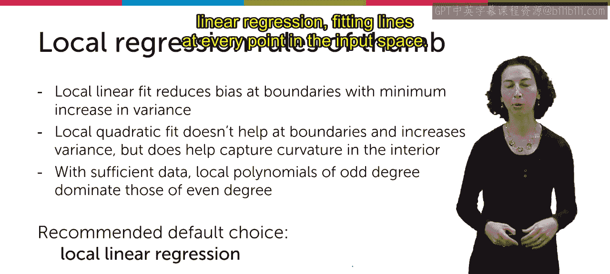

# 华盛顿大学《机器学习（回归，第2课⧸共4课）｜Machine Learning》中英字幕 p109 109_参数模型的全局拟合vs核回归的局部拟合.zh_en -BV11b421H7XL_p109-

。

At the beginning of this module， we talked about this idea of fitting globally versus fitting locally Now that we've seen K nearest neighbors in colonel regression。

 I want to formalize this idea。So in particular， let's look at what happens when we just fit a constant function to our data。

So in that case， that's just computing what's called a global average where we take all of our observations。

 add them together， and take the average or just divide by that total number of observations。

 so that's exactly equivalent to summing over a weighted set of our observations where the weights are exactly the same on each of our data points and then dividing by the total sum of these weights。

So now that we've put our global average in this form。

 things start to look very similar to the kernel regression ideas that we've looked at。

Where here it's almost like kernel regression， but we're including every observation in our fit and we're having exactly the same weights on every observation so that's like using this box car kernel that puts the same weights on all observations and just having a really really massively large bandwidth parameter such that for every point in our input space。

All the other observations are going to be included in the fit。

But now let's contrast that with a more standard version of kernel regression。

 which leads to what we're going to think of as locally constant fits。

Because if we look at the kernel regression equation。

 what we see is that it's exactly what we had for our global average。

 but now it's going to be weighted by this kernel where in a lot of cases what that kernel is doing is it's putting a hard limit that some observations outside of our window。

Ofro whatever target point we're looking at are out of our calculation。

 so the simplest case we can talk about is this box car kernel that's going to put equal weights over all observations。

 but just local to our target point x0。And so we're going to get a constant fit。

But just at that one target point and then we're going to get a different constant fit at the next target point and the next one and the next one。

 and I want to be clear that the resulting output isn't a staircase kind of function or' not it's not a collection of these constant fits。

It is a collection of the constant fits， but just at a single point， so we're taking a single point。

 doing another constant fit， taking the single point， which is at that target。

And as we're doing this over all our different inputs， that's what's defining this green curve。Okay。

 but if we look at another kernel， like our Eetnikov kernel that has the weights decaying over this fixed region。

嗯。Well， it is still doing a constant fit， but how is it figuring out what the level of that line should be？

At our target point well what it's doing is it's just down weighting observations that are further from our target point and emphasizing more heavily the observations close to our target point so this is just a weighted global average but it's no longer global it's local because we're only looking at observations within this defined window so we're doing this weighted average locally at each one of our input points and tracing out this green curve。

So this hopefully makes very clear how before in the types of linear regression models we are talking about。

 we are doing these global fits， which in the simplest case was just a constant model that was our。

Most basic model we could consider having just the constant feature。

And now what we're talking about is doing exactly the same thing but locally and so locally that it's at every single point in our input space。

So this kernel regression method that we've described so far。

 we've now motivated as fitting a constant function locally at each observation。

 well more than each observation， each point in our input space。

 and this is referred to as locally weighted averages。

But instead of fitting a constant at each point in our input space。

 we could have likewise fit a line or a polynomial。

 and so what this leads to is something that's called locally weighted linear regression。

And we're not going to go through the details of locally weighted linear regression in this module。

 it's fairly straightforward is a similar idea to these local constant fits but now plugging in a line or a polynomial but I wanted to leave you with a couple rules of thumbs for which fit you might choose between the set of different polynomials that you have options over and one thing that fitting a local line instead of a local constant helps you with are those boundary effects that we talked about before。

 the fact that you get these large biases at the boundary。

So you can show very formally that these local linear fits help with that bias and if we talk about local quadratic fits。

 that helps with bias that you get at points of curvature in the interior view space。

 so for example we have that blue curve we've been trying to fit。And if we go back。

 maybe it's worth quickly jumping back to what our fit looks like。

 we see that towards the boundary we get large biases and right at the point of curvature we also have a bias where we're underfitting the true curvature of that blue function and so the local quadratic fit helps with fitting that curvature。

 but what it does is it actually leads to larger variance so that can be unattractive。

 so in general just。Basic recommendation is to use just standard local linear regression fitting lines at every point in the input space。

