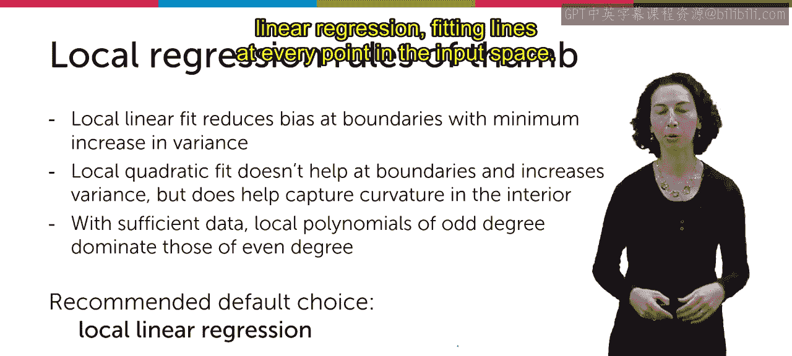
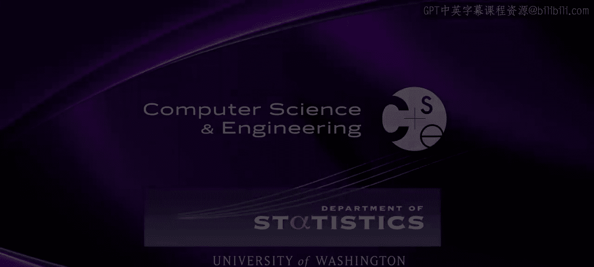

# 机器学习：第2课：全局拟合与局部拟合

在本节课中，我们将学习参数化模型与核回归方法在拟合数据时的核心区别：全局拟合与局部拟合。我们将从最简单的常数拟合开始，逐步理解核回归如何实现局部加权平均，并简要探讨其扩展形式——局部加权线性回归。

---

## 全局拟合：常数模型

上一节我们介绍了K近邻与核回归的基本概念。本节中，我们首先来看一种最简单的拟合方式：用常数函数拟合数据。

这被称为计算**全局平均值**。具体做法是，取所有观测值，将它们相加，然后除以观测值的总数。

用公式表示，即：
`全局平均值 = (观测值1 + 观测值2 + ... + 观测值N) / N`

这个公式也可以写成加权和的形式，其中每个数据点的权重完全相同，然后除以所有权重的总和。当我们以这种形式来看待全局平均值时，它就开始与核回归的思想非常相似了。

---

## 从全局到局部：核回归的思想

以下是核回归与全局平均的关键对比：

*   **全局平均（常数模型）**：这类似于使用一个**箱型核函数**，该核函数为所有观测点分配完全相同的权重，并且使用一个**极大的带宽参数**。结果是，对于输入空间中的每一个点，拟合时都包含了**所有**其他观测点。
*   **标准核回归（局部常数拟合）**：现在我们来看更标准的核回归公式。它与全局平均公式形式一致，但权重由核函数决定。核函数的作用通常是设定一个硬性界限，只考虑目标点 `x0` 附近一个窗口内的观测值。

最简单的例子是**局部箱型核**，它为目标点 `x0` 附近的所有观测点分配相等的权重。这样，我们在 `x0` 处得到一个常数拟合值。然后，我们在下一个目标点进行同样的操作，得到另一个常数拟合值，依此类推。

需要明确的是，最终的输出并不是一个阶梯函数，也不是这些常数块的集合。我们是在**每一个独立的点**上分别进行一次局部常数拟合，所有这些拟合点的连线就构成了图中绿色的拟合曲线。

如果使用另一个核函数，例如**爱普尼科夫核**，权重会在固定区域内衰减。它仍然是在进行常数拟合，但它通过**降低远离目标点的观测值的权重**，**提高靠近目标点的观测值的权重**来确定这条水平线的高度。这本质上是一个**加权**的平均，并且由于只考虑了定义窗口内的观测值，所以它是**局部**的。我们在输入空间的每一个点上进行这种局部加权平均，从而描绘出绿色的曲线。

---

## 局部拟合的扩展：从常数到多项式

到目前为止，我们所描述的核回归方法，其动机可以理解为在输入空间的**每一个点**上局部地拟合一个常数函数。这被称为**局部加权平均**。

然而，我们不一定非要在每个点拟合一个常数。同理，我们也可以在局部拟合一条**直线**或一个**多项式**。这就引出了**局部加权线性回归**的概念。

本模块不会深入探讨局部加权线性回归的细节，但其思想与局部常数拟合类似，只是将常数替换为直线或多项式。这里，我们提供一些关于如何在不同阶数多项式之间进行选择的经验法则：

*   **局部线性拟合 vs 局部常数拟合**：使用局部直线而非局部常数，有助于缓解我们之前讨论过的**边界效应**问题，即边界处存在的较大偏差。可以严格证明，局部线性拟合能有效减少这种偏差。
*   **局部二次拟合**：局部二次拟合有助于减少在输入空间内部**曲率变化点**处产生的偏差。例如，在我们一直试图拟合的蓝色曲线中，曲率变化点处存在欠拟合真实曲率的情况。局部二次拟合能更好地捕捉这种曲率。
*   **权衡**：但局部二次拟合通常会导致**方差增大**，这可能是一个缺点。

因此，一个基本的通用建议是：使用标准的**局部线性回归**，即在输入空间的每个点拟合一条直线。

---

## 总结

本节课中，我们一起学习了机器学习中两种核心的拟合策略。我们首先回顾了参数化模型的**全局拟合**思想，并以最简单的常数模型为例。然后，我们深入探讨了核回归所代表的**局部拟合**思想，看到它如何通过在每一个输入点进行局部加权平均来实现灵活的拟合。最后，我们了解到这种思想可以从局部常数扩展到局部线性甚至多项式拟合，并了解了不同选择在偏差与方差之间的权衡。理解全局与局部的区别，是掌握多种回归方法的关键。