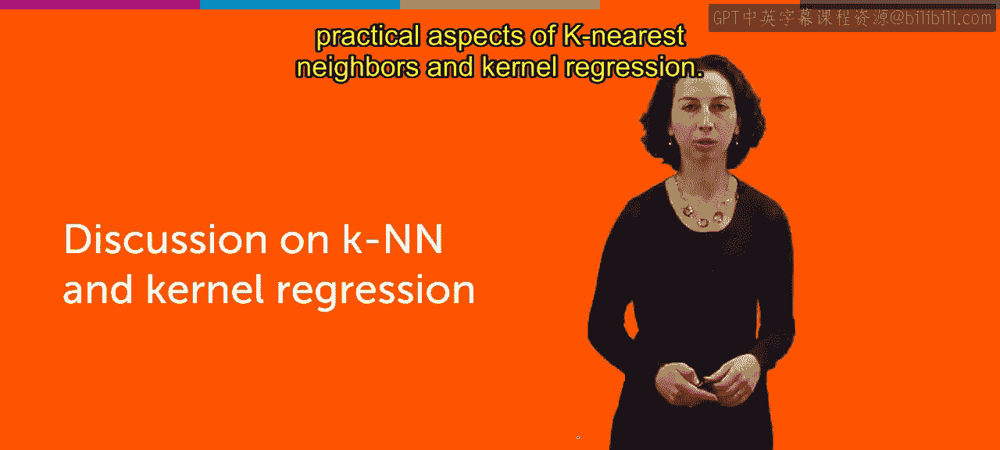
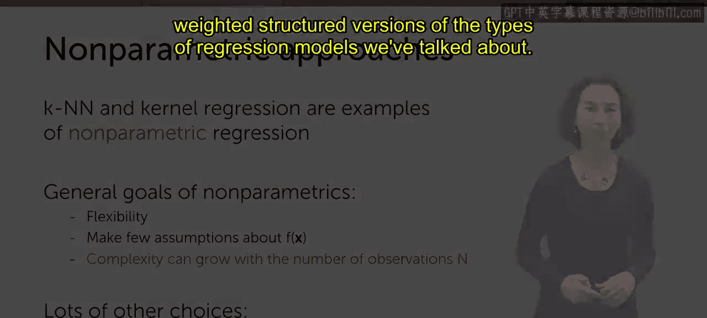
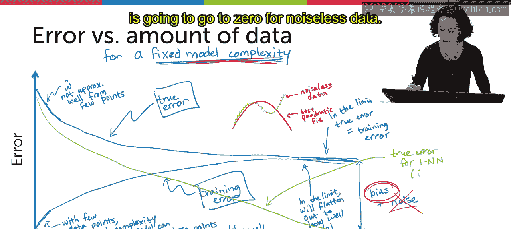
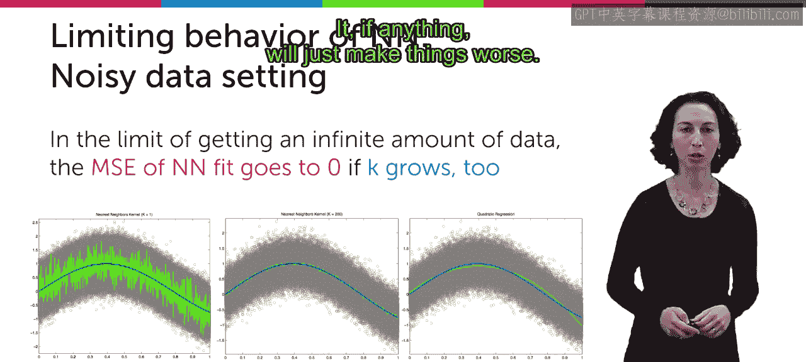
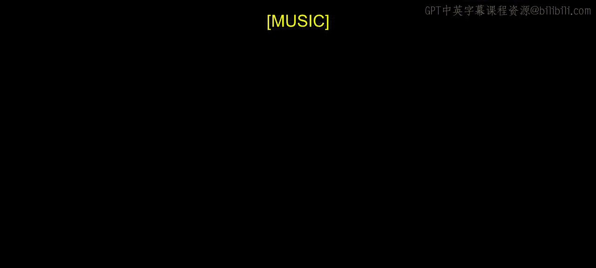

# 华盛顿大学《机器学习（回归，第2课⧸共4课）｜Machine Learning》中英字幕 p110 110_随数据量增加NN的性能.zh_en -BV11b421H7XL_p110-

。

So now let's step back and discuss some important theoretical and practical aspects of key nearest neighbors and kernel regression。

If you remember the title of this module， it was calledGoing Noparmetric。

 and we've yet to mention what that means， what is a non parametric approach。Well。

 Can nearest neighbors and kernel regression are examples of non-parametric approaches and the general goal of a nonparametric approach is to be really flexible in how you're defining f of x in particular you want to make as few assumptions as possible and the really key thing that defines a nonparametric method is that the complexity of the fit can grow as you get more data points and we've definitely seen that with Can nearest neighbors in kernel regression in particular the fit is a function of how many observations you have but these are just two examples of non-parametric methods you might use for regression。

 there are lots of other choices， things like splines and trees which we'll talk about in the classification course and locally weighted structured versions of the types of regression models we've talked about so nonparmetrics is all about this idea of having the complexity grow with the number of observations。

So now let's talk about what's the limiting behavior of nearest neighbor regression as you get more and more data and to start with let's just assume that we get completely noiseless data。

 so every observation we get lies exactly on the true function。Well in this case。

 the mean squared error of one nearest neighbor regression goes to zero as you get more and more data。

But let's just remember what mean squared error is and if you remember from a couple of modules ago。

 we talked about this bias variance trade off and that mean squared error is the sum of bias squared plus variance。

 so having mean squared error go to zero means that both bias and variance are going to zero。

So to motivate this visually， let's just look at a couple movies here in this movie I'm showing what the one nearest neighbor fit looks like as we're getting more and more data。

 so remember the blue line is our true curve。The green line is our current nearest neighbor fit based on some set of observations that are going to lie exactly on the true function。

 that blue curve。Okay， so here's our fit changing as we get more and more data and what you see is that it's getting closer and closer and closer and closer and closer to the true function and hopefully you can believe that in the limit of getting an infinite number of observations spread over our input space。

 this nearest neighbor fit is going to lie exactly on top of the true function。

 and that's true for all possible data sets of infinite number of observations that we would get。

But in contrast， if we look at what just doing a standard quadratic fit。

 just our standard least squares fit we talked about before， no matter how much data we get。

There's always going to be some bias so we can see this here where especially at this point of curvature。

 we see that this green fit， even as we get lots and lots of observations is never matching up to that true blue curve and that's because that true blue curve that's actually part of a sinusoid we've just zoomed in on a certain region of that sinusoid and so this quadratic fit is never exactly going to describe what a sinusoid is describing。

So this is what we talked about before about the bias that's inherent。In our model。

 even if we have no noise， so even if we eliminate this noise。

 we still have the fact that our true error as we're getting more and more and more and more data is never going to go exactly to zero。

Unless， of course the data were generated from exactly the model that we're using to fit the data。

 but in most cases， for example， maybe you have data。That looks like the following。 So this is。

Are noiseless。Data and if we constrain our， this was all for fixed model complexity， remember。

 if we constrain our model， let's say to be a quadratic。Then， maybe。Maybe this will be our。

Best quadratic fit。And no matter how many observations I give you from this more complicated function。

 this quadratic is never going to have zero bias。In contrast。

 let's switch colors here so that we can draw our one nearest neighbor fit。Our one nearest neighbor。

As we get more and more data。It's fitting these。Constance locally to each observation。

And as we get more and more and more data， the fit is going to look exactly like the true curve。

And so when we talk about our true error。With increasing number of observations。Our true error。

For this is a plot of。True error。For one nearest neighbor is going go to 0。

4 noiseless data。

But now let's talk about the noisy case， this is the case that we're typically faced with in most applications and in this case。

 what you can say is that the mean squared error of nearest neighbor regression goes to zero。

 if you allow the number of neighbors are the K in our nearest neighbor regression to increase with the number of observations as well。

 because if you think about getting tons and tons and tons of observations， if you keep k fixed。

You're just going to be looking at a very， very， very local region of your input space and you're going to have a lot of noise introduced from that。

 but if you allow K to grow， it's going to smooth over the noise that's being introduced。

 so let's look at a visualization of this。So here， what we're showing is the same true function we've shown throughout this module。

But we're showing tons of observations， all these gray dots。

 but they're noisy observations are no longer lying exactly on that blue curve。

 that's why they're this cloud of blue points and we see that our one nearest neighbor fit is very。

 very noisy okay it has this wild behavior because like we discussed before。

 one nearest neighbor is very sensitive to noise in the data。But in contrast。

 if we look at a large K， so here we're looking at k equals 200s or 200 nearest neighbors fit。

It looks much， much better， so you can imagine that as you get more and more observations。

 if you're allowing k to row， you can smooth over the noise being introduced by each one of these observations and have the mean squared error going to zero。

But in contrast， again， if we look at just our standard least squares regression here in this case of a quadratic fit。

 we're always going to have bias， so nothing's different by having introduced noise if anything will just make things worse。

