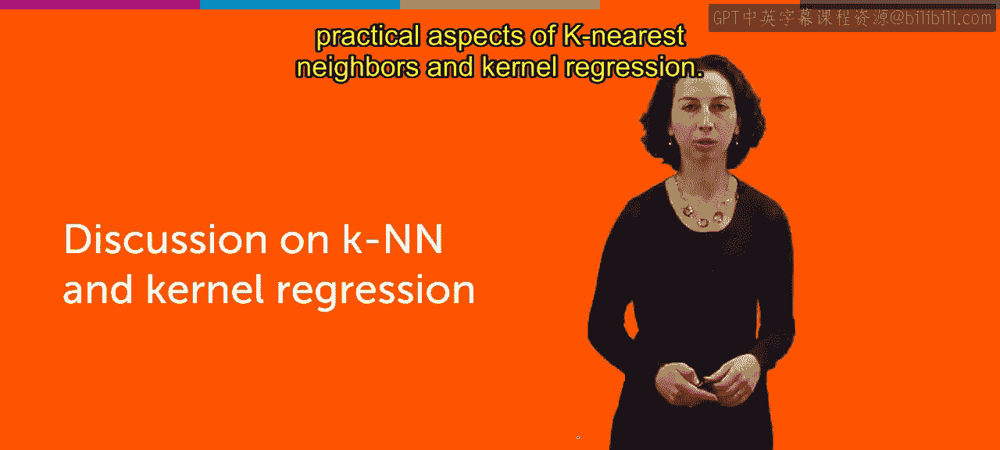
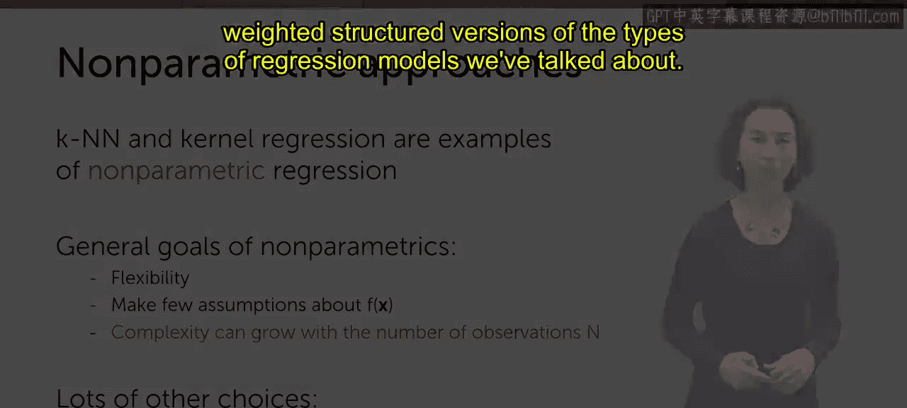
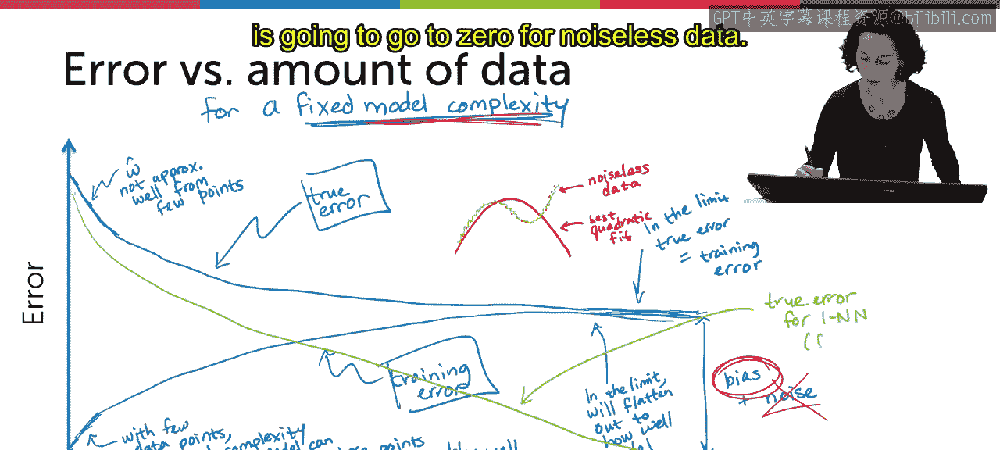
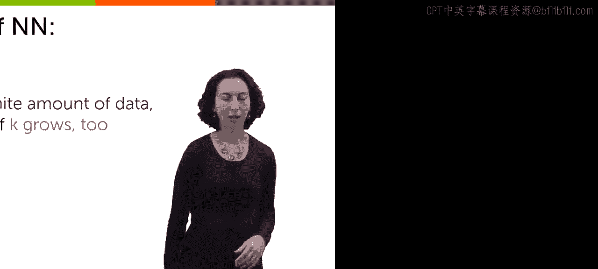
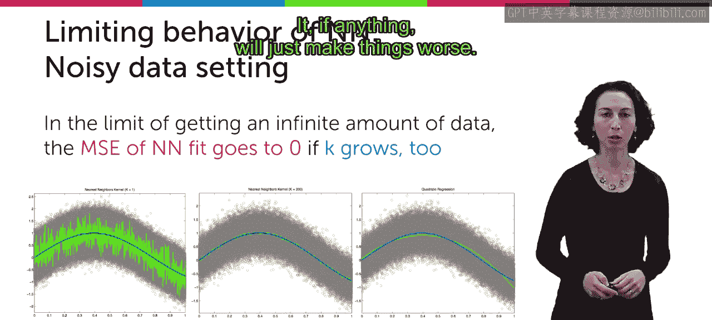

# 机器学习（回归）：第2课：非参数方法与最近邻回归的性能分析 🧠

在本节课中，我们将要学习非参数方法的核心概念，并深入探讨最近邻回归在数据量增加时的性能表现。我们将分析其在无噪声和有噪声数据下的极限行为，理解其与参数化方法的根本区别。

---

## 非参数方法简介

上一节我们介绍了最近邻和核回归，本节中我们来看看它们所属的类别——非参数方法。

非参数方法的目标是在定义函数 **f(x)** 时保持高度灵活性，其核心是**尽可能少地做出假设**。定义非参数方法的一个关键特性是：**模型的复杂度可以随着数据点的增加而增长**。我们已经在最近邻和核回归中看到了这一点，其拟合结果直接依赖于观测数据的数量。

除了最近邻和核回归，非参数方法还包括样条、决策树（将在分类课程中讨论）以及我们已讨论过的回归模型的局部加权版本等。非参数方法的核心理念就是让模型复杂度随观测数据量一同增长。

---

## 无噪声数据下的最近邻回归

现在，让我们来探讨当数据量不断增加时，最近邻回归的极限行为。首先，我们假设获得的数据是完全无噪声的，即每个观测点都精确地落在真实函数上。

在这种情况下，**1-最近邻回归的均方误差（MSE）会随着数据量的增加而趋近于零**。回顾一下，均方误差是**偏差平方**与**方差**之和（`MSE = Bias² + Variance`）。MSE趋近于零意味着偏差和方差都趋近于零。

为了直观地理解这一点，请看下面的动态演示。蓝线代表真实曲线，绿线是基于恰好落在真实函数（蓝线）上的一组观测点得到的当前1-最近邻拟合结果。

随着我们获得越来越多的数据，拟合曲线越来越接近真实函数。可以相信，在输入空间中获得无限多个观测点的极限情况下，最近邻拟合将**完全覆盖在真实函数之上**。这对于我们可能获得的所有无限观测数据集都是成立的。

相比之下，如果我们使用标准的二次拟合（即之前讨论的标准最小二乘拟合），无论获得多少数据，总会存在一些偏差。我们可以看到，尤其是在曲线的弯曲点，即使获得大量观测数据，绿色拟合线也永远不会与真实的蓝色曲线完全匹配。这是因为真实的蓝色曲线实际上是正弦函数的一部分，而二次拟合永远无法精确描述正弦函数。

这就是我们之前讨论的模型固有偏差。即使消除了噪声，随着数据量无限增加，我们的真实误差也永远不会精确地变为零——除非数据恰好是由我们用于拟合的模型生成的，但这在大多数情况下并不成立。

---

## 有噪声数据下的最近邻回归

现在我们来讨论更常见的有噪声情况。在大多数实际应用中，我们面对的都是有噪声的数据。

在这种情况下，可以证明：**只有当最近邻回归中的邻居数量K也随着观测数据量的增加而增加时，其均方误差才会趋近于零**。试想，如果你获得了海量数据但保持K固定，你只会关注输入空间中一个非常局部的区域，并且会引入大量噪声。但如果允许K增长，它就能平滑掉由每个观测点引入的噪声。

让我们通过可视化来理解这一点。下图展示了本模块中一直使用的同一个真实函数，但观测点（灰色点）是有噪声的，它们不再精确地位于蓝色曲线上，因此形成了一片点云。

我们可以看到，1-最近邻拟合结果非常嘈杂，表现出剧烈的波动，正如我们之前讨论的，1-最近邻对数据中的噪声非常敏感。

相反，如果我们观察一个较大的K值（例如K=200的200-最近邻拟合），结果看起来要好得多。可以想象，随着观测数据越来越多，如果你允许K增长，就可以平滑掉每个观测点引入的噪声，从而使均方误差趋近于零。

再次对比，如果我们观察标准最小二乘回归（本例中是二次拟合），我们将始终存在偏差。引入噪声并不会改变这一点，甚至可能使情况变得更糟。

---

## 总结

本节课中我们一起学习了非参数方法的核心思想，并重点分析了最近邻回归的性能。我们了解到：

1.  **非参数方法**（如最近邻、核回归）的模型复杂度会随数据量增长，从而提供了极大的灵活性。
2.  在**无噪声数据**下，1-最近邻回归的拟合结果会随着数据量无限增加而**收敛到真实函数**，其均方误差趋近于零。
3.  在**有噪声数据**下，为了达到同样的效果，必须让最近邻的数目**K也随数据量一同增加**，以平滑噪声的影响。
4.  相比之下，**参数化方法**（如固定次数的多项式回归）存在**固有偏差**，即使数据量无限增加，其误差也不会降至零（除非模型设定完全正确）。

理解这些理论特性，有助于我们在实践中根据数据的噪声水平和可获得的数据量，在模型的灵活性与稳定性之间做出明智的权衡。