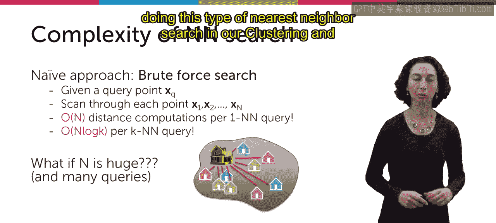

# 华盛顿大学《机器学习（回归，第2课⧸共4课）｜Machine Learning》中英字幕 p111 111_高维问题：数据稀疏性和计算复杂度.zh_en -BV11b421H7XL_p111-

。

So we've talked about the performance of nearest neighbor regression as you get tons and tons of observations and things look pretty good in that case。

 actually amazingly good， but the picture isn't quite as nice when we start increasing the dimension of our input space or if we just have a limited set of observations because the performance of nearest neighbors regression as we've talked about before is very sensitive to。

How well the data covers the input space， so if you remember we had this plot early on where we just removed observations from some point of our input space and we got a pretty bad one nearest neighbor fit Well now imagine you have a huge really。

 really high dimensional space that you're looking at。

And you need your observations to cover all points within this space Well you're going to need an exponentially large number of observations in the dimension of the space you're looking at in order to cover this space and have good nearest neighbor performance and that's typically really hard to do to have as many observations as you would need in these high- dimensionmenal spaces So the cases where you have limited data relative to the dimension of the input space you're looking at is where these parametric models that we've talked about throughout the rest of this course becomes so important and another thing that's important to talk about is the complexity of our nearest neighbor search and the naive type of algorithm that we've talked about so far。

 which is just our brute force search through our entire data can be quite computationally intensive so for example。

 if you have just one query point Xq and you're just doing one nearest neighbor search you have to scan。

through every single observation in your data and compute the distance to each one of those observations。

 so going from our query house to each one of the different houses in our data。

 computing this similarity between these houses in order to find the nearest neighbor and so that has complexity that's linear in the number of observations that we have。

 or if we want to do our K nearest neighbors approach。

We have to maintain a list of the k nearest neighbors and if you do this in this sortded queue that we've talked about。

 then you can do this search in order n log K， but both of these。

 either for our one nearest neighbor or k nearest neighbor have complexity linear in the number of observations we have。

 but what if n is huge because this is the situation where we've said these k nearest neighbor approaches work so well？

Well that can be really， really intensive to do， especially if you have to do many queries。

 so if you want to predict the values at many points in your input space， this can be a really。

 really intensive procedure。So instead， we're going to talk about more efficient methods for doing this type of nearest neighbor search in our clustering and retrieval course later in the specialization。

