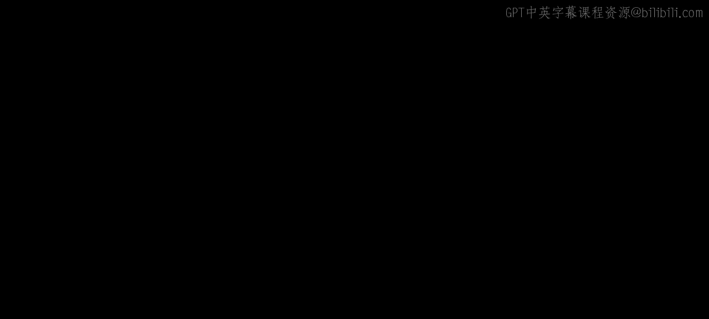
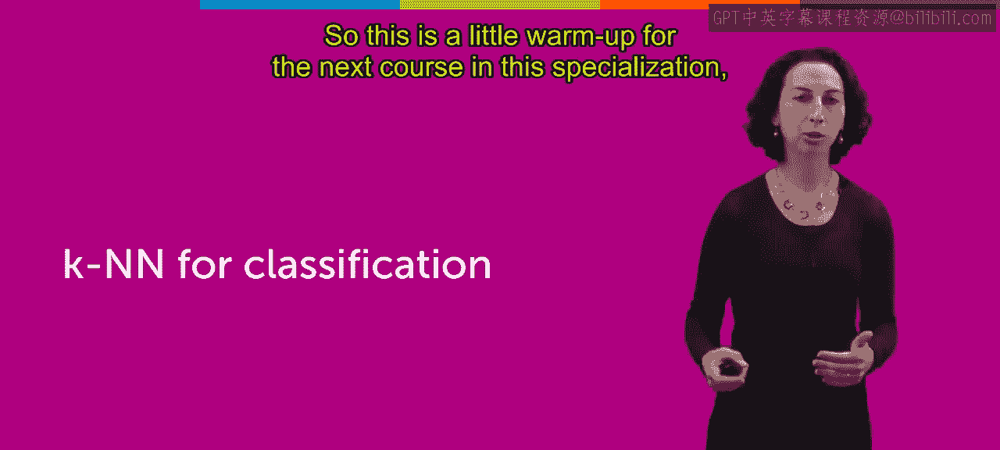
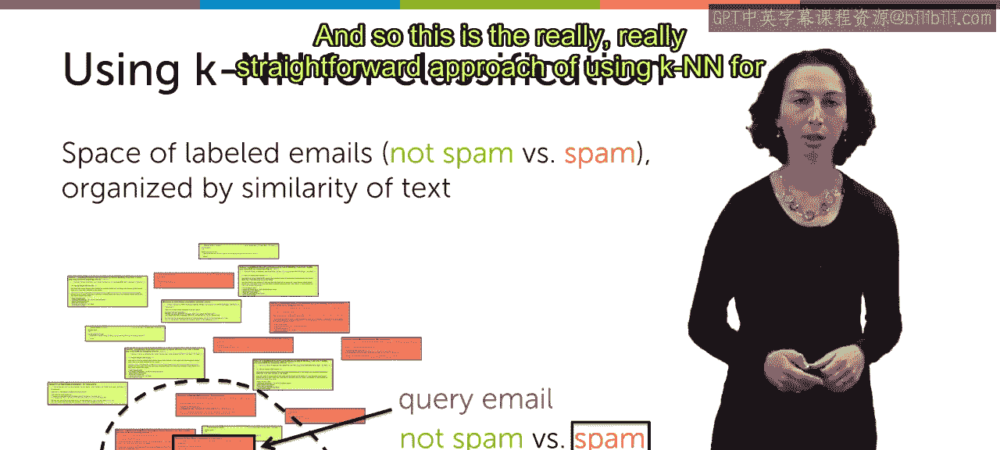

# 华盛顿大学《机器学习（回归，第2课⧸共4课）｜Machine Learning》中英字幕 p112 112_用于分类的K-NN.zh_en -BV11b421H7XL_p112-

。

So we've talked about using K nearest neighbors for regression， but these methods can also be very。

 very straightforwardly used for classification， so this is a little warm up for the next course and the best realization。

 which is our classification course。

And let's start out by just recalling our classification task where we're going to do this in the context of spam filtering where we have some email as our input。

 and the output is going to be whether the email is spam or not spam。

 and we're going to make this decision based on the text of the email。

 maybe information about the sender， IP and things like this。

Well what we can do is use K nearest neighbors for classification visually we can think about just taking all of the emails that we have labeled as spam or not spam and throwing them down in some space where the distance between emails in this space represents how similar the text or the sender IP information is。

 all the inputs or the features we're using to represent these emails。

And then what we can do is we get some query email that comes in。

 so that's this little gray email here and we're going to say is it spam or not spam。

There's a very intuitive way to do this， which is just search for the nearest neighbors of this email。

 the email is most similar to this email。And then we're just going to do a majority vote on the nearest neighbors to decide whether this email is spam or not spam and what we see in this case is that four of the neighbors are spam and only one neighbor is not spam。

 so we're going to label this email as spam， and so this is the really。

 really straightforward approach of using Ka nearest neighbors for classification。

