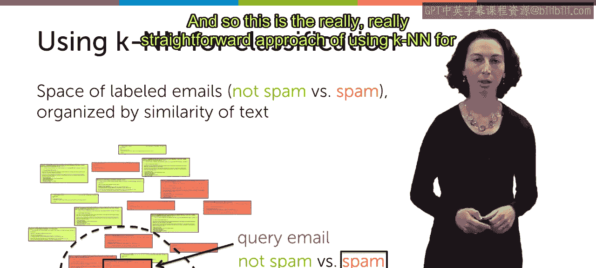

# 机器学习：第2课：用于分类的K-NN


在本节课中，我们将学习如何将K最近邻（K-NN）算法应用于分类问题。我们将以垃圾邮件过滤为例，介绍其核心思想、具体步骤以及实现方式。

## 概述


上一节我们介绍了K-NN在回归问题中的应用。本节中我们来看看如何将这一方法用于分类任务。分类与回归的核心区别在于，我们的预测目标是离散的类别标签，而不是连续的数值。我们将通过一个直观的例子——垃圾邮件分类——来理解这个过程。

## 分类任务与K-NN

我们的任务是构建一个垃圾邮件过滤器。输入是一封电子邮件，输出是一个类别标签：**垃圾邮件**或**非垃圾邮件**。这个决策将基于邮件的文本内容、发件人信息、IP地址等特征。

K-NN分类的直观想法是：将所有已标记为“垃圾邮件”或“非垃圾邮件”的邮件样本放置在一个特征空间中。在这个空间里，邮件之间的距离代表了它们在特征（如文本相似度）上的差异。

当我们收到一封新的查询邮件时，我们就在这个特征空间中找到它的K个最近邻（即最相似的K封已知邮件）。然后，我们通过这K个邻居的类别进行**多数投票**，来决定新邮件的类别。

## K-NN分类步骤

以下是使用K-NN进行分类的具体步骤：

1.  **数据准备与表示**：将每封邮件转化为特征向量。例如，可以使用词袋模型来表示文本。
2.  **距离计算**：为查询邮件计算它与训练数据集中所有邮件的距离。常用的距离度量是**欧几里得距离**。
    **公式**：`distance(x, y) = sqrt( sum( (x_i - y_i)^2 ) )`
3.  **寻找邻居**：根据计算出的距离，找出距离查询邮件最近的K个训练样本。
4.  **多数投票**：统计这K个邻居中属于每个类别的数量。将查询邮件分配给数量最多的那个类别。
    **代码逻辑**：
    ```python
    # 假设 neighbors_labels 是K个邻居的标签列表
    predicted_label = max(set(neighbors_labels), key=neighbors_labels.count)
    ```

## 一个具体例子

假设我们有一封待分类的灰色邮件。在特征空间中，我们找到它的5个最近邻（K=5）。其中4个邻居被标记为“垃圾邮件”，1个被标记为“非垃圾邮件”。

通过多数投票，我们预测这封查询邮件为**垃圾邮件**。这个方法非常直观且易于理解。

## 总结



本节课中我们一起学习了K最近邻算法在分类问题上的应用。核心思想是“物以类聚”——通过查找特征空间中最近的已知样本，并用它们的类别标签进行多数投票，来预测新样本的类别。我们以垃圾邮件分类为例，介绍了从数据表示、距离计算到多数投票的完整流程。下一节，我们将深入探讨更专门的分类算法。