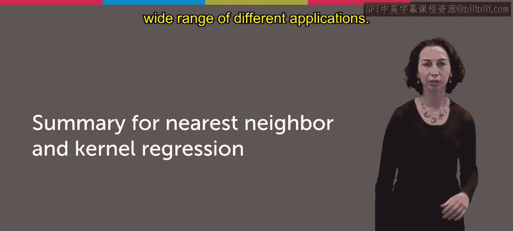

# 华盛顿大学《机器学习（回归，第2课⧸共4课）｜Machine Learning》中英字幕 p113 113_简要回顾.zh_en -BV11b421H7XL_p113-

。

So in summary， we've talked about nearest neighbor and kernel regression。

 and these are as we've seen really simple approaches。

 very simple to think about intuitively and really simple to implement in practice。

 but they have surprisingly good performance in just a very wide range of different applications。

And some things in particular that we talked about in this module are how to perform one nearest neighbor or k nearest neighbor regression。

 and we also talked about ideas of weighting our k nearest neighbors leading us this idea of doing kernel regression and for this。

 there was this choice of our bandwidth parameter which is kind of akin to the K and k nearest neighbors and we said we could just choose this using crossvalation。

 and then we talked about some of the theoretical and practical aspects of k nearest neighbors and kernel regression。

 talking about some really nice properties of k nearest neighbors as you get lots and lots of data。

 but also some computational challenges that you run into and challenges you run into if you don't have a lot of data or if you're in really high dimensional input spaces。

And finally， we talked about how one can use Can nearest neighbors for classification。

 and we're going to talk a lot more about classification in the next course。

 which is all about classification， so stay tuned for that course。

