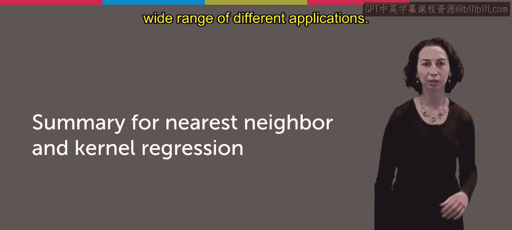

# 机器学习：第2课：简要回顾 🧠

在本节课中，我们将对最近邻与核回归方法进行总结，回顾其核心概念、应用与挑战。

---

## 概述

本节将总结最近邻与核回归方法。这些方法直观易懂，实现简单，且在众多应用中表现出色。我们将回顾其核心操作、参数选择、理论性质、实践挑战，以及如何将其应用于分类问题。

---

## 核心方法回顾

上一节我们介绍了最近邻与核回归的基本思想。本节中，我们来看看这些方法的具体要点。

以下是本模块讨论的核心内容：

*   **最近邻回归**：我们学习了如何执行**1-最近邻**或 **k-最近邻回归**。其核心思想是，对于一个查询点，找到训练集中与其最接近的k个邻居，并用这些邻居目标值的（加权）平均值作为预测。对于k-最近邻回归，预测公式可表示为：
    `ŷ = (1/k) * Σ(y_i)`，其中求和针对k个最近邻。
*   **核回归**：我们探讨了为k个最近邻赋予不同权重的思想，这引出了**核回归**的概念。核回归使用一个核函数（如高斯核）来根据距离远近为所有数据点分配权重，距离越近权重越高。其预测公式通常为：
    `ŷ = Σ( K( (x - x_i) / h ) * y_i ) / Σ( K( (x - x_i) / h ) )`，其中`K`是核函数，`h`是带宽参数。
*   **参数选择**：对于核回归，存在一个关键的**带宽参数**选择，这类似于k-最近邻中的**K值**。我们提到，可以使用**交叉验证**方法来选择这些参数，以在验证集上获得最佳性能。
*   **性质与挑战**：我们讨论了k-最近邻与核回归的一些理论和实践方面。当拥有海量数据时，k-最近邻具有非常良好的理论性质。然而，我们也会遇到一些计算上的挑战，以及在数据量不足或输入空间维度极高时面临的困难。

---

## 方法拓展：分类问题

最后，我们讨论了如何将k-最近邻方法应用于**分类**问题。其基本思路与回归类似，但对于一个查询点，我们将其k个最近邻中最常见的类别作为预测类别。

我们将在下一门专门讲解分类的课程中更深入地探讨分类问题。

---

## 总结

本节课中，我们一起学习了最近邻与核回归方法。我们回顾了它们的实现方式、参数选择策略、优缺点以及向分类问题的拓展。这些方法以其简单性和广泛适用性，构成了机器学习工具箱中的重要组成部分。