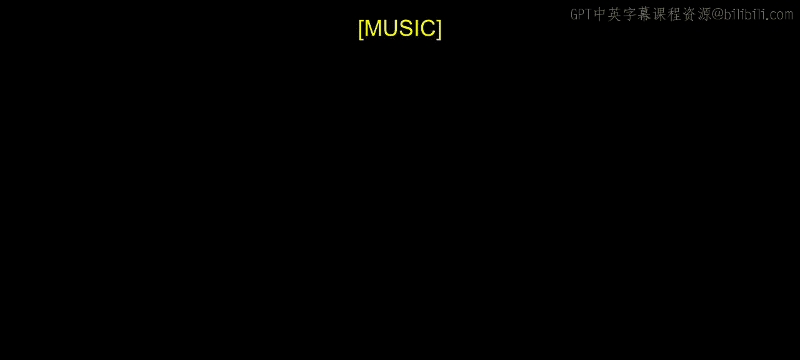
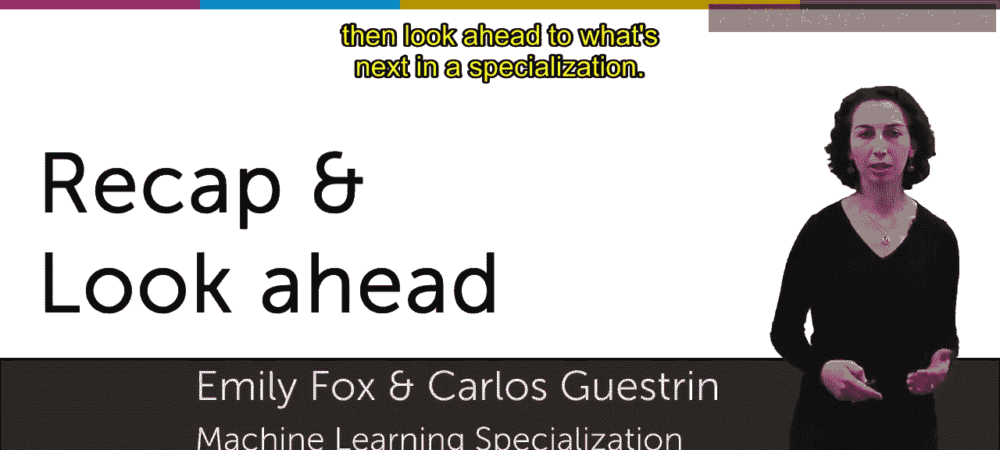
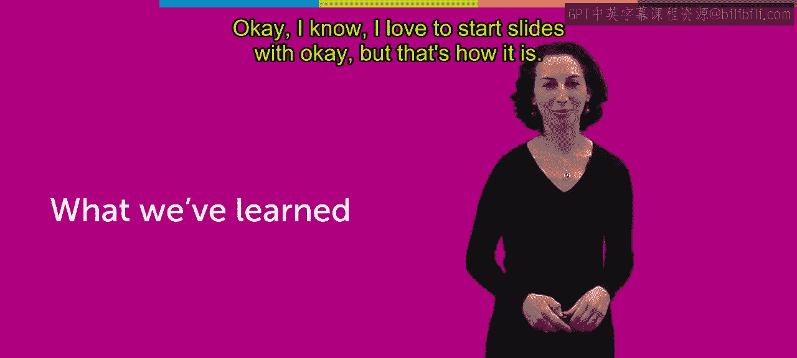
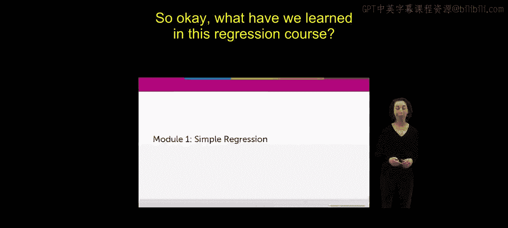
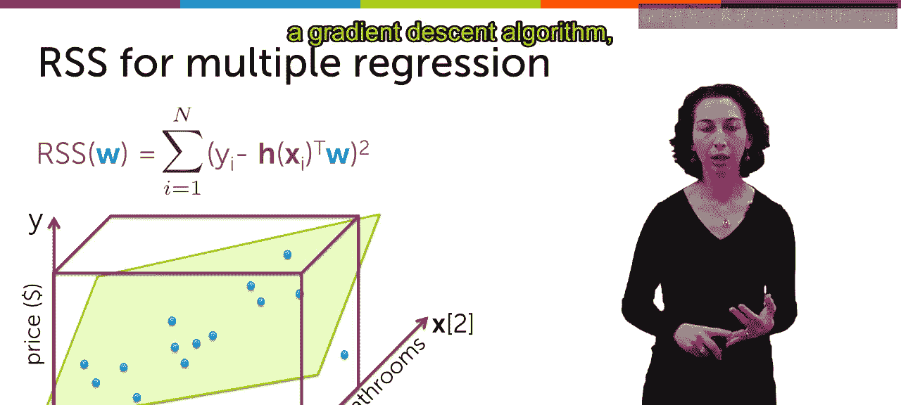
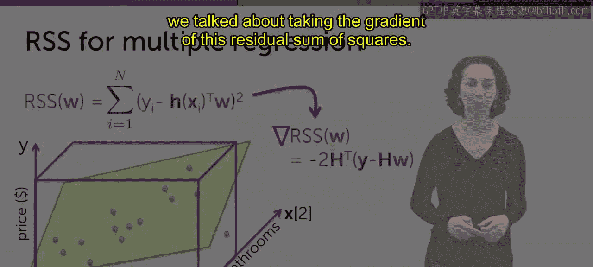
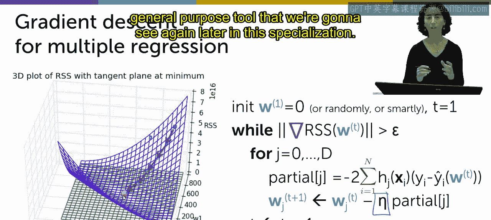
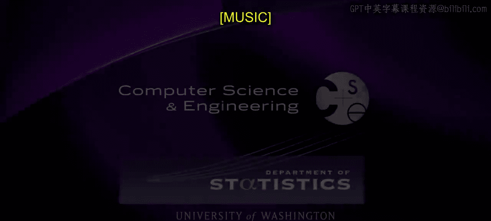

# 华盛顿大学《机器学习（回归，第2课⧸共4课）｜Machine Learning》中英字幕 p114 114_简单回归和多元回归.zh_en -BV11b421H7XL_p114-

。

Congratulations for getting through this really challenging course， we covered a lot。

 a lot of ground discussing many ideas relating to regression as well as more general ideas that are foundational to machine learning。

 so let's just recap where we've been and then look ahead to what's next in a specialization。

Okay， I know I love to start slides with okay， but that's how it is。 So okay。

 what have we learned in this regression course Well， in the first module。

 we talked about something called simple regression。 Let's just remember what simple regression was。

 This is where we assumed that we just had a single input and we're just fitting a very simple line as a relationship between the input and the output。

Then we discussed what the cost was of using a given line and for this we defined something called the residual sum of squares and then once we've defined our residual sum of squares。

 this allows us to assess the different fits of different lines。

 and then with that we can choose which best fits our specific training dataset set。In particular。

 to find the best fitting line， we talked about our objective being an objective over two variables which represented our slope and our intercept。

 and the specific algorithm that we went through in this module was gradient descent。

 which we discussed was an iterative algorithm that moves in the direction of the negative gradient and for convex functions converges to the optimum。

We then turned to multiple regression and multiple regression allowed us to fit more complicated relationships between our single input and our output。

 we talked about polynomial regression， seasonality and lots of different features of our single input that we could use in a multiple regression model。

 but then we talked more generically about incorporating different inputs。

 like in our housing application， square feet number of bathrooms， number of bedrooms。

 lot size year built， as well as features of these inputs。

 and so generic we wrote our multiple regression model as follows so it's just a weighted collection of our features。

 H of our inputs Xi for our Ithe house plus some epsilon term which is our error representing the noise in our observations。

Then for this case of multiple regression， we have some more complicated relationship between now a whole bunch of features and our output。

 we talked about how we define our residual sum of squares。

 and then in order to derive both a closedform solution as well as a gradient toscent algorithm。

 we talked about taking the gradient of this residual sum of squares。

So it was pretty cool how even when dealing with a large collection of features。

 we can derive a closed form solution， which says just given all of our data。

 we just have to compute the term shown here。And that will give us our estimated set of coefficients for all of our features。

 but we also talked about the fact that this could be computationally intensive。

 itss operations are cubic in the number of features that we have in addition to the fact that this matrix H transpose H that we might have to invert might not be invertible。

And so now we know that this is where Rige regression can be so useful in the cases where we might not have a matrix that we can invert。

 the Rige regression is just a very simple modification to this closed form solution and leads to forms that are always invertible and thus allows us to handle cases where we have lots and lots of features。

 even more features than we have observations。But instead of this closeform solution。

 which we mentioned could be very computationally intensive。

 we talked about a gradient descent algorithm， which is an iterative procedure for solving this optimization objective where we can start at any point in our space so anywhere and compute the gradient and take these steps where remember there was a step size that we had to set。

 wheres our step size here it is。And that determined a lot of the properties of how quickly we converge to the optimal。

 but we showed that in our well behaved cases that we would converge to this optimal solution。嗯。

And this idea of gradient descent or this optimization algorithm is a very general purpose tool that we're going to see again later in this specialization。

