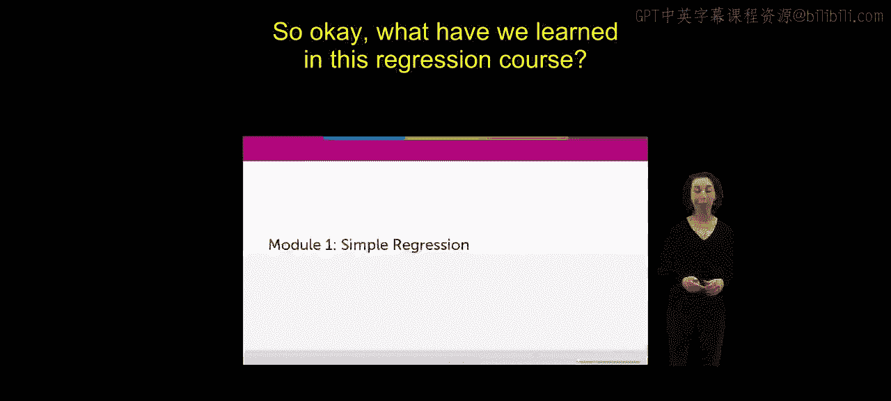
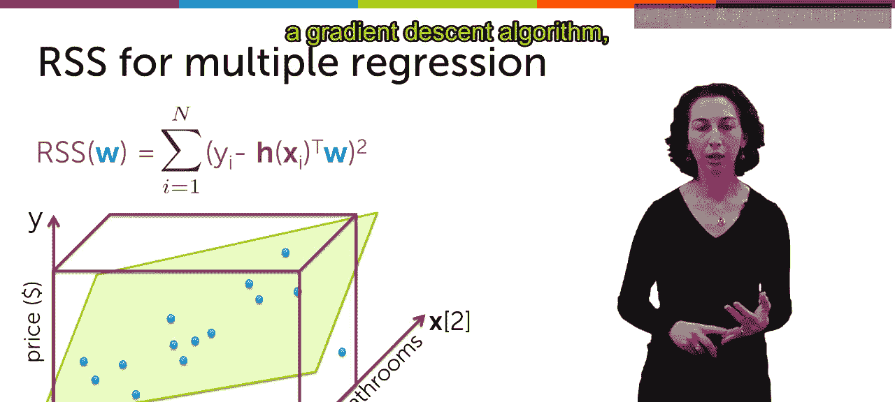
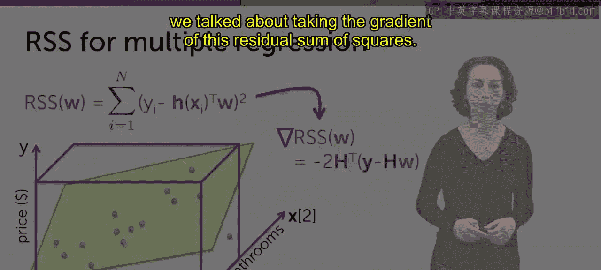
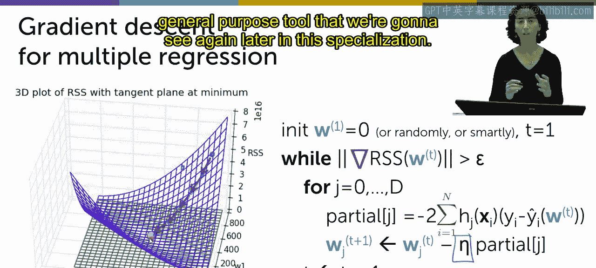

# 机器学习：第2课：回归课程总结与回顾 🎯


在本节课中，我们将回顾华盛顿大学《机器学习（回归）》课程的核心内容。我们将总结从简单回归到多元回归的关键概念，并展望后续学习方向。

---


## 简单回归 📈

上一节我们介绍了机器学习的基础，本节中我们来看看简单回归。简单回归假设我们只有一个输入变量，并拟合一条直线来描述输入与输出之间的关系。

简单回归模型可以表示为：

```
y = w0 + w1 * x + ε
```




其中：
- **y** 是输出变量
- **x** 是输入变量
- **w0** 是截距
- **w1** 是斜率
- **ε** 是误差项

为了评估不同直线的拟合效果，我们定义了**残差平方和（RSS）**：

```
RSS = Σ (yi - (w0 + w1 * xi))^2
```

以下是选择最佳拟合线的步骤：

1.  定义目标函数：基于斜率 `w1` 和截距 `w0` 的 RSS。
2.  使用**梯度下降**算法最小化 RSS。
3.  梯度下降是一种迭代算法，沿负梯度方向移动，对于凸函数能收敛到最优解。

---

## 多元回归 🔄

在掌握了简单回归后，我们将其扩展到更复杂的情况。多元回归允许我们使用多个特征来拟合输入与输出之间更复杂的关系。

多元回归模型可以表示为：

```
y = w0 + w1 * h1(x) + w2 * h2(x) + ... + wk * hk(x) + ε
```

其中 `h1(x), h2(x), ..., hk(x)` 是特征函数，它们可以是：
- 多项式项（如 `x^2`）
- 季节性指标
- 其他输入变量的函数（如在房价预测中使用的面积、卧室数量等）

对于多元回归，我们同样使用残差平方和（RSS）作为成本函数，并计算其梯度以进行优化。

---

## 参数估计方法 ⚙️

在定义了成本函数后，我们需要找到最优参数。有两种主要方法：

### 1. 闭式解



当特征矩阵 `H` 满足条件时，我们可以直接计算最优权重：



```
ŵ = (H^T * H)^(-1) * H^T * y
```

**优点**：直接给出精确解。
**缺点**：
- 计算复杂度高（与特征数量的立方成正比）。
- 矩阵 `H^T * H` 可能不可逆。

### 2. 岭回归

为了解决矩阵不可逆的问题，我们引入了岭回归。它对闭式解进行了简单修改，确保矩阵始终可逆：

```
ŵ = (H^T * H + λI)^(-1) * H^T * y
```

其中 `λ` 是正则化参数，`I` 是单位矩阵。

### 3. 梯度下降

对于计算成本高昂或矩阵不可逆的情况，梯度下降提供了一种迭代解决方案：

```
重复直到收敛：
    w := w - η * ∇RSS(w)
```

其中：
- **η** 是学习率（步长），控制收敛速度。
- **∇RSS(w)** 是残差平方和在当前权重 `w` 处的梯度。

梯度下降是一种通用优化算法，将在后续课程中再次出现。

---

## 总结 📝

本节课中我们一起学习了回归分析的核心内容。我们从**简单回归**开始，学习了如何用一条直线拟合数据，并使用梯度下降最小化残差平方和。接着，我们扩展到**多元回归**，探讨了如何利用多个特征构建更复杂的模型。最后，我们比较了参数估计的几种方法：**闭式解**、**岭回归**和**梯度下降**，理解了它们各自的适用场景与优缺点。




这些关于模型定义、成本函数和优化算法的概念，为理解更广泛的机器学习模型奠定了坚实基础。