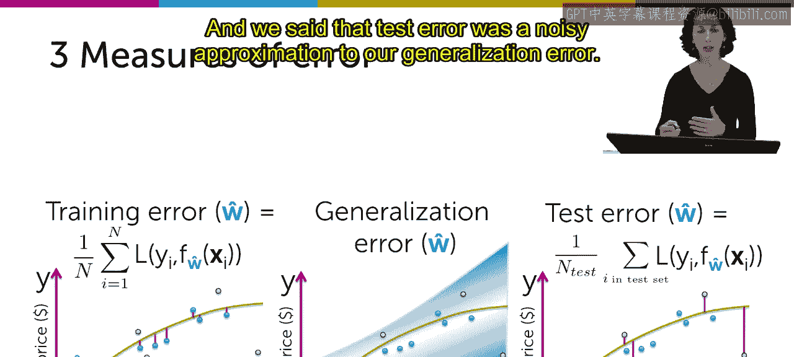
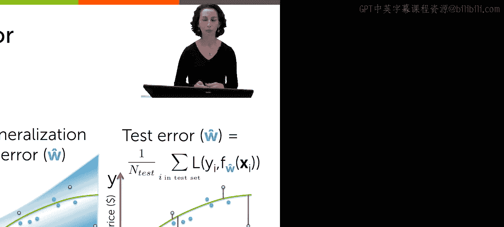
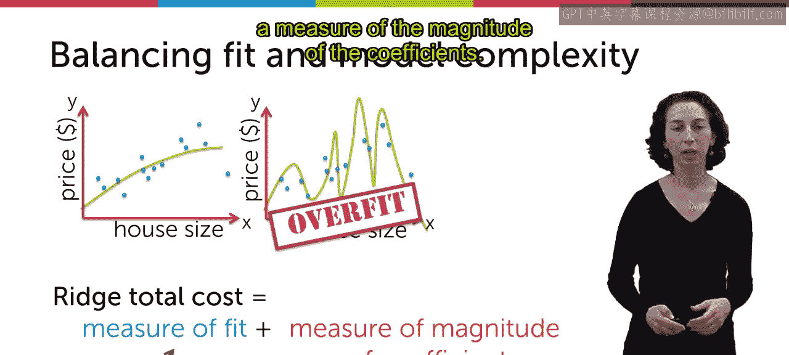
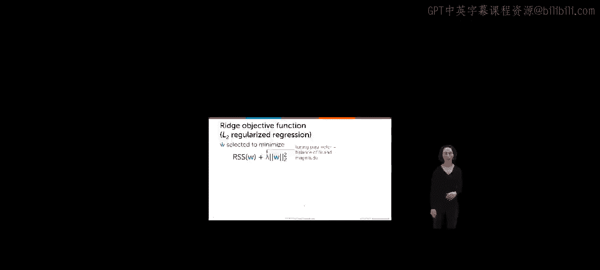
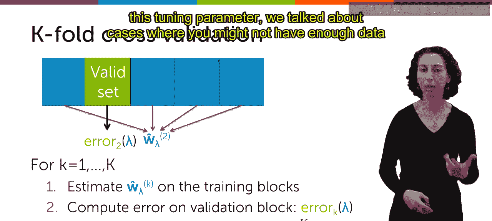
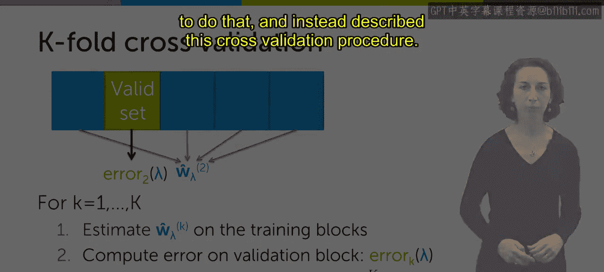

# 华盛顿大学《机器学习（回归，第2课⧸共4课）｜Machine Learning》中英字幕 p115 115_性能评估和岭回归.zh_en -BV11b421H7XL_p115-

。

So in modules1 and two， we described how to fit different models and in module2。

 we described how to fit very complex models， but up to our third module we had no idea how to assess whether that fitted model was going to perform well in our prediction task。

So in module3， that was our emphasis in assessing the performance of our fitted model and thinking about how we can select between different models to get good predictive performance。

 So the first notion that we introduced in order to measure how good our fit was performing was a measure of loss。

 So this is kind of a negative measure of performance where we want to lose as little as possible in making poor predictions were just under an assumption that our predictions would are not perfect。

And we discussed two different examples of loss metrics that are very commonly used talking about this absolute error or this squared error。

Then with this loss function， we talked about defining three different measures of error。

 The first was our training error， which we said was not a good assessment of the predictive performance of our model。

 then we define something called our generalization or true error， which is what we really want。

 we want to say how well are we predicting every possible observation that we might see out there。

 and we said okay， well we can't actually compute that so then we define something called our test error。

 which looks at a subset of our data。That was not included in the training set and looks at the model that was fit on the training data。

 but now making predictions on these heldout points。

And we said that test error was a noisy approximation to our generalization error。

And for these three different measures of error， we talked about how they varied as a function of model complexity。

 so training error we know goes down with increasing model complexity。

 but that doesn't indicate that we get better and better predictions as we increase our model complexity。

 but in contrast if we look at generalization error or true error， these tend to increase。

The errors tend to increase after a certain point and we say that that point is when these models start to become overfit because they perform very well on the training data。

 but they don't generalize well to new data that we have not yet seen。And again。

 although we discuss this in the context of regression， this notion of training test。

 generalization error and variations with model complexity is a much more general concept that we'll see again in the specialization。

 We then characterize three different sources that contribute to our prediction error。

 These are the noise that's inherent in the data。 This is our irreducible error。

 we have no control over it has nothing to do with our model or our estimation procedure。

 But then we talked about this idea of bias invariance。

 So we described bias as saying how well can our model fit the true relationship。

Averaging over all possible training data sets that we might see。

 whereas variance was describing how much can a fitted function vary from training dataset to training dataset。

 all of size and observations。So of course， noise in the data can contribute to our errors and prediction。

 but of course if our model can't adequately describe the tree relationship。

 that's also a source of error as well as this variability from training set to training set。

So of course we want low bias and low variance to have good predictive performance。

 but we saw that there's this bias variance tradeoff that as you increase model complexity。

 your bias goes down but your variance goes up， and so there's this sweet spot that trades off between bias and variance and results in the lowest what's called mean squared error。

 and that's what we're seeking to find。And like we've said multiple times。

 machine learning is all about exploring this biasvari trade off。

Then we concluded this module by saying how are we both going to select our model and assess its performance and for this we said。

 well we need to actually form something called a validation set so we're going to fit our model on the training data set。

 we're going to select between different models or thinking about selecting a tuning parameter。

 describing these different models on our validation set and then testing the performance on our test set where we never touch the test data and in later modules like we're going to describe。

 we talked about how if you don't have enough data to form this validation set。

 you can think about doing cross-valid instead。Then in our fourth module。

 we talked about ridge regression。 and remember that as our models become more and more complex。

 we can become overfit。 And what we saw as a symptom of overfitting was that the magnitude of our estimated coefficients just exploded。

 So what ridge regression does is it trades off between a measure of fit of our function to our training data and a measure of the magnitude of the coefficients and implicitly by balancing these two terms we' doing a bias variance trade off。

In particular， we saw that our ridge regression objective sought to minimize our residual summa squares plus lambda times the L2 norm of our coefficients。

And we talked about what the coefficient path of our ridge solution looked like as we varied this tuning parameter。

 lambda， the penalty strength on this L2 norm term。

And we saw that as you increase this penalty parameter。

 the magnitude of our coefficients becomes smaller and smaller and smaller then for our ridge objective。

 just like we did in our standard least squares objective。

 we computed the gradient set it equal to zero to get our closedform solution。

 and this looks very similar to our solution we had before。

 except with this additional term and what we talked about in this module was the fact that by adding this lambda times the identity matrix。

This allowed us to have a solution even when the number of features was larger than the number of observations and it allowed for a much more quote unquotereized solution。

 that's why it's called a regularized regression technique。

But the complexity of the solution was exactly the same as we had for least squares。

 cubic in the number of features that we have。So we also talked about a gradient descent implementation of Ridge。

And as we saw， a key question in what solution we would get out of Ri was determined by this lambmbda penalty strength。

 and so for this， instead of talking about cutting out a validation set to select this tuning parameter。

 we talked about cases where you might not have enough data to do that and instead describe this crossvalidation procedure。

