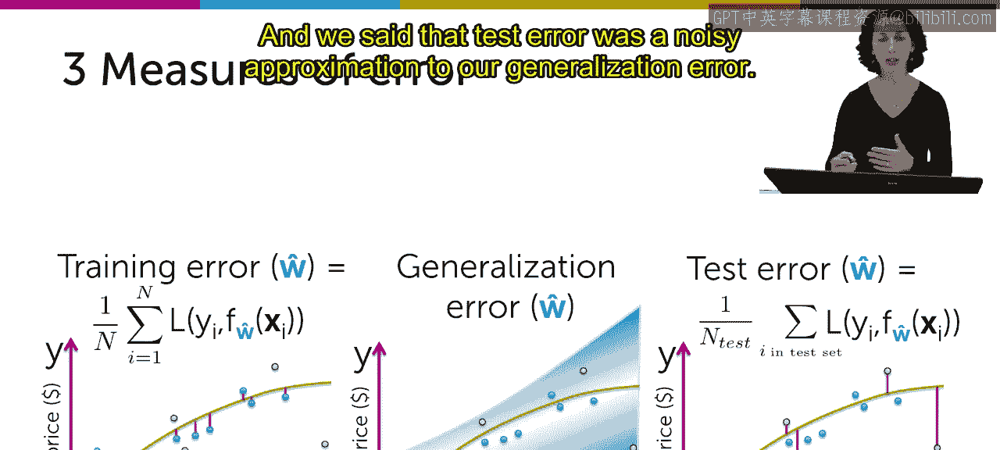
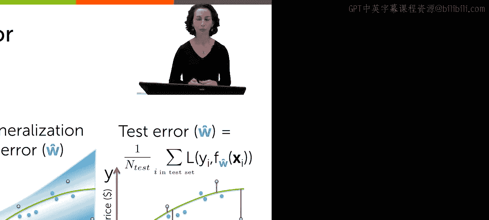
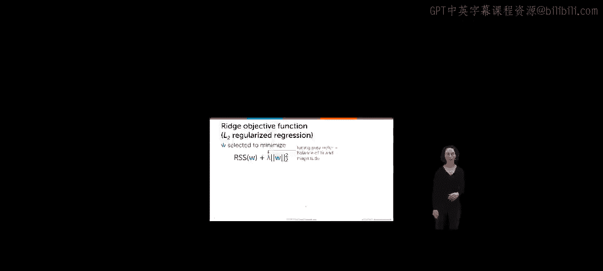
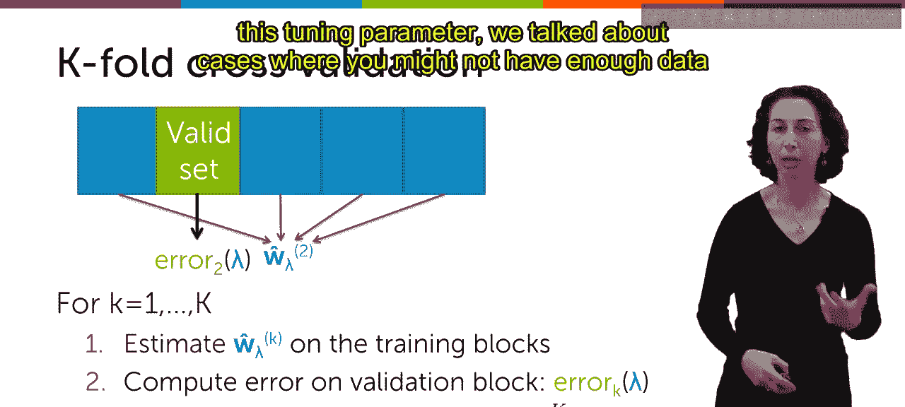
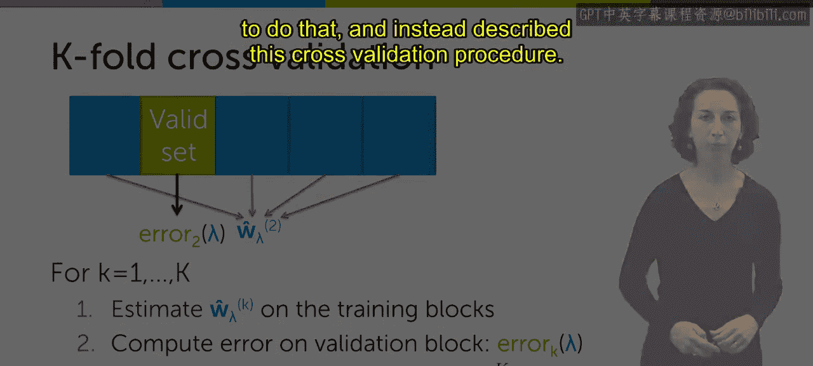

# 机器学习：第2课：性能评估与岭回归

在本节课中，我们将学习如何评估机器学习模型的性能，并介绍一种名为岭回归的技术，它通过控制模型复杂度来防止过拟合，从而提升预测能力。

---

## 性能评估：损失与误差

在第一和第二模块中，我们介绍了如何拟合不同的模型。在第二模块中，我们描述了如何拟合非常复杂的模型。但直到第三模块，我们仍不清楚如何评估拟合的模型是否能在预测任务中表现良好。

因此，第三模块的重点是评估拟合模型的性能，并思考如何在不同的模型之间进行选择以获得良好的预测性能。

为了衡量拟合效果，我们引入的第一个概念是**损失**。这是一种衡量性能的负面指标，我们希望在做不完美的预测时，损失尽可能小。我们讨论了两种常用的损失度量：**绝对误差**和**平方误差**。

基于损失函数，我们定义了三种不同的误差度量：

1.  **训练误差**：我们指出，这不是评估模型预测性能的好方法。
2.  **泛化误差（或真实误差）**：这是我们真正想要的，它衡量模型对所有可能观测值的预测能力。
3.  **测试误差**：由于无法计算真实误差，我们定义了测试误差。它使用训练集之外的数据子集（测试集），评估在训练数据上拟合的模型对这些“保留”点的预测效果。

测试误差是泛化误差的一个有噪声的近似值。

---

## 模型复杂度与误差的关系

对于上述三种误差度量，我们讨论了它们如何随模型复杂度变化：

*   **训练误差** 随着模型复杂度增加而下降。
*   **泛化误差（或真实误差）** 在达到某个点后趋于上升。

当模型在训练数据上表现很好，但无法很好地推广到未见过的数据时，我们就说模型**过拟合**了。虽然我们在回归的背景下讨论，但训练误差、测试误差、泛化误差及其与模型复杂度的关系是一个更普遍的概念，将在后续课程中再次出现。

---

## 预测误差的来源

我们分析了构成预测误差的三个不同来源：

1.  **数据固有噪声（不可约误差）**：我们无法控制，与模型或估计过程无关。
2.  **偏差**：衡量模型在所有可能训练数据集上的平均拟合能力，描述模型捕捉真实关系的能力。
3.  **方差**：描述拟合函数在不同训练数据集（大小均为 `n`）之间的波动程度。

数据噪声、模型无法充分描述真实关系（高偏差）以及模型对训练数据的敏感性（高方差）都是预测误差的来源。为了获得良好的预测性能，我们希望偏差和方差都低。

然而，存在**偏差-方差权衡**：随着模型复杂度增加，偏差下降，但方差上升。因此，存在一个最佳平衡点，能实现最低的**均方误差**，这正是我们寻求的目标。可以说，机器学习在很大程度上就是在探索这种偏差-方差的权衡。

---

## 模型选择与性能评估

为了选择模型并评估其性能，我们需要引入**验证集**。具体流程如下：

1.  在**训练集**上拟合模型。
2.  在**验证集**上评估不同模型或调整参数，进行模型选择。
3.  在从未使用过的**测试集**上最终测试模型性能。

如果数据不足以划分出验证集，可以采用**交叉验证**作为替代方法。

---

## 岭回归：控制过拟合

在第四模块中，我们讨论了**岭回归**。随着模型变得越来越复杂，可能会发生过拟合。过拟合的一个典型症状是估计系数的**幅度急剧增大**。

岭回归通过在目标函数中引入一个惩罚项，来权衡模型对训练数据的拟合程度与系数幅度的大小。通过平衡这两项，我们实际上在进行偏差-方差的权衡。

岭回归的目标函数是：
`最小化：残差平方和 + λ * (系数的L2范数)`

其中，`λ` 是惩罚强度参数。我们讨论了随着 `λ` 变化，岭回归解的系数路径如何变化。随着惩罚参数 `λ` 增大，系数的幅度会变得越来越小。

与标准最小二乘法类似，我们通过计算梯度并设为零，得到了岭回归的**闭式解**：
`w_ridge = (X^T X + λI)^(-1) X^T y`

这个解与之前的标准解类似，但多了一个 `λI` 项。这个附加项使得即使在特征数量 `p` 大于观测数量 `n` 时，我们也能得到一个解，并且能得到一个更“稳定”的解，因此它被称为一种**正则化回归技术**。其计算复杂度与最小二乘法相同，都是 `O(p^3)`。

我们还讨论了岭回归的**梯度下降**实现方法。

岭回归解的关键由 `λ` 这个惩罚强度参数决定。为了选择这个调整参数，我们讨论了在数据不足时，使用**交叉验证**程序来代替划分独立验证集的方法。

---

## 总结

在本节课中，我们一起学习了：

1.  如何通过损失函数和训练/测试/泛化误差来评估模型性能。
2.  模型复杂度如何影响不同误差，以及过拟合的概念。
3.  预测误差的三个来源：噪声、偏差和方差，以及它们之间的权衡关系。
4.  如何使用训练集、验证集和测试集（或交叉验证）来选择和评估模型。
5.  岭回归如何通过惩罚系数幅度（L2正则化）来控制模型复杂度、防止过拟合，并在高维情况下提供稳定解。