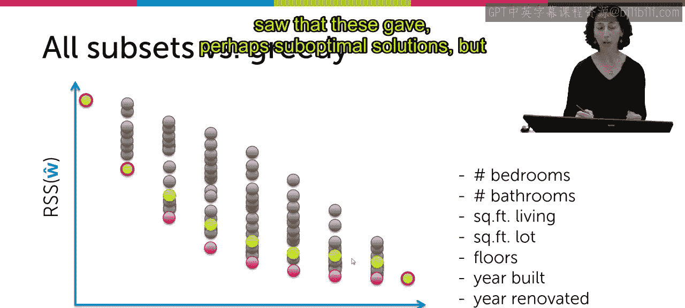
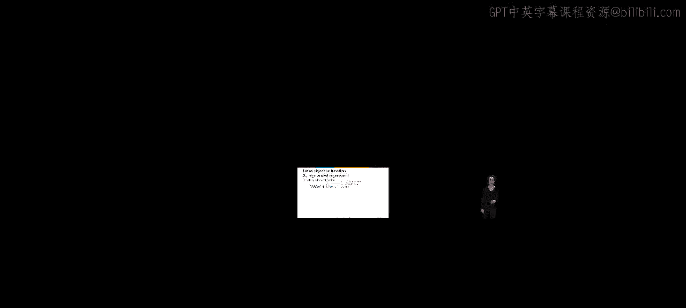
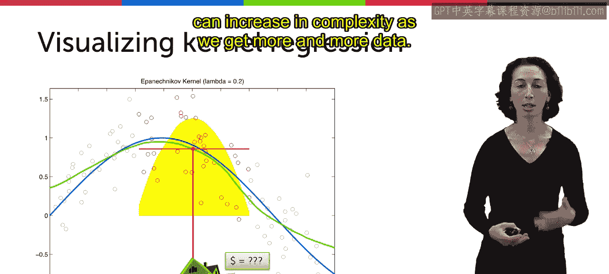

# 华盛顿大学《机器学习（回归，第2课⧸共4课）｜Machine Learning》中英字幕 p116 116_特征选择、Lasso和最近邻回归.zh_en -BV11b421H7XL_p116-

。

The fifth module was then all about feature selection。So to motivate this。

 we talked about the fact that every house might have a really long list of attributes associated with it and for reasons of both interpretability as well as efficiency inform forming our predictions。

 we want to select a sparse subset of these features to include in our model。

So to perform this feature selection， the first thing that we talked about were a set of methods that explicitly searched over models with different numbers of features。

And the exhaustive approach was something that's called all subsets selection。

 but then we also talked about greedy procedures like For selection and saw that these gave perhaps suboptimal solutions。

 but were much more efficient than the all subsets procedure。

But instead of explicitly searching over models with different sets of features。

 we talked about how to use Lasso regression to implicitly do this feature selection。

 where the objective looked just like Rige， but instead of using the L2 norm。

 we're using L1 norm of our coefficients and we showed how that led to sparse solutions。

 So in particular if we look at the coefficient path associated with LasSso we saw that for any value of lambmbda。

 we ended up typically with a sparse solution getting sparser and sparser as we increase Lambda and this was in contrast to what we saw for ridge where the coefficients just got smaller and smaller here we actually end up with these sparse solutions that lead to this idea of feature selection。

Then to optimize this Lasso objective， we talked about a coordinate descent algorithm where we solved a collection of 1D optimization problems iterating through the different dimensions of our objective。

 So in particular， the different features of our regression model。

 and what we saw was that for Lasso， we ended up setting our coefficients。

 according to something that we called soft thresholdholding， where in a certain range。

Of the correlation， this correlation coefficient that we described in this module。

 we were going to set our coefficient exactly to zero and outside that range。

 relative to our least square solution， we are going to shrink the value of the estimated coefficient。

So LAso can lead to these sparse solutions and has shown impact in just a really。

 really large set of different applied domains。In our last module。

 we talked about a set of non-parmetric techniques called nearest neighbor and kernel regression and one nearest neighbor was a really really simple procedure。

 the most basic procedure that you would imagine doing。

 but we show that it actually could perform really well especially when you have lots of data and what this method does is if you're going to estimate the value of your house。

 you just look for the most similar house look at its value and predict your value to be exactly the same。

Then we talked about making this a little bit more robust by looking at a set of K nearest neighbors and then said。

 well， you could also think about weighting these k nearest neighbors when you're going to compute your predicted value by how similar they are to you and then average across these weightings to form your estimated prediction。

And this led directly to an idea of kernel regression where instead of just waiting a collection of k nearest neighbors。

 you actually weight every observation in your data set。

 but a lot of the kernels that we specify actually set those weights to zero outside a certain range and decay them within a given range and so what this leads to is an idea of these very local fits and we talked about how kernel regression was equivalent to forming these locally constant fits。

 which was in contrast to our parametric models that form these global fits so here's a visualization of our kernel regression that we saw in this module and we see how it leads to these really nice smooth fits and these fits are very adaptive to the complexity of the data that we see and can increase in complexity as we get more and more data。

