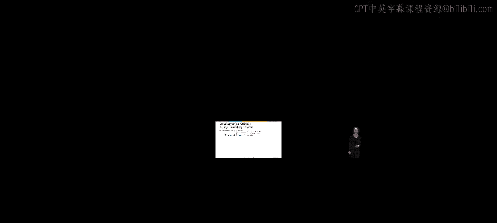

# 机器学习（回归）：第2课：特征选择、Lasso与最近邻回归 🧠

在本节课中，我们将学习回归模型中的三个核心主题：特征选择、Lasso回归以及最近邻与核回归。我们将探讨如何从众多特征中筛选出最重要的子集，如何使用L1正则化实现稀疏解，以及如何利用数据本身的相似性进行非参数预测。

## 概述 📋

第五模块的核心内容是特征选择。我们讨论这一主题的动机在于，现实数据（例如房屋属性）往往包含大量特征。为了提高模型的**可解释性**和**预测效率**，我们需要从中选择一个稀疏的特征子集来构建模型。

## 特征选择方法 🔍

为了执行特征选择，我们首先介绍了一类显式搜索不同特征数量模型的方法。

以下是两种主要的搜索策略：

*   **全子集选择**：这是一种穷举方法，会评估所有可能的特征组合。虽然能找到最优子集，但计算成本极高。
*   **前向选择**：这是一种贪婪算法。它从一个空模型开始，每次迭代添加一个对模型改进最大的特征。这种方法效率更高，但可能无法得到全局最优解。

## Lasso回归：隐式特征选择 ⚙️

上一节我们介绍了显式搜索方法，本节我们来看看如何利用Lasso回归**隐式地**完成特征选择。

Lasso的目标函数与岭回归相似，但关键区别在于它使用系数的**L1范数**作为惩罚项，而非L2范数。正是这一改动导致了**稀疏解**的产生。

其目标函数公式为：
**minimize (RSS + λ * Σ|w_j|)**

如果我们观察Lasso的系数路径，会发现对于任意给定的正则化参数λ，解通常是稀疏的。随着λ增大，越来越多的系数会变为零。这与岭回归形成鲜明对比：在岭回归中，系数只会不断缩小但很少会精确为零。Lasso的这种特性直接实现了特征选择。

为了优化Lasso目标函数，我们介绍了一种**坐标下降算法**。该算法通过迭代求解一系列一维优化问题来更新每个特征的系数。

具体来说，对于Lasso，我们最终会根据一种称为**软阈值**的规则来设置系数。我们定义了一个与特征相关性有关的系数。当这个相关性系数处于某个特定范围内时，对应的模型系数将被**精确地设为零**；而在这个范围之外时，估计的系数值会相对于最小二乘解进行收缩。

Lasso能够产生稀疏解，这一特性在众多应用领域中都显示出巨大价值。

## 最近邻与核回归 🌐

在最后一个模块中，我们讨论了一组称为最近邻回归和核回归的**非参数技术**。

**1-最近邻**是一个极其简单的过程：要预测一个目标值（如房屋价格），你只需在数据集中找到最相似的样本（房屋），并将其值作为预测值。尽管简单，但在拥有大量数据时，这种方法往往表现优异。

为了使方法更稳健，我们将其推广到**K-最近邻**回归。我们不是只看最近的一个点，而是查看K个最近邻点，然后取它们的平均值作为预测。

更进一步，我们可以根据这些近邻点与查询点的**相似度**对它们进行**加权**，然后计算加权平均值作为最终预测。这直接引出了**核回归**的思想。

在核回归中，我们不再仅仅加权K个近邻点，而是为数据集中的**每一个观测值**分配一个权重。不过，我们使用的许多核函数会使距离查询点较远的观测值权重为零，而在一定范围内的权重则随着距离衰减。

这导致了**局部拟合**的思想。我们讨论了核回归等价于进行这些局部常数拟合，这与我们之前学习的形成**全局拟合**的参数化模型形成了对比。

下图展示了本模块中介绍的核回归可视化结果。我们可以看到它如何产生非常平滑的拟合曲线。这些拟合能够自适应数据的复杂度，并且随着数据量的增加，其复杂度也可以相应提升。

## 总结 🎯

本节课我们一起学习了回归中的三个重要概念。我们了解了进行特征选择的动机和方法，包括显式的全子集/前向选择，以及通过Lasso回归实现隐式特征选择的原理。最后，我们探索了最近邻和核回归这两种非参数方法，它们通过局部加权平均的方式进行预测，能够灵活地适应数据的复杂结构。