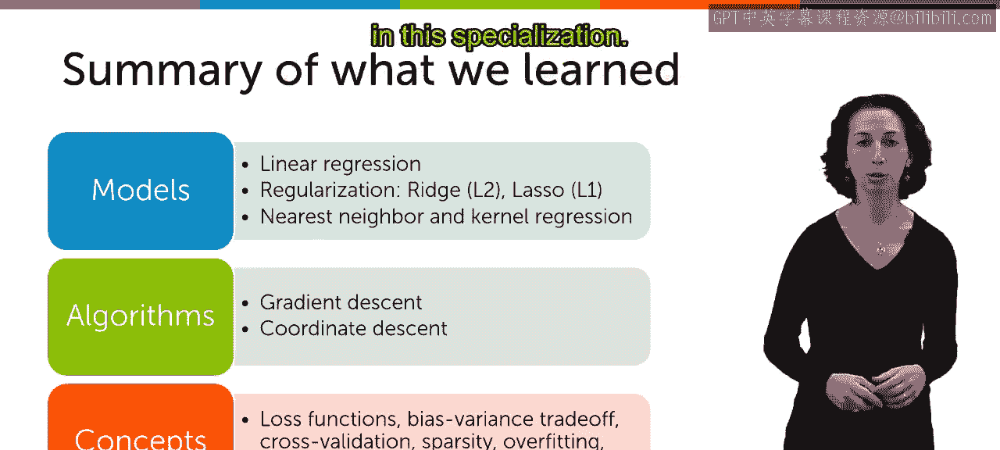
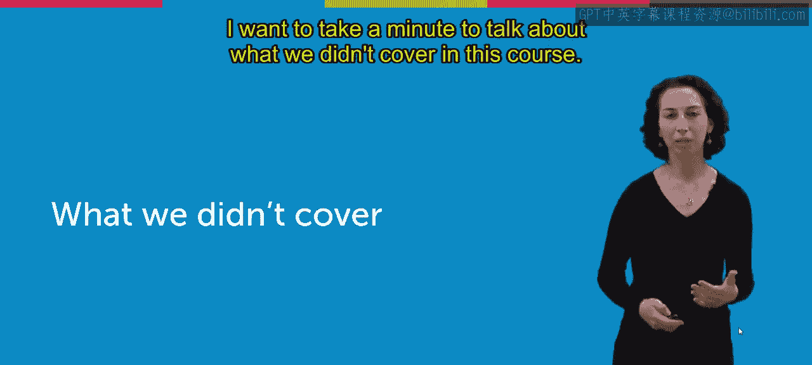
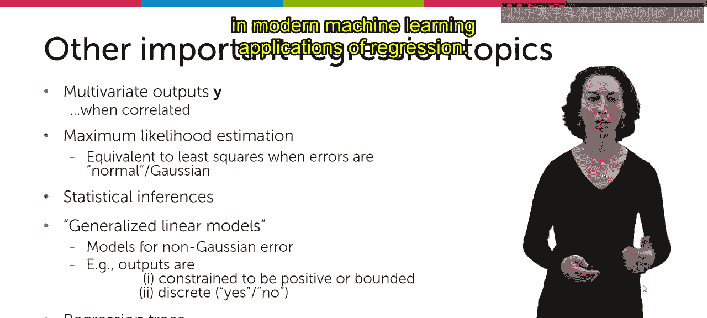

# 华盛顿大学《机器学习（回归，第2课⧸共4课）｜Machine Learning》中英字幕 p117 117_我们涵盖的内容和未涵盖的内容.zh_en -BV11b421H7XL_p117-

。

Okay， so here's a summary of the large set of topics that we've covered in this course。

 we talked about a bunch of models including different models of linear regression from simple regression to multiple regression。

 we talked about doing Rige regression and Laso and then nearest neighbors and kernel regression。

And we also talked about some very important optimization algorithms like gradient descent and coordinate descent and really just this notion of what is optimization and how do you go about doing it。

And then we talked about concepts that generalize well beyond just regression。

 these include things like loss functions， this very important concept of the bias variance trade off。

 talking about cross validation， sparsity， overfitting feature selection， model selection。

 and these are ideas that we're going to see in most of the courses in the specialization。

So we spend a lot of time teaching the methods of this module and now we spend a lot of time summarizing what we learned。

 but I want to take a minute to talk about what we didn't cover in this course。

 So there are actually a few important topics that unfortunately we didn't have time to go through in this course and I want to highlight them here One is the fact that in this course we focus on just having a univariate output which for example was the value of a house or the sales price of a house but of course you could have a multivariate output and in cases where that multivariate output where the dimensions are correlated you need to do slightly more complicated things but in contrast if you assume that each of these outputs are independent of each other then you can just do the methods we described independently for each dimension The other thing that we haven't covered yet is this idea of what's called maximum likelihood estimation we're going to go through that in the classification course but I want to mention。

That in the context of regression， if you've heard of maximum likelihood estimation。

 it results in exactly the same objective we had with our minimizing our residual sum of squares。

 assuming that your model has what are called normal or Gaussian errorss that this epsilon term that we've talked about。

 remember y equals Wx plus epsilon。Well， that epsilon。

 if we assume it's normally distributed or sometimes people say Gaussian distributed。

 then maximum likelihood estimation is exactly equivalent to what we've talked about in this course。

And like I said， we'll learn more about maximum likelihood estimation in the classification course。

But one really， really important thing that we didn't talk about in this course which truthfully pains me being a statistician are statistical inferences。

 we just focus on what are called these ideas of point estimation we just returned a W hat value or estimated coefficients but we didn't talk about any notion of what our measure is of uncertainty about those estimated coefficients or our predictions。

 so again there's noise inherent in the data so we can think of having measures of uncertainty about our predictions or our estimated coefficients。

 so this is referred to as inference and it's a really important topic that we did not go through here。

Another cool set of methods are what are called generalized linear models and we're actually going to see an example of a generalized linear model in the classification course。

 so you will get to see this， but I want to bring it up here and what generalized linear models allow you to do is form regressions when you have certain restrictions on your output like the output is always positive or bounded or positive and bounded。

 or it's going to be discrete value like we're going to talk about in the classification course。

 just a yes or no response Well， if we're assuming that our Gaussian our errors are Gaussian like I talked about with this maximum likelihood estimation or in this course。

 what we talked about of having zero mean but the observations were equally likely to be above or below the true function and they're actually unbounded in how far they could be above or below that true function Well。

 the regression models that we've talked about so far are inappropriate for forming predictions if those predicted。

Vals have these types of constraints or specific structures to them。

And generalized linear models allow us to cope with certain types of these structures very efficiently Another really powerful tool that we didn't describe in this course is something called a regression tree and that's because we're going to covered in the classification course actually more generally these methods are referred to as cart or classification and regression trees because what you do is you form a tree and that structure is the same whether we're looking at classification or regression。

we're going to focus on describing these structures in the context of classification because they're a lot simpler to understand in that context。

 but I want to emphasize that those same tools that we're going to learn in the next course can be used for regression as well。

And of course there are lots and lots of other methods that we haven't described in this course。

 regression has an extremely long history in statistics。

 so there are lots of things that are potentially of interest。

 but in this course we really try to focus in on the main concepts that are useful in modern machine learning applications of regression。

