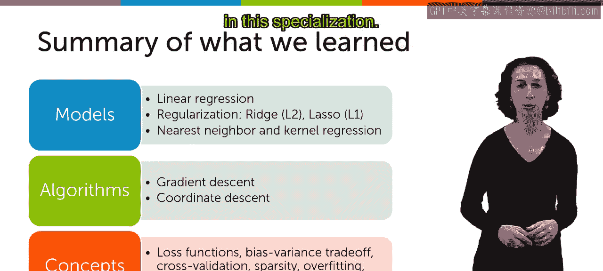
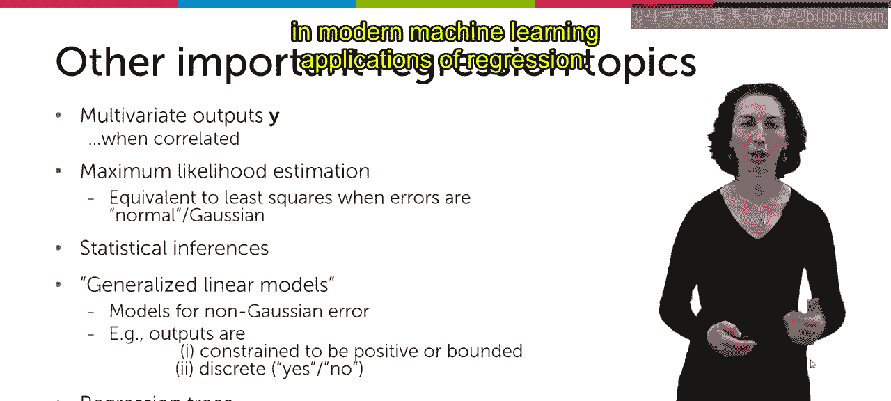

# 机器学习：回归：第2课：课程内容总结与展望 🧭

在本节课中，我们将总结本课程已涵盖的核心内容，并简要介绍一些因时间限制而未深入探讨的重要主题。这有助于你建立完整的知识框架，并了解回归分析在更广阔机器学习领域中的位置。

## 课程内容回顾 📚

上一节我们介绍了多种回归模型，本节中我们来系统回顾一下本课程所涵盖的广泛主题。

我们讨论了一系列模型，包括从简单回归到多元回归的不同线性回归模型。我们还探讨了岭回归、Lasso回归、最近邻回归以及核回归。

此外，我们介绍了一些非常重要的优化算法，例如梯度下降法和坐标下降法。这实质上涉及了“什么是优化”以及“如何进行优化”的核心概念。

然后，我们讨论了那些适用范围远超回归分析本身的重要概念。这些概念包括：
*   **损失函数**
*   **偏差-方差权衡**这一核心概念
*   **交叉验证**
*   **稀疏性**
*   **过拟合**
*   **特征选择**
*   **模型选择**

这些思想将在本专业系列课程的大部分内容中反复出现。

## 未涵盖的重要主题 🔮

我们花了大量时间学习本模块的方法并总结所学，现在我想花点时间谈谈本课程未涵盖的内容。实际上，有一些重要主题我们因时间关系未能深入讲解，我在此特别指出。

以下是本课程未涵盖的几个关键方向：

*   **多元输出回归**：本课程只关注单变量输出（例如房屋价值或售价）。当然，你也可以处理多元输出。当这些输出维度相互关联时，你需要采用更复杂的方法。相反，如果你假设每个输出彼此独立，那么你可以对每个维度独立应用我们描述过的方法。
*   **最大似然估计**：我们尚未涵盖这个概念，它将在分类课程中详细介绍。但我想指出，在回归的背景下，如果你听说过最大似然估计，并且假设你的模型具有所谓的正态或高斯误差（即我们讨论过的公式 **y = Wx + ε** 中的 **ε** 项），那么最大似然估计的结果完全等同于我们在本课程中讨论的最小化残差平方和目标。我们将在分类课程中进一步学习最大似然估计。
*   **统计推断**：本课程完全没有讨论统计推断，这让我作为一名统计学家感到非常遗憾。我们只专注于所谓的点估计思想，即直接返回一个估计系数 **Ŵ**。但我们没有讨论任何关于这些估计系数或预测的不确定性度量。数据本身存在噪声，因此我们可以考虑对预测或估计系数进行不确定性度量。这被称为推断，是一个非常重要但我们未涉及的主题。
*   **广义线性模型**：我们实际上将在分类课程中看到一个广义线性模型的例子。广义线性模型允许你在输出受到特定限制时进行回归建模，例如输出总是正值、有界、或是离散值（如分类课程中将讨论的是/否响应）。如果我们假设误差是高斯分布的（如最大似然估计或本课程所讨论的，具有零均值，观测值等可能地高于或低于真实函数，并且实际上在偏离真实函数的程度上无界），那么当我们预测的值具有此类约束或特定结构时，目前讨论的回归模型就不适用了。广义线性模型使我们能够高效处理某些类型的输出结构。
*   **回归树**：本课程未描述的另一个强大工具是回归树。这是因为我们将在分类课程中介绍它。实际上，这些方法更普遍地被称为CART（分类与回归树）。无论我们处理分类还是回归，你构建的树结构是相同的。我们将在分类的背景下重点描述这些结构，因为在那样的语境下更容易理解。但我想强调，我们在下一课程中将学习的这些相同工具也可用于回归。
*   **其他方法**：当然，本课程未描述的方法还有很多很多。回归在统计学中有着极其悠久的历史，因此有许多潜在值得关注的内容。但在本课程中，我们真正专注于对现代机器学习回归应用有用的核心概念。

## 总结 ✨

本节课中我们一起学习了本回归课程的知识体系总结。我们回顾了已涵盖的核心模型、优化算法及通用概念，如偏差-方差权衡。同时，我们也展望了多元输出回归、统计推断、广义线性模型和回归树等重要但未深入的主题，为你勾勒出回归分析更广阔的图景。这些未涵盖的主题将在后续课程，特别是分类课程中得到延续和深化。