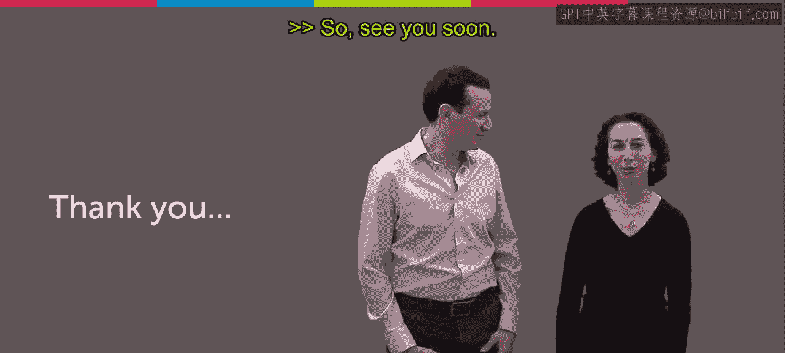

# 机器学习（回归）：第2课：课程总结与展望

在本节课中，我们将对回归课程的核心内容进行总结，并展望机器学习专项课程后续的学习方向。

---

你们在回归课程中付出了巨大努力，学习了许多至关重要的概念。不仅学习了回归模型，还掌握了如何使用、实现以及在实践中部署它们。掌握了这些方法后，你们可以着手解决许多重要的实际问题。

此外，我们学习的一些概念是整个机器学习专项课程的基础，是核心的机器学习思想。

回归技术广泛应用于众多领域。卡洛斯度假归来，看起来神采奕奕，在下一门课程中你们会更多地见到他。

以下是回归的一些典型应用场景：
*   从预测产品的销售量，到预测股票市场走势。

你们在此学到的技术，将帮助你们构建真正能在现实世界产生影响的智能应用。

我们希望能在整个专项课程中继续见到你们。我们将一起学习分类器、推荐系统、文档检索，直至使用深度学习构建出色的推荐系统。

期待不久后与你们再见。

---

本节课中，我们一起回顾了回归课程的主要成果，了解了回归在预测等领域的广泛应用，并展望了机器学习专项课程后续将涵盖的分类、推荐系统及深度学习等激动人心的内容。