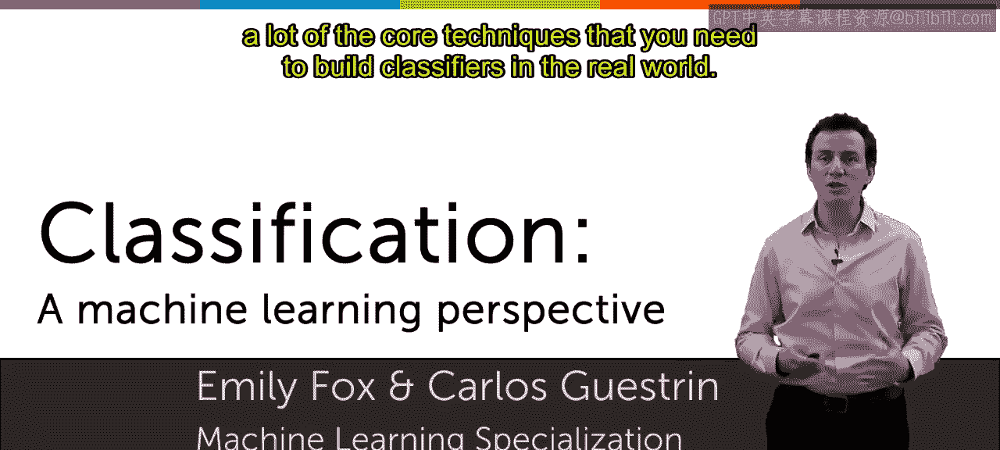
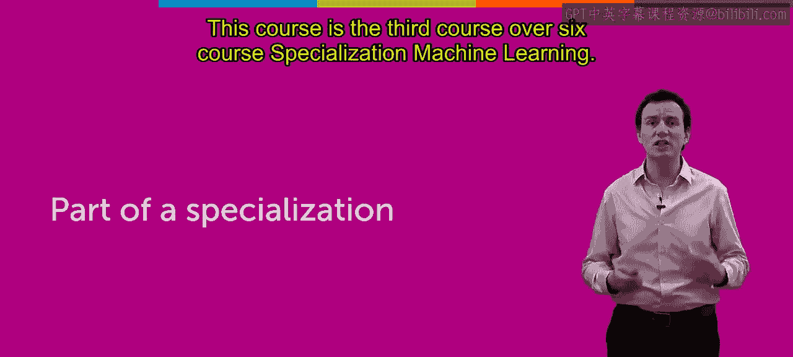
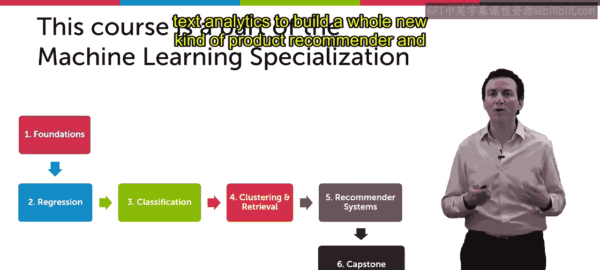

# 华盛顿大学《机器学习（分类，聚类和检索，第3-4课⧸共4课）｜Machine Learning》中英字幕 p01 0_欢迎并介绍聚类和检索任务.zh_en -BV1Sr421F7N7_p1-

。

Welcome to classification。 This is the third course in our machine learning specialization。

 I'm Carlos Gutin， and together we're going to go through the basics to the fundamentals to actually building real world classifiers。

 It's going to be fun， exciting bit of work be tons of work。

 but you'll come out to the other side being really an expert on a lot of the core techniques that you need to build classifiers in the real world。

😊。

This course is the third course of our sixth course specialization in machine learning In the first one。

 we outlined the basics of machine learning， using the techniques as input output black boxes。

 from the second course onward we actually understanding the depths of each algorithm and implementing them from scratch ourselves The first course on regression was a really fun and exciting And Emily led that I'm leading this course on classification。

 which will be followed by a course on clustering one on recommender systems and finally our capstone project where you're going to use deep learning and text analytics to build a whole new kind of product recommender and deployed as a realtime service。

😊。

