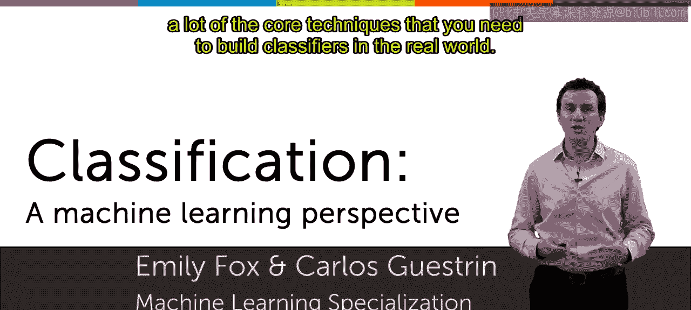
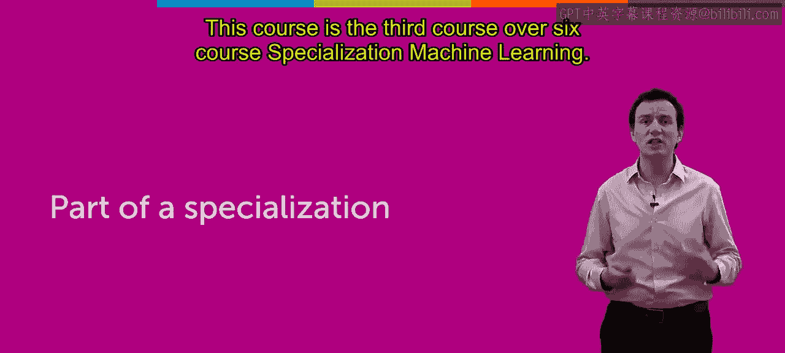
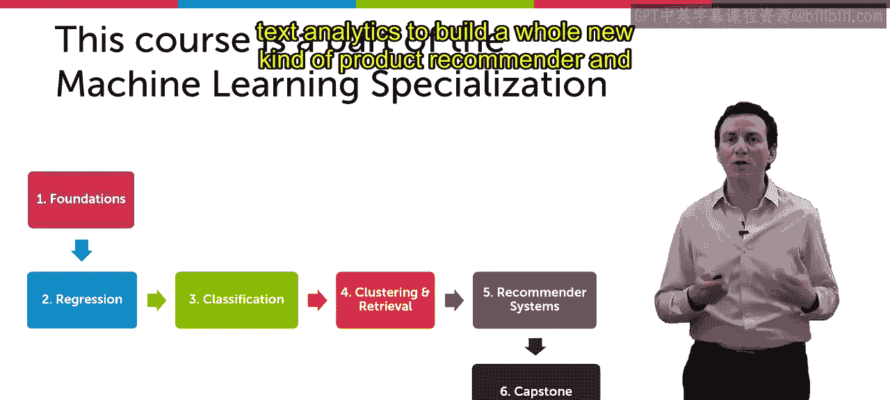

机器学习（分类，聚类和检索）：第3课：欢迎与课程概述

在本节课中，我们将学习分类的基础知识，这是机器学习专项课程的第三门课。我们将从基础概念出发，深入理解核心算法，并最终能够构建现实世界中的分类器。

我是卡洛斯·古丁，我们将一起探索分类的方方面面。这个过程将充满挑战，但也非常有趣。通过努力，你将掌握构建实用分类器所需的核心技术。

---

这门课程是我们六门机器学习专项课程中的第三门。在第一门课程中，我们概述了机器学习的基础，将算法视为输入输出的黑箱。从第二门课程开始，我们深入理解每个算法的原理，并尝试自己从头实现它们。

上一节我们回顾了整个专项课程的脉络，本节中我们来看看本课程的具体定位。第一门关于回归的课程非常精彩，由艾米丽主讲。现在由我主讲这门关于分类的课程。此后，还将有关于聚类、推荐系统的课程，以及最终的顶点项目。在顶点项目中，你将运用深度学习和文本分析技术，构建一种全新的产品推荐系统，并将其部署为实时服务。

---

以下是本课程在专项课程中的位置图示：

---

本节课中我们一起学习了课程的欢迎介绍和整体安排，明确了分类课程在机器学习知识体系中的位置以及后续的学习路径。