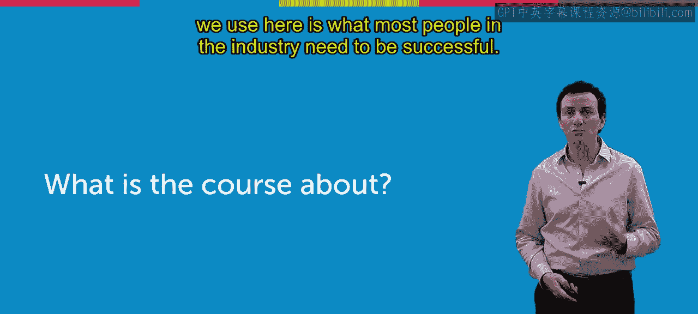
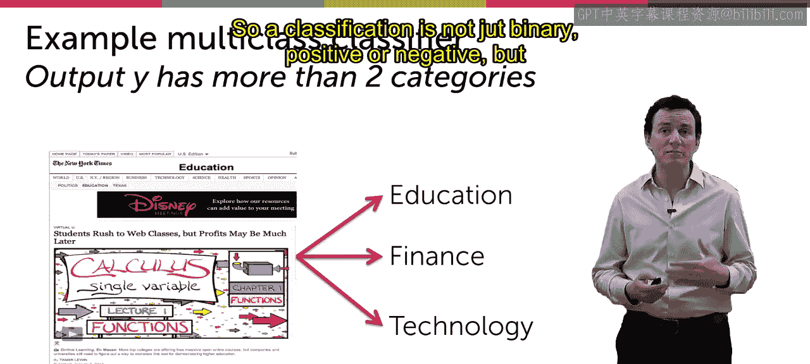
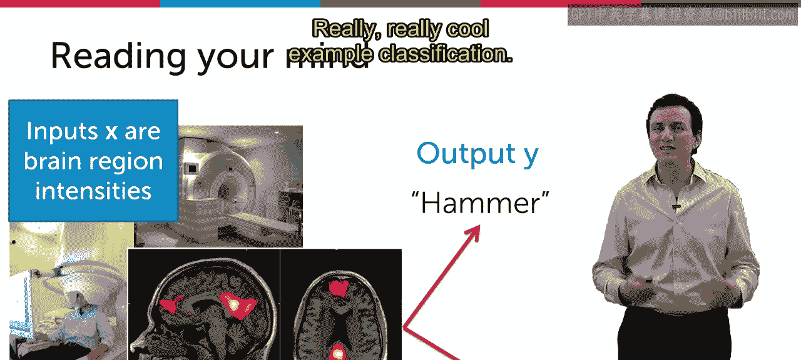

# 华盛顿大学《机器学习（分类，聚类和检索，第3-4课⧸共4课）｜Machine Learning》中英字幕 p02 1_这门课程讲什么.zh_en -BV1Sr421F7N7_p2-

。

This course addresses classification， which is one of the most widely used most fundamental areas of machine learning if you understand classifiers you'll also understand basically the rest of machine learning and the techniques we use here is what most people in the industry need to be successful。

We discuss how machine learning is about some input data。

 which can be pushed through some machine learning algorithm。

 which output puts what we think about as some kind of intelligence from the data in this course when to build classifiers so classifier takes in to input some X some features of our data。

And as output makes a prediction， which a discrete class or category or label for the data。

 and we're going to see a ton of different examples of how this is used in practice the goal of a classifier is to learn a mapping from the input X to the output Y。

 those classes。😊，The example that we discussed in the first course was a sentiment classifier where we' were given an input sentence X like easily the best susin Seattle。

 we fed that through the sentiment classifier， which then told us an output and Y that was either yeah。

 that is a positive sentence or nay that is a negative sentence。

 and we can use the sentences these predictions in a wide range of ways， that we'll see soon。

In general， classifier is about taking some input X， pushing it through some model。

 which predicts why。That might be， for example， two classes or multiple classes of say positive or negative。

 or as I will see。It could be  three，4 or more categories。

Let's suppose for example I have a web page and I want to figure out what ads should show on this webage so I need to figure out what that page is about the goal here is to take the text of the webage and categorize it automatically as whether it's kind of an educational site and educational type ads。

 whether it's kind of a site about finance or an article about finance and we need that kind of ad or when its about technology and so on。

 so classification is not just binary positive or negative。

 but it can be one of multiple categories or multiple classes。

Perhaps the most common type of classifier that we see every day every time we look in our email is a famous spam filter。

 so goes spam filters to take our email and every time a new email arrives。

 makes a prediction whether this is a spammy that should be ignored or not spam。

And that prediction needs to be made based not just on the text of the email but other information we get from that email like who the sender was。

 what the IP address of that sent messages， other messages that the sender sent and so on and from that information we're gonna learn the mapping from those inputs to whether it's spam or not and those span filters got in so much better over the year so I remember early on we just use keyword search or key keyword classifiers and they weren't very good but today I don't even check my spanm folder anymore So if you send me an email and they dont open it maybe it's my spam folder sorry。

We can build all sorts of classifiers though， we can use for example， image data。

 so given this particular input， my dog。😊，The image pixels I want to make a prediction from a set of categories。

 so from this from the famous imageNe data set where there's1 thousand0 different categories might want to predict。

 so for example let me know if it's a labbrador retriever， a golden retriever and so on。

 what kind of dog it is， and that's the output label wide that we might want。😊。

Now the idea of classifiers can be extremely useful for a wide range of domains。

 one they'm particularly excited about is the area of personalized medicine。

 which I think is going to change the world。So today， if I don't feel so well。

 I might put a thermometer under my arm and check out my temperature or a doctor might order a X ray to see what's going on in my chest or maybe use some lab test and based on that information。

Goes through some classifier， which maybe it's in the doctor's head or maybe it's an automated system that tries to make a prediction as to what condition I might have。

But what's annoying about how medicine is done today is that based on the same conditions。

 we make the same predictions for me or for you independently of the fact that we're really different people and personalized medicine and totally change that so it's going to look at our DNA sequences because we're genetically different and find a good treatment for each one of us and maybe even look at our lifestyle which might say something about what I'm prone to maybe that's your lifestyle。

 maybe my lifestyle is more like this and so based on that kind of information we gonna to predict what condition I have in what treatment is going to be most effective for me and that's an example of classification in the real world。

Perhaps one of the most fun and surprising examples of classification is work that one of my colleagues Tom Mitchell did。

 which is pretty amazing， take a scan of your brain as you look at a word and based on that image from what's called an FMRI it can make a prediction as to what kind of word you're reading so for example。

 based on image of your brain， it can predict if you're reading。

 say the word hammer or the word house which is basically reading your mind and I've been talking to Tom for a long time about this topic like more than 1015 years and over that time the kinds of results they have have evolved from very basic things so amazing things so for example today they can train a classifier on your brain images based on words that you read and then use it to predict something from my brain images based on pictures that I see so picture of a hammer instead of the actual word hammer。

And that is an incredible kind of evolution， an incredible kind of analysis that you can do from brain data。

 really， really cool， cool example classification， read your mind。😊。

