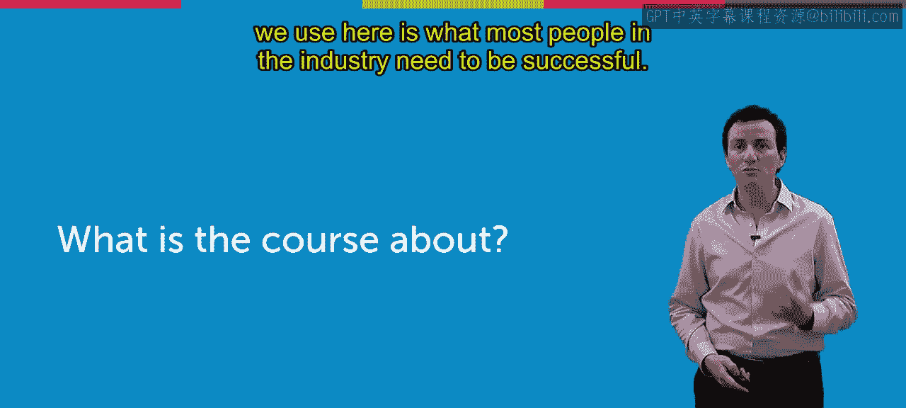
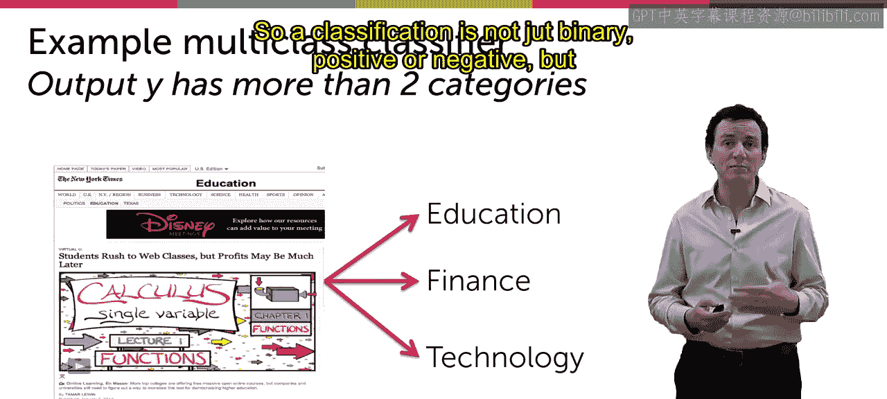
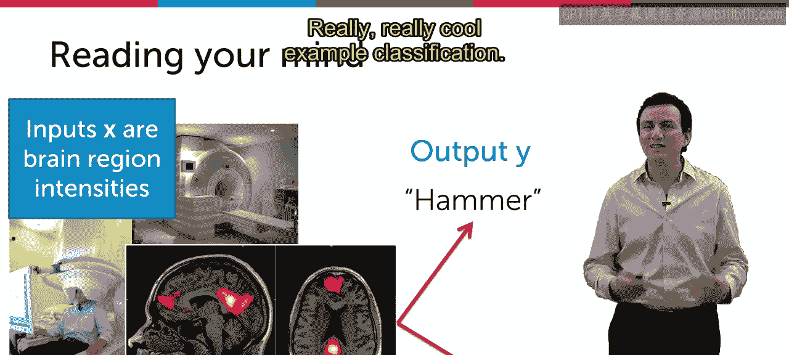

# 机器学习（分类，聚类和检索）：第1课：课程概述 🎯

在本节课中，我们将要学习机器学习的一个核心领域——分类。分类是机器学习中最基础、应用最广泛的技术之一。理解分类器，将帮助你掌握机器学习的核心思想，并且本课程所教授的技术是业界成功应用机器学习的关键。

## 什么是分类？🤔

上一节我们介绍了课程的整体目标，本节中我们来看看分类的具体定义。机器学习通常涉及输入数据，这些数据通过某种机器学习算法进行处理，最终从数据中输出我们视为某种“智能”的结果。

在本课程中，我们的目标是构建分类器。分类器接收输入 **X**（即数据的特征），并输出一个预测结果 **Y**。这个预测结果是一个离散的类别、分类或标签。

分类器的目标是学习一个从输入 **X** 到输出 **Y**（即类别）的映射关系。用公式可以表示为：

**Y = f(X)**

其中，**f** 代表我们学习的分类模型。

## 分类实例：情感分析 💬

在第一门课程中，我们讨论过一个情感分类器的例子。给定一个输入句子 **X**，例如“西雅图毫无疑问最好的寿司”，我们将其输入情感分类器。分类器会输出一个预测结果 **Y**，判断该句子是积极的（“yeah”）还是消极的（“nay”）。这种预测可以以多种方式被广泛应用。

## 超越二分类：多类别分类 📊

一般来说，分类就是接收输入 **X**，通过某个模型来预测 **Y**。这可能是二分类（例如正面或负面），也可能是多类别分类。

例如，假设我有一个网页，需要确定应该展示什么广告。为此，我需要自动判断该网页的内容属于哪个类别。目标是获取网页文本，并将其自动分类为教育类网站（展示教育类广告）、金融类文章（展示金融类广告）或科技类内容等等。因此，分类不仅仅是二元的“是或否”，它可以是多个类别中的一个。

以下是多类别分类的一些常见应用场景：

*   **垃圾邮件过滤**：这是最常见的分类器之一。每当新邮件到达时，垃圾邮件过滤器会基于邮件文本、发件人、IP地址等信息，预测该邮件是垃圾邮件（应被忽略）还是非垃圾邮件。
*   **图像识别**：给定一张图片（例如我的狗的图像像素），我们希望从一组类别中做出预测。例如，在著名的ImageNet数据集中有1000个不同类别，我们可能想预测它是否是拉布拉多犬、金毛猎犬等。
*   **个性化医疗**：这是一个令人兴奋的领域。传统的医疗基于相同的症状对所有人做出相同的诊断。个性化医疗将考虑我们的DNA序列（因为基因不同）和生活方式，来预测我们可能患有的疾病以及对我们最有效的治疗方案。这是一个现实世界中的分类示例。
*   **脑成像与“读心术”**：一个有趣且惊人的例子是我的同事Tom Mitchell的工作。通过扫描你在阅读单词时的大脑图像（fMRI），分类器可以预测你正在阅读的是哪个词（例如“锤子”或“房子”）。更惊人的是，他们可以在一个人阅读单词的脑图像上训练分类器，然后用它来预测另一个人观看图片（例如锤子的图片）时的脑活动。这是一个非常酷的分类应用。

## 总结 📝

本节课中我们一起学习了机器学习中分类的基本概念。我们了解到，分类器旨在学习从输入特征 **X** 到输出类别 **Y** 的映射。我们探讨了从简单的二分类（如情感分析）到复杂的多类别分类（如网页分类、图像识别）的各种实例。此外，我们还看到了分类在垃圾邮件过滤、个性化医疗乃至脑科学研究等广泛领域中的强大应用。掌握分类是理解机器学习世界的关键一步。