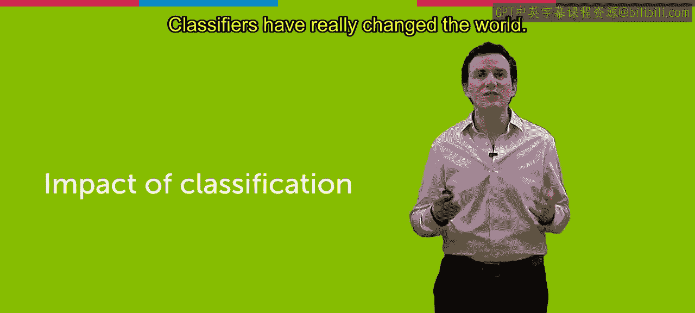
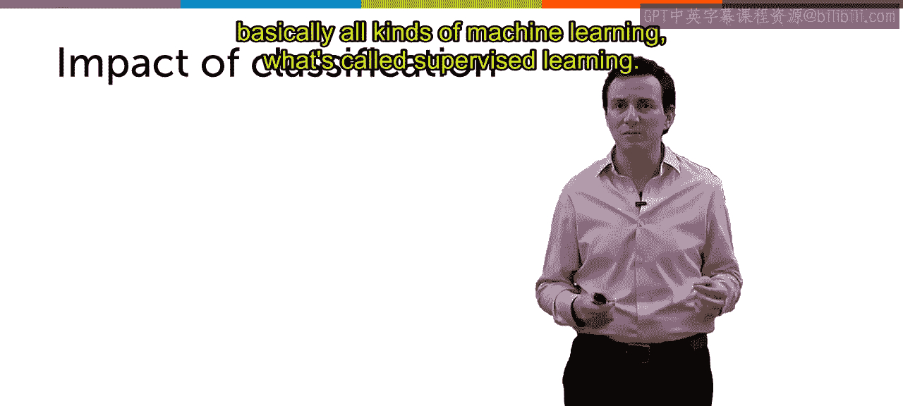
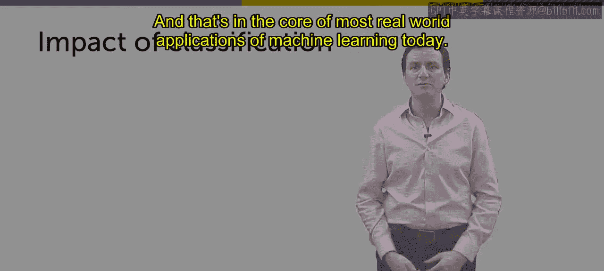

# 华盛顿大学《机器学习（分类，聚类和检索，第3-4课⧸共4课）｜Machine Learning》中英字幕 p03 2_分类的影响.zh_en -BV1Sr421F7N7_p3-

。

Classifiers have really changed the world。

So they would take classifiers for granted， but they're at the core of every piece of technology that we enjoy be it the span filters we talked about dealing email。

 what happens when you type on a web search and get a particular set of answers back。

 what ads get shown to you， what products get recommended。

And how we classify somebody's medical conditions and more。

 and we see that all over the world happening every day and the interesting thing about classifiers is that the fundamental techniques that you need to build a classifier are very similar to those that you need to build all sorts of other machine learning models。

And so if you really understand classifiers in depth。

 you'll be able to do basically all kinds of machine learning what's called supervised learning。

 and that's at the core of most real world applications of machine learning today。

