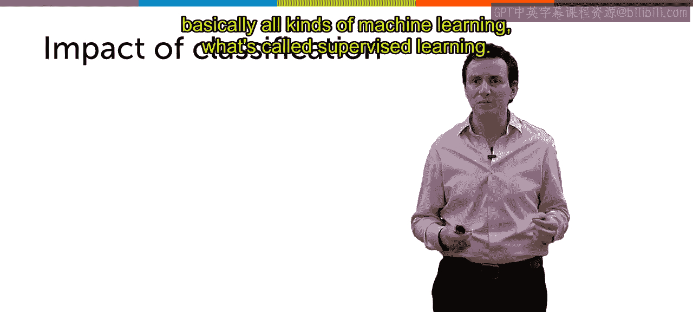
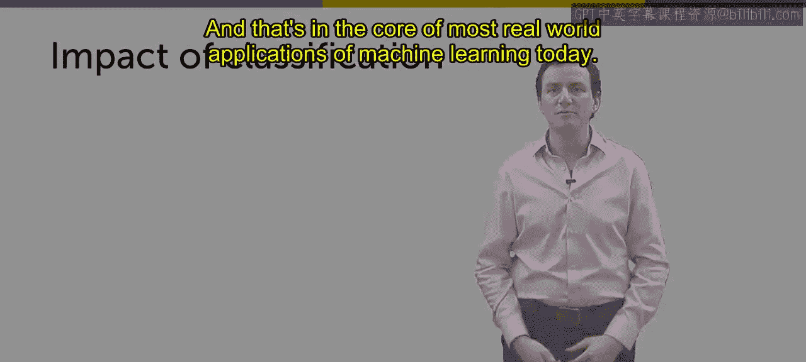

# 机器学习（分类，聚类和检索）：第3课：分类的影响 🚀

在本节课中，我们将探讨分类器如何深刻地改变世界，并理解其在众多技术应用中的核心地位。我们将看到，分类技术不仅是处理电子邮件或网络搜索的基础，也是构建更广泛机器学习模型的关键。

---

分类器已经真正地改变了世界。

人们可能对分类器习以为常，但它们是我们所享受的每一项技术的核心。无论是我们讨论过的处理电子邮件的垃圾邮件过滤器、在网页搜索时返回特定答案集的过程、向你展示的广告、推荐的产品，还是我们对某人医疗状况的分类等等，分类器都无处不在。

我们每天都能看到这一切在世界各地发生。关于分类器的一个有趣之处在于，构建分类器所需的基本技术与构建各种其他机器学习模型所需的技术非常相似。

因此，如果你能深入理解分类器，你将基本上能够进行所有类型的机器学习，即所谓的**监督学习**。而这正是当今大多数机器学习实际应用的核心。

---

本节课中我们一起学习了分类器在现实世界中的广泛影响及其核心地位。我们了解到，掌握分类技术是深入理解监督学习乃至更广泛机器学习应用的关键基础。