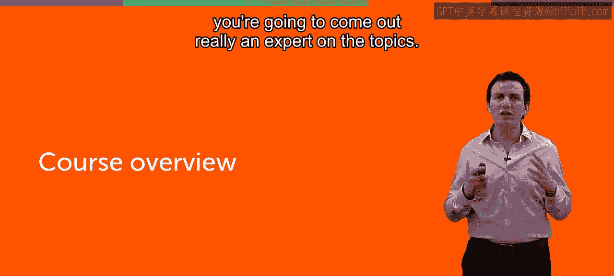
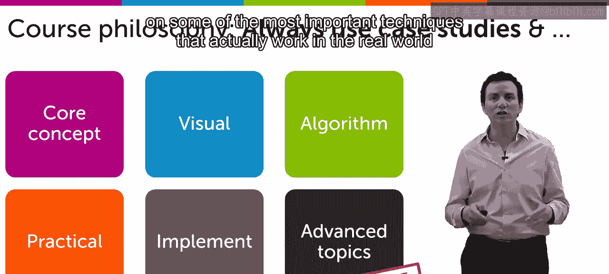
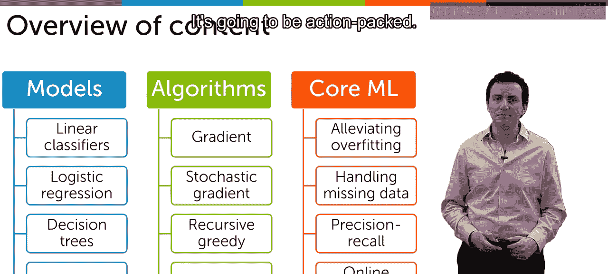

# 华盛顿大学《机器学习（分类，聚类和检索，第3-4课⧸共4课）｜Machine Learning》中英字幕 p04 3_课程概览.zh_en -BV1Sr421F7N7_p4-

。

This is going to be a highly handson course， a little tough hard work but you're going to come out really an expert on the topics and as usual we're going to keep on a core philosophy which is to always use case studies to motivate everything that we do and you'll see that throughout the course but there's also six things I think about in every module and you'll see that happening we'll talk about core concepts。

 core concepts that go beyond the techniques in that particular module I've created visualizations for every aspect of the course so you'll see new kinds of visualizations that hopefully will help you really grasp in the underlying ideas。

We'll talk about actual algorithms in detail that make it possible to build these things in practice。

 so we'll really cover the algorithms。But we won't cover everything about classification。

 we've narrowed down the course to cover techniques that are really having impacting the world today that are actually practical and we'll talk about what it takes and make those techniques practical and that's a big thing because you're going to implement them。

 you're going implement them from scratch in this course。

 all the algorithms we're going to talk about you'll implement them from scratch and you'll be able to take them into the real world and implement them yourselves if you're interested in or use them from a package but really understand where they're coming from。

For every module we we cover in this course， we've created some additional advanced topics and advanced areas。

 we're going to mark those as optional， for those interested you'll be able to dig in for every module。

 new things you might want to learn if you want to go into more depth， but those are optional。

 you don't need them， even if you skip all of those you still have a really fantastic handle on some of the most important techniques that actually work in the real world to build classifiers。

We're not going to cover everything but we cover we're going to cover in depth enough for you to be able to really understand that。

 so we're going gonna focus on models that make most difference so that's linear classifiers。

 logistic regression， decision trees and ensemble methods and if you can understand those you'll be able to create the kinds of classifiers that you need to get amazing accuracy on a wide range of real world problems。

We're going to talk about fundamental algorithms and you're going to implement them and be very proficient at them。

 gradient， which we also talked about in the regression course， stochastic gradient。

 which is useful for scaling gradient methods and classifiers to pretty massive problems。

 recursive gradient algorithms that useful to learn decision trees and boosting。

 which is an amazing technique which is useful for learning assembles of classifiers。

And we're going to discuss core machine learning concepts which are useful way beyond the contact of this course。

 way beyond classifiers， so things like how to avoid overfitting， how to deal with missing data。

Precision recall and online learning。

It's going to be action packed。